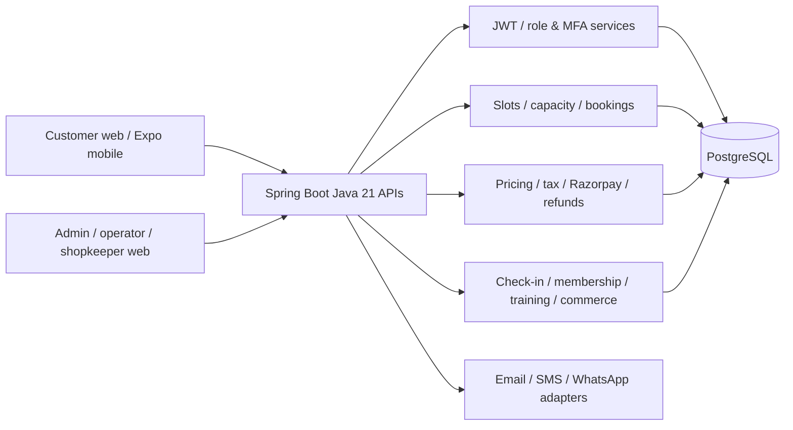
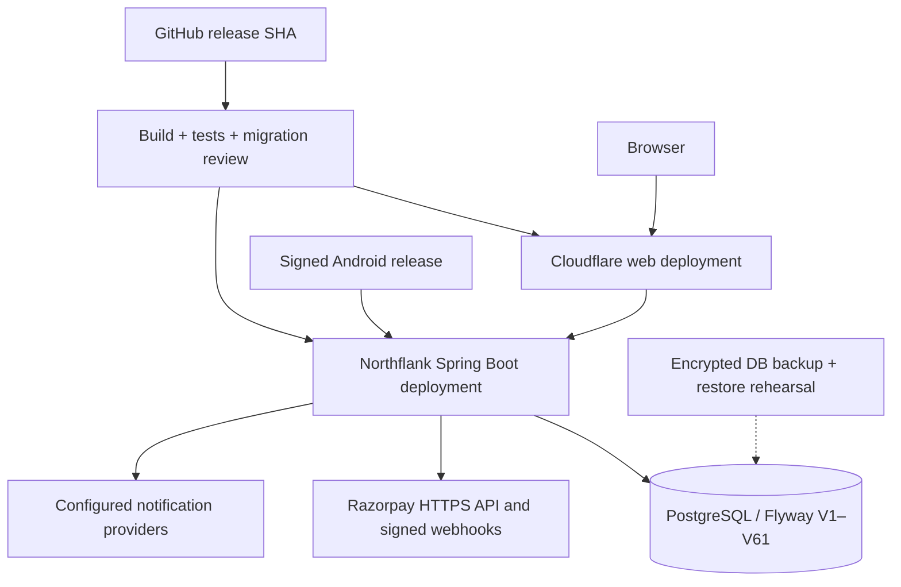
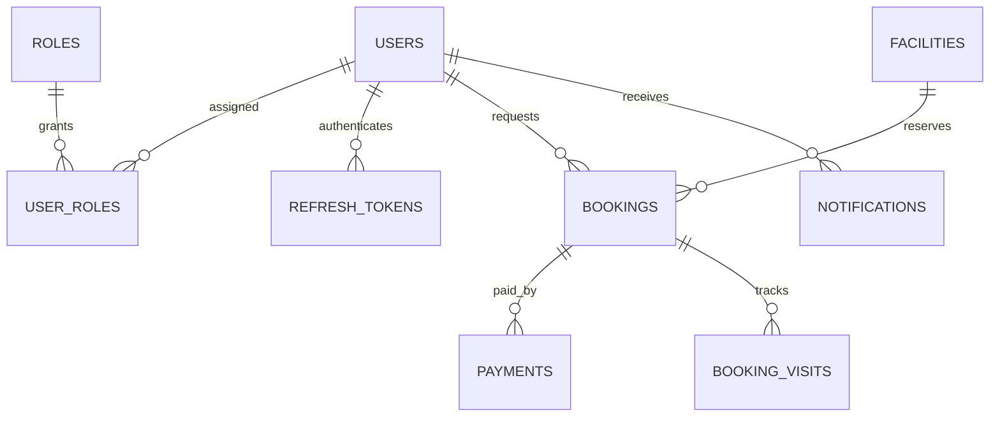

# Jnapanam: source review and deployment / KT handover — 2026-11-10

**Scope:** Repository default branch review. This is not a live browser/device penetration test, a completed end-to-end UAT, or a verified production database export. Follow [architecture baseline](README.md), [migration catalogue](SCHEMA_INDEX.md), [status-message contract](../STATUS_MESSAGES_AUDIT.md), [production runbook](../PRODUCTION_RUNBOOK.md), and [release gate](../UAT_TO_PRODUCTION_GATE.md).

## 1. System architecture (source-grounded)

Deployment target reference: Cloudflare frontend, Northflank backend and PostgreSQL; confirm actual deployed hostnames, regions, versions, env and provider accounts before release.

## 2. Core ER / logical relationships (not complete physical schema)

**Caution:** The names and relationships beyond the identity tables are a *conceptual* model; verify exact table names, foreign keys, nullable fields and cardinalities against the live schema. Do not use this diagram to generate destructive DDL. The authoritative DDL is the versioned Flyway migration directory and actual `pg_dump --schema-only`.

## 3. Review inventory and critical UAT flows

| Area | Repository evidence | Mandatory manual and negative checks |
|---|---|---|
| Customer discovery, facilities, slots | catalogue and booking controllers | empty/error/loading, sold-out slot, time zone, date boundaries, capacity race |
| Registration, login, MFA, profile | identity controllers and MFA tests | incorrect password must not trigger MFA; expiry, retry limits, session revocation, user-safe messages |
| Booking, cancellation, reschedule | booking controllers and integration tests | duplicate request, concurrent booking, cancellation cutoff, stale pricing, refund transitions |
| Razorpay checkout, payment, refund | payment controllers and gateway tests | signed webhook, replay, delayed capture, payment failure, partial refund with deduction and reason, no-show |
| Admin/operator and check-in | admin controllers, QR and assignment tests | unauthorized roles, stale QR, double check-in, photo/document access, slot management |
| Tax, invoicing and commerce | pricing and commerce controllers | tax snapshots, receipt accuracy, rounding, refunds, failed checkout, double submit |
| Notifications | notification controllers/provider settings | no false success, retries, provider outage, consent, duplicate messages |
| Mobile | Expo source and Android handover | logo, profile parity, Kannada/English, Android navigation, app update enforcement, offline/slow network |
| Logs and errors | telemetry filter, global exception tests | correlation ID, redaction, 400/401/403/404/409/422/429/500 semantics, stack traces hidden |
| Accessibility/UI | web and mobile source | keyboard navigation, focus, contrast, responsive widths, screen-reader labels, error recovery |

These are **test obligations**, not claims that every screen has been visually inspected or passed.

## 4. Error/status and security release contract

- 2xx only after authoritative state change; asynchronous refund initiation must never be described as refunded.
- 400 invalid syntax; 401 unauthenticated; 403 insufficient permission; 404 unavailable resource; 409 stale/conflicting state; 422 business validation; 429 rate limited; 5xx safe generic message plus request ID.
- Never log passwords, MFA/OTP, JWTs, payment keys, card data, PAN, identity images, or raw authorization headers.
- Apply ownership/role checks on every admin/operator/payment/document endpoint, not only navigation.
- Disable UAT-only OTP, development origins and health detail exposure before production.
- Verify signed Razorpay callbacks and reconcile payment, booking, refund and ledger states.
- Require customer-visible status parity across web/mobile, especially payment confirmation vs request initiation.

## 5. Migration, deployment and recovery

1. Freeze release SHA; export `flyway_schema_history`, confirm version and checksums.
2. Take encrypted, restorable PostgreSQL backup; **restore-test on staging**.
3. Run `./mvnw -f apps/backend/pom.xml test` if Maven wrapper is present, otherwise `mvn -f apps/backend/pom.xml verify`; run web/mobile lint, typecheck and tests using their package scripts.
4. Validate SQL in a staging clone; use the [guarded migration script](migrate-safe.sh) after inspecting its parameters. Never re-run already applied migrations manually.
5. Deploy backend with runtime secrets and restricted CORS, then web and signed Android app; check health, API, booking, payment and webhook.
6. Execute smoke + negative UAT, monitor error-rate, latency, DB connections, pending refunds and notification delivery.
7. On failure, roll back application to compatible SHA; **do not undo irreversible Flyway DDL blindly**. Restore database only under an approved recovery plan with data-loss assessment.

## 6. KT demonstration agenda

- 15 min: architecture, roles, access, environments, secret rotation and observability
- 20 min: customer registration, search, slot quote, booking and receipt
- 20 min: operator slots, check-in, QR, no-show, cancellation and refund deduction
- 15 min: admin catalogue, tax, pricing, reports, notifications and mobile release
- 20 min: staging migration, backup/restore, logs, troubleshooting, incident escalation
- 10 min: known gaps, sign-off evidence and owner assignment

## 7. Outstanding proof before calling the project complete

- Visual screenshots and device tests of **every route/screen** with a versioned test matrix.
- Current CI run results, test totals, JaCoCo coverage and security scan findings.
- Live provider test-mode payment/refund and notification receipts.
- Current deployment environment inventory, verified actual ER/schema dump and restore exercise.
- UAT defects resolved with screenshots, logs and regression evidence.

**Sign-off:** Not certified. This document adds review guidance and diagrams; it does not assert tests passed or live deployment readiness.
