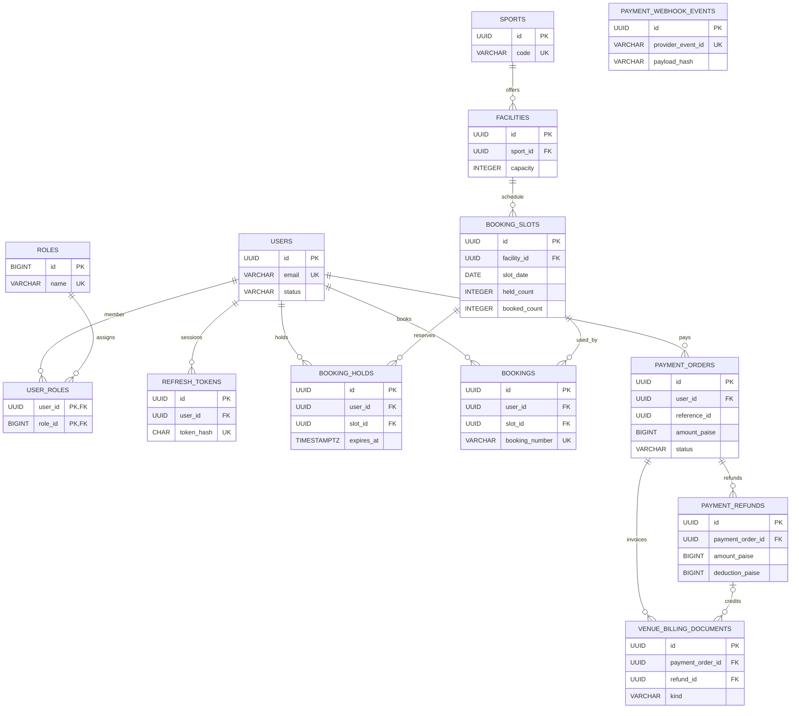
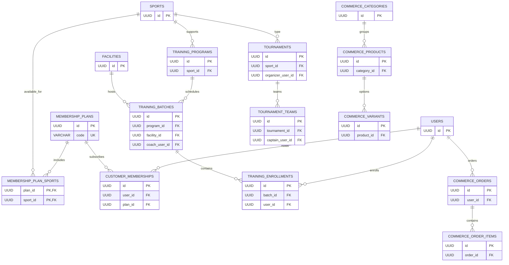

# Jnapanam — Core logical ER diagrams and key constraints

> Derived from V1, V3–V9, V20, V47 and V49 in apps/backend/src/main/resources/db/migration. **Logical core overview, not the deployed physical schema.** Later ALTER/DROP changes through V61 must be reconciled before signing off a physical ER.

## Identity, catalog, booking and settlement

**Important:** payment_orders.reference_id is a polymorphic purpose/reference pointer, *not* an enforced FK to bookings. payment_webhook_events/provider_event_id is unique for replay defenses. booking_slots has a facility/date/start unique constraint and a CHECK ensuring held_count + booked_count <= capacity. payment_refunds gains deduction_paise in V60 and deduction_description in V61.

## Memberships, training, tournaments, commerce

The commerce_order_items table carries product/variant snapshot IDs and labels; V20 does **not** declare foreign keys on those snapshot product/variant columns. Do not invent physical FK edges in ER exports.

## Physical schema sign-off

The full migration-wise column inventory is in SCHEMA_INDEX.md and SCHEMA_MIGRATIONS_01.md through SCHEMA_MIGRATIONS_05.md. Reconcile against the running database with DB_SCHEMA_AND_MIGRATION.md and db-introspection.sql before calling the result a production ER.
