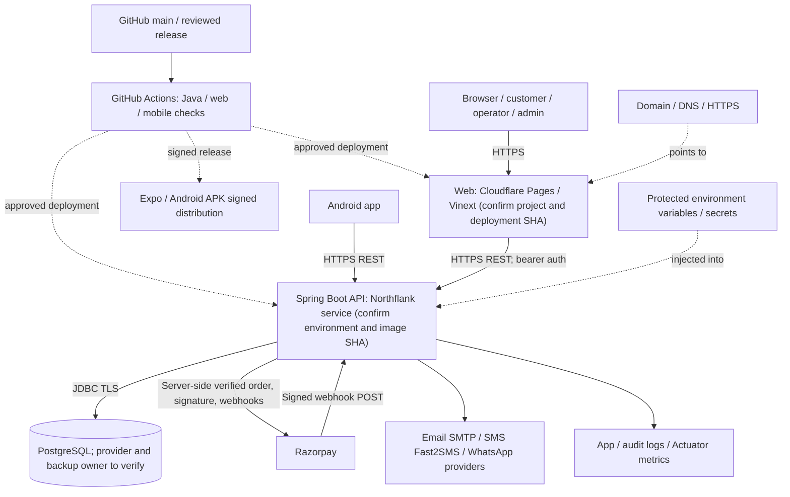

# Jnapanam — Deployment topology and environment inventory

> Source-reviewed 2026-11-10. This diagram is an implementation reference, **not** confirmation of the current cloud resources, DNS, database location or deployment SHA.

## Deployment diagram

**Repository evidence:** Java 21 + Spring Boot in apps/backend/pom.xml; PostgreSQL + Flyway in apps/backend/src/main/resources/application.yml; Vinext/Vite app in apps/web/package.json; Expo Router in apps/mobile/package.json; GitHub workflow in .github/workflows/application-ci.yml. Host labels describe the intended arrangement discussed for this project and need live-operator confirmation.

## Environment contract

| Concern | Backend (server-only) | Web/Android | Proof to capture |
|---|---|---|---|
| Host/API | SERVER_PORT, production HTTPS endpoint | NEXT_PUBLIC_API_URL / EXPO_PUBLIC_API_URL | Actual health response and deployed SHA |
| Database | DB_URL (JDBC), DB_USERNAME, DB_PASSWORD | Never expose DB credentials | Verified DB identity, Flyway history |
| Token / OTP | JWT_SECRET, JWT_ACCESS_MINUTES, JWT_REFRESH_DAYS, CUSTOMER_MFA_REQUIRED | Only public endpoints; token in safe storage | MFA login and refresh rotation test |
| Origin policy | CORS_ALLOWED_ORIGINS | HTTPS allowed origin | Disallowed-origin negative test |
| Payment | PAYMENT_PROVIDER, RAZORPAY_KEY_ID / KEY_SECRET / WEBHOOK_SECRET | Public checkout key only | Capture and webhook evidence |
| Notification | SMTP, FAST2SMS and WhatsApp configured provider secrets | Consent and user preferences | Provider receipt / delivery record |
| Release | Server app-version policy | Signed APK and update links | Version gate on stale APK |

Protect PROD with distinct credentials, isolated database, independent webhook secrets, short-lived access tokens, no test OTP, no development reset-token exposure, and **PAYMENT_PROVIDER explicitly set to an approved live provider**. The checked-in application.yml has development-friendly fallbacks: do not deploy unchanged.

## Promotion path

1. Record approval, target branch/SHA and artifact checksums.
2. Run backend mvn --batch-mode verify; web npm test and npx tsc --noEmit; mobile npm ci, npx tsc --noEmit, node --test tests/*.test.mjs.
3. Back up the **actual target** PostgreSQL database, rehearse restoration to an isolated DB, and capture Flyway pending history.
4. Deploy the backend with protected secrets; apply validated migrations via the established Flyway route. Never edit applied V1–V61 scripts or run concurrent migration processes.
5. Confirm /actuator/health and a REST probe from the web origin; verify auth, booking hold/confirm, payment status, admin and operator actions.
6. Deploy web and verify /login, /sports, /services, /operations, /admin; publish versioned APK and QR link after device validation.
7. Confirm Razorpay webhook signature and replay rejection, SMS/mail status, error log correlation IDs and refund reconciliation.
8. Record actual URLs, environment owner, database restore point, deployed SHAs and rollback decision in the release ticket.

## Failure / rollback

Roll back application code to the previously approved image; Flyway is **forward-only by default**. For schema failure, coordinate a forward fix or restore from a verified pre-change backup according to the DBA-approved runbook. A successful GitHub job does not prove the live environment is healthy.
