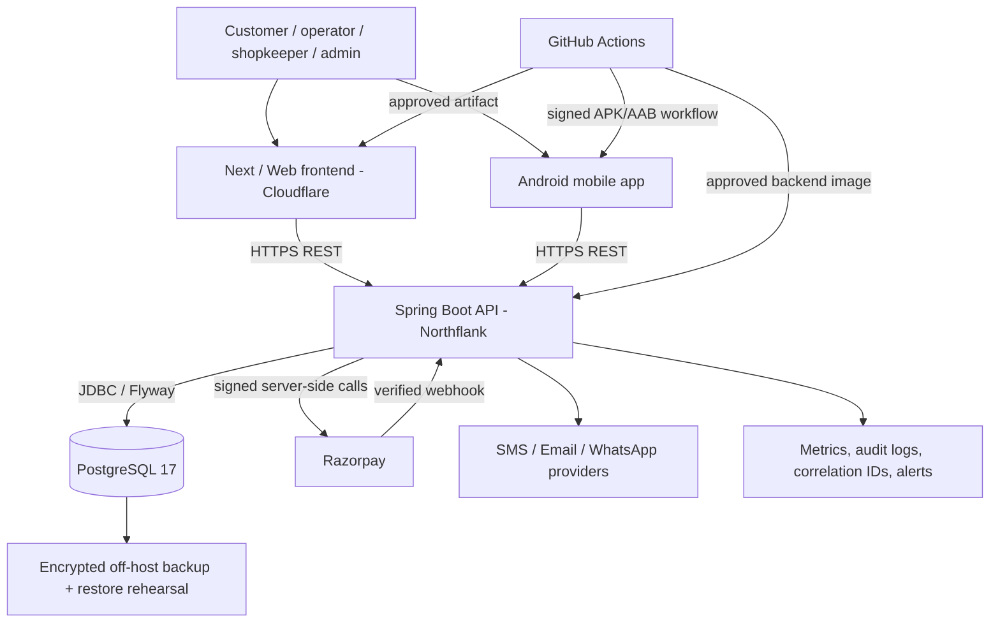
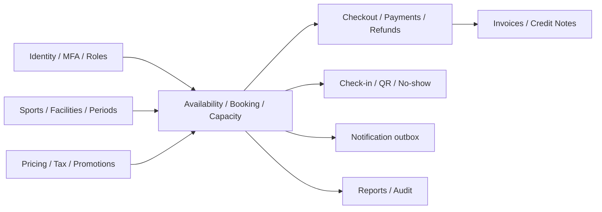
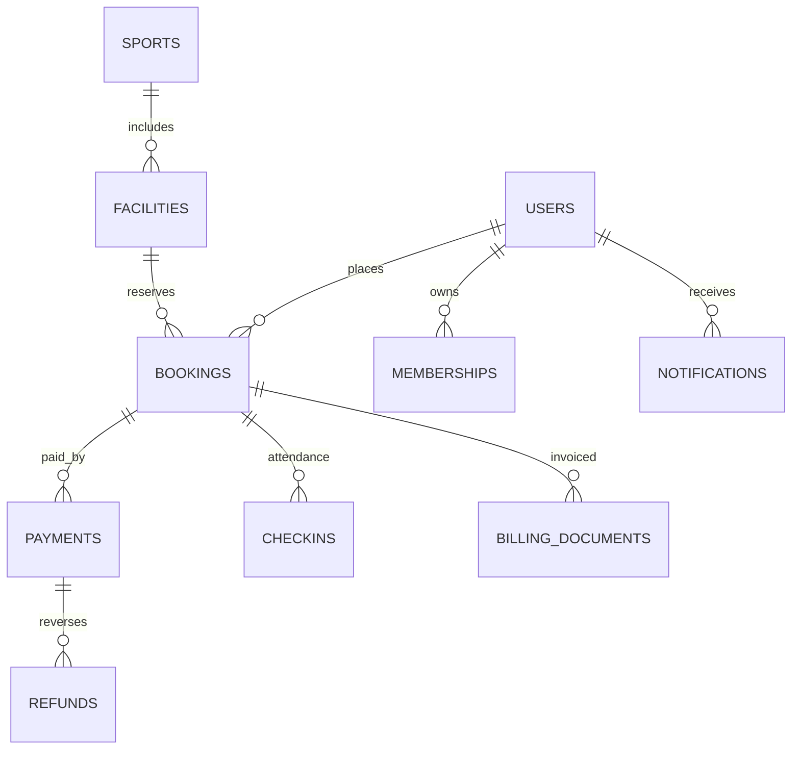

# Jnapanam — deployment, operations and KT handover (2026-11-10)
> Source-derived operational guidance. Production state, schema and configuration require independent verification. See README.md, SCHEMA_INDEX.md, migrate-safe.sh and PRODUCTION_RUNBOOK.md.

## Component and deployment diagram

Hosting names are based on existing project runbooks, not a live inventory check. Never place payment secrets in frontend/mobile.

## Functional architecture

## Domain ER (conceptual; not a physical schema)

Names and relationships are logical concepts only. Exact physical names/keys are in Flyway migrations and must be reconciled against `pg_catalog` before a physical ER is approved.

## Database and migrations
- Flyway SQL is under `apps/backend/src/main/resources/db/migration`; the repository currently contains versions V1 through V61 with gaps. **Do not invent missing migration numbers**.
- Review `SCHEMA_INDEX.md` and all five migration-group notes. The index was generated earlier and may need updating when new migrations are added.
- Use `bash docs/architecture-kt/migrate-safe.sh plan` to inspect migration files; `export-schema` to export actual schema. Never apply blindly to production.
- Run `SELECT installed_rank, version, description, type, script, checksum, success FROM flyway_schema_history ORDER BY installed_rank;` with a least-privileged account.
- Before any migration: confirm exact release SHA, verified database identity, backup, successful restore rehearsal, change ticket, compatibility with old API, staging dry run and maintenance window.
- After migration: validate Flyway history, schema diff, API health, booking creation, payment webhook, refund, invoice, QR check-in and operational dashboard. Roll back application code only if schema remains compatible; otherwise use approved forward-fix/restore.

## KT demonstration script (recommended 75–100 minutes)
1. 10 min: environments, infrastructure ownership, GitHub Actions, secrets and deploy approval.
2. 15 min: identity, roles, MFA, customer booking and availability/slot capacity.
3. 15 min: Razorpay checkout, asynchronous callback/webhook, booking status and payment reconciliation.
4. 10 min: operator QR check-in, no-show, cancellation and partial refund with deduction reason.
5. 10 min: billing/tax, reports, customer notifications, Kannada/English.
6. 15 min: Flyway, backup/restore, monitoring, alert routing, log correlation and incident drill.
7. 10 min: release gates, known defects, support ownership and sign-off evidence.

## Operational runbooks
- **HTTP 5xx spike:** capture UTC timestamp, endpoint, correlation ID, deployment SHA, sanitized exception class; inspect API health/DB pool and last migration; rollback only with DB compatibility.
- **Payment not reflected:** do not replay charges; inspect provider payment ID, checkout session, webhook signature/event dedupe and booking ledger; reconcile before displaying success.
- **Refund failure:** distinguish refund requested vs processed vs settled; confirm original capture, available balance, deduction amount/reason and provider reference. Never claim completed before provider confirmation.
- **Login/MFA failure:** validate credentials before MFA challenge, delivery provider and expiry/rate-limit; redact OTP/token/password from logs; never enable fixed OTP in production.
- **QR/check-in:** validate authenticated role, facility ownership, booking date and timezone (Asia/Kolkata), replay protection and duplicate scan behavior.
- **Restore:** rehearse on isolated database; record RPO/RTO, encrypted backup location, verification checksum and business owner sign-off.

## Handover checklist
- [ ] Exact prod/UAT URLs, backend SHA, web SHA and APK version/build recorded
- [ ] Architecture, domain ER and exported physical ER signed off
- [ ] DBA-reviewed schema, Flyway history, migration plan and restore drill
- [ ] Secrets ownership, rotation schedule, TLS/CORS, Android signing custody
- [ ] Razorpay live keys/webhooks, refund policy and settlement reconciliation
- [ ] Alerts, dashboards, log retention/redaction, incident contacts, escalation SLA
- [ ] Role-by-role demo, negative tests, accessible mobile UI and Kannada translation
- [ ] Open P0/P1 defects zero; customer UAT approval recorded
