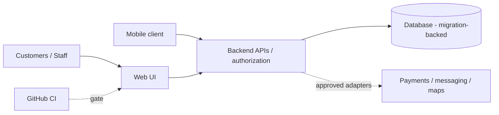
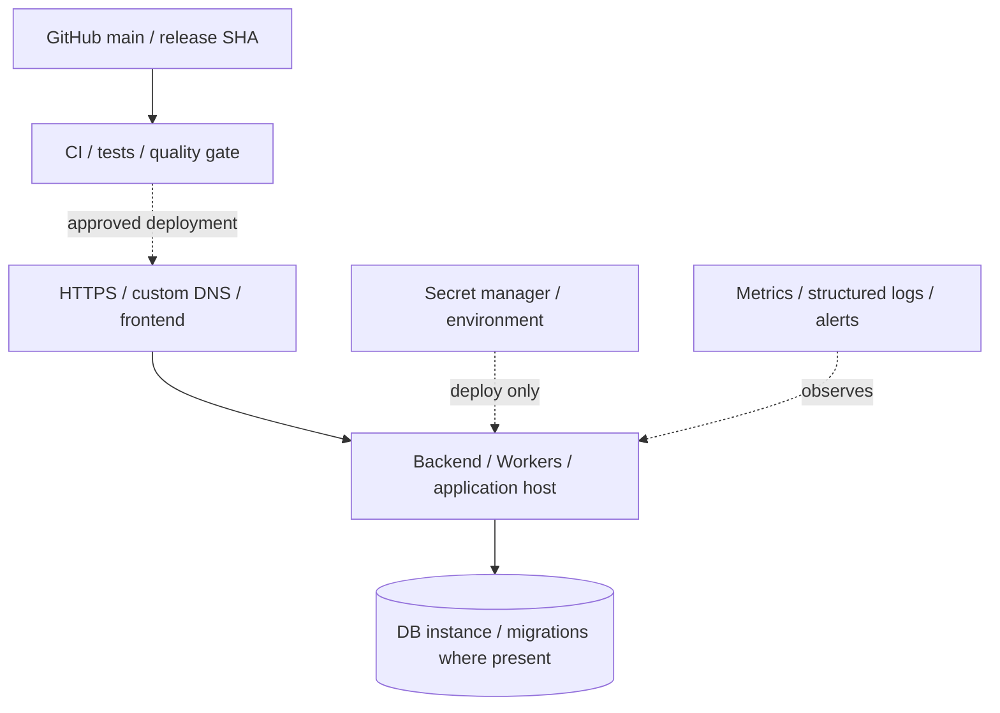
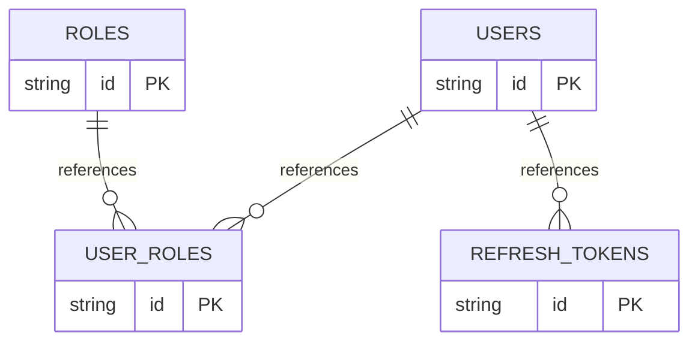

# Jnapanam Sports Zone: Architecture, Deployment, ER, DB, Migration and KT
> **Snapshot:** 2026-11-09. Evidence: [bv-prasanna/jnapanam-sports-zone](https://github.com/bv-prasanna/jnapanam-sports-zone) default branch `main`. This is **source-derived**, not a live deployment or data audit.
**Environment:** confirm live Northflank/Cloudflare configuration, DB, signing, keys and deployment SHA with operators; code alone is not deployment proof.
## 1. Application architecture
**Stack:** Java 21, Spring Boot, PostgreSQL/Flyway, web and mobile.

**Security/data flow:** browser/app -> validated API -> RBAC/session/tenant checks -> transaction/domain service -> database -> auditable external integration; server verifies provider webhooks and preserves idempotency. In projects lacking source on main, this is the **expected** flow, not code proof.

## 2. Deployment topology (reference only)

**Deployment inventory to complete:** DEV/UAT/PROD; Git SHA; frontend host; API runtime, URL and region; DB provider and backup policy; CORS/TLS; payment webhook URLs; service accounts; mail/SMS provider; Android signing; rollback owner; support contacts and alert routing. This schematic does not confirm any particular hosting account is active.

## 3. ER diagram - observed baseline only
Parsed from [`apps/backend/src/main/resources/db/migration/V1__identity_schema.sql`](../../apps/backend/src/main/resources/db/migration/V1__identity_schema.sql); **NOT the full ER** across 60 migrations. Later tables/ALTER statements require a fresh physical schema export.

**Baseline tables detected:** `roles`, `users`, `user_roles`, `refresh_tokens`.

## 4. Database schema and migration catalogue
- Migration files discovered on `main`: **60**.
- Definitive source SQL sequence:
- [`apps/backend/src/main/resources/db/migration/V1__identity_schema.sql`](../../apps/backend/src/main/resources/db/migration/V1__identity_schema.sql)
- [`apps/backend/src/main/resources/db/migration/V2__align_refresh_token_hash_type.sql`](../../apps/backend/src/main/resources/db/migration/V2__align_refresh_token_hash_type.sql)
- [`apps/backend/src/main/resources/db/migration/V3__sports_facilities_schema.sql`](../../apps/backend/src/main/resources/db/migration/V3__sports_facilities_schema.sql)
- [`apps/backend/src/main/resources/db/migration/V4__booking_schema.sql`](../../apps/backend/src/main/resources/db/migration/V4__booking_schema.sql)
- [`apps/backend/src/main/resources/db/migration/V5__membership_schema.sql`](../../apps/backend/src/main/resources/db/migration/V5__membership_schema.sql)
- [`apps/backend/src/main/resources/db/migration/V6__training_coaching_schema.sql`](../../apps/backend/src/main/resources/db/migration/V6__training_coaching_schema.sql)
- [`apps/backend/src/main/resources/db/migration/V7__payments_schema.sql`](../../apps/backend/src/main/resources/db/migration/V7__payments_schema.sql)
- [`apps/backend/src/main/resources/db/migration/V8__notifications_schema.sql`](../../apps/backend/src/main/resources/db/migration/V8__notifications_schema.sql)
- [`apps/backend/src/main/resources/db/migration/V9__tournaments_schema.sql`](../../apps/backend/src/main/resources/db/migration/V9__tournaments_schema.sql)
- [`apps/backend/src/main/resources/db/migration/V10__administration_reporting.sql`](../../apps/backend/src/main/resources/db/migration/V10__administration_reporting.sql)
- [`apps/backend/src/main/resources/db/migration/V11__public_content_events.sql`](../../apps/backend/src/main/resources/db/migration/V11__public_content_events.sql)
- [`apps/backend/src/main/resources/db/migration/V12__customer_user_management.sql`](../../apps/backend/src/main/resources/db/migration/V12__customer_user_management.sql)
- [`apps/backend/src/main/resources/db/migration/V13__reports_audit_hardening.sql`](../../apps/backend/src/main/resources/db/migration/V13__reports_audit_hardening.sql)
- [`apps/backend/src/main/resources/db/migration/V14__backend_completion_workflows.sql`](../../apps/backend/src/main/resources/db/migration/V14__backend_completion_workflows.sql)
- [`apps/backend/src/main/resources/db/migration/V15__booking_payment_options.sql`](../../apps/backend/src/main/resources/db/migration/V15__booking_payment_options.sql)
- [`apps/backend/src/main/resources/db/migration/V16__promotions_and_loyalty.sql`](../../apps/backend/src/main/resources/db/migration/V16__promotions_and_loyalty.sql)
- [`apps/backend/src/main/resources/db/migration/V17__payment_void_and_kannada_content.sql`](../../apps/backend/src/main/resources/db/migration/V17__payment_void_and_kannada_content.sql)
- [`apps/backend/src/main/resources/db/migration/V18__booking_visit_tracking.sql`](../../apps/backend/src/main/resources/db/migration/V18__booking_visit_tracking.sql)
- [`apps/backend/src/main/resources/db/migration/V19__profile_preferences.sql`](../../apps/backend/src/main/resources/db/migration/V19__profile_preferences.sql)
- [`apps/backend/src/main/resources/db/migration/V20__commerce_schema.sql`](../../apps/backend/src/main/resources/db/migration/V20__commerce_schema.sql)
- [`apps/backend/src/main/resources/db/migration/V21__commerce_settings_and_loyalty.sql`](../../apps/backend/src/main/resources/db/migration/V21__commerce_settings_and_loyalty.sql)
- [`apps/backend/src/main/resources/db/migration/V22__commerce_logo_upload.sql`](../../apps/backend/src/main/resources/db/migration/V22__commerce_logo_upload.sql)
- [`apps/backend/src/main/resources/db/migration/V23__shop_keeper_role.sql`](../../apps/backend/src/main/resources/db/migration/V23__shop_keeper_role.sql)
- [`apps/backend/src/main/resources/db/migration/V24__operator_facility_assignments.sql`](../../apps/backend/src/main/resources/db/migration/V24__operator_facility_assignments.sql)
- [`apps/backend/src/main/resources/db/migration/V25__shop_counter_workflows.sql`](../../apps/backend/src/main/resources/db/migration/V25__shop_counter_workflows.sql)
- [`apps/backend/src/main/resources/db/migration/V26__promotion_multi_purpose.sql`](../../apps/backend/src/main/resources/db/migration/V26__promotion_multi_purpose.sql)
- [`apps/backend/src/main/resources/db/migration/V27__notification_template_channels.sql`](../../apps/backend/src/main/resources/db/migration/V27__notification_template_channels.sql)
- [`apps/backend/src/main/resources/db/migration/V28__release1_completion.sql`](../../apps/backend/src/main/resources/db/migration/V28__release1_completion.sql)
- [`apps/backend/src/main/resources/db/migration/V29__advanced_release1_workflows.sql`](../../apps/backend/src/main/resources/db/migration/V29__advanced_release1_workflows.sql)
- [`apps/backend/src/main/resources/db/migration/V30__privileged_mfa_challenge.sql`](../../apps/backend/src/main/resources/db/migration/V30__privileged_mfa_challenge.sql)
- [`apps/backend/src/main/resources/db/migration/V31__release1_operational_depth.sql`](../../apps/backend/src/main/resources/db/migration/V31__release1_operational_depth.sql)
- [`apps/backend/src/main/resources/db/migration/V32__sms_otp_and_device_sessions.sql`](../../apps/backend/src/main/resources/db/migration/V32__sms_otp_and_device_sessions.sql)
- [`apps/backend/src/main/resources/db/migration/V33__release1_workflow_completion.sql`](../../apps/backend/src/main/resources/db/migration/V33__release1_workflow_completion.sql)
- [`apps/backend/src/main/resources/db/migration/V34__whatsapp_consent.sql`](../../apps/backend/src/main/resources/db/migration/V34__whatsapp_consent.sql)
- [`apps/backend/src/main/resources/db/migration/V35__notification_provider_settings.sql`](../../apps/backend/src/main/resources/db/migration/V35__notification_provider_settings.sql)
- [`apps/backend/src/main/resources/db/migration/V36__player_growth_phase1.sql`](../../apps/backend/src/main/resources/db/migration/V36__player_growth_phase1.sql)
- [`apps/backend/src/main/resources/db/migration/V37__audit_event_geolocation.sql`](../../apps/backend/src/main/resources/db/migration/V37__audit_event_geolocation.sql)
- [`apps/backend/src/main/resources/db/migration/V38__uat_otp_allowed_mobiles.sql`](../../apps/backend/src/main/resources/db/migration/V38__uat_otp_allowed_mobiles.sql)
- [`apps/backend/src/main/resources/db/migration/V39__registration_email_otp.sql`](../../apps/backend/src/main/resources/db/migration/V39__registration_email_otp.sql)
- [`apps/backend/src/main/resources/db/migration/V40__booking_address_proofs.sql`](../../apps/backend/src/main/resources/db/migration/V40__booking_address_proofs.sql)
- [`apps/backend/src/main/resources/db/migration/V41__document_verification_audit.sql`](../../apps/backend/src/main/resources/db/migration/V41__document_verification_audit.sql)
- [`apps/backend/src/main/resources/db/migration/V43__event_media_images.sql`](../../apps/backend/src/main/resources/db/migration/V43__event_media_images.sql)
- [`apps/backend/src/main/resources/db/migration/V44__daily_booking_digest_deliveries.sql`](../../apps/backend/src/main/resources/db/migration/V44__daily_booking_digest_deliveries.sql)
- [`apps/backend/src/main/resources/db/migration/V45__payment_checkout_sessions.sql`](../../apps/backend/src/main/resources/db/migration/V45__payment_checkout_sessions.sql)
- [`apps/backend/src/main/resources/db/migration/V46__razorpay_webhook_observations.sql`](../../apps/backend/src/main/resources/db/migration/V46__razorpay_webhook_observations.sql)
- [`apps/backend/src/main/resources/db/migration/V47__recurring_subscriptions.sql`](../../apps/backend/src/main/resources/db/migration/V47__recurring_subscriptions.sql)
- [`apps/backend/src/main/resources/db/migration/V48__venue_pricing_taxes_booking_snapshot.sql`](../../apps/backend/src/main/resources/db/migration/V48__venue_pricing_taxes_booking_snapshot.sql)
- [`apps/backend/src/main/resources/db/migration/V49__billing_tax_documents.sql`](../../apps/backend/src/main/resources/db/migration/V49__billing_tax_documents.sql)
- [`apps/backend/src/main/resources/db/migration/V50__booking_tax_rate_snapshot.sql`](../../apps/backend/src/main/resources/db/migration/V50__booking_tax_rate_snapshot.sql)
- [`apps/backend/src/main/resources/db/migration/V51__billing_payment_tax_policy.sql`](../../apps/backend/src/main/resources/db/migration/V51__billing_payment_tax_policy.sql)
- [`apps/backend/src/main/resources/db/migration/V52__billing_email_outbox.sql`](../../apps/backend/src/main/resources/db/migration/V52__billing_email_outbox.sql)
- [`apps/backend/src/main/resources/db/migration/V53__customer_billing_and_auto_issue_policy.sql`](../../apps/backend/src/main/resources/db/migration/V53__customer_billing_and_auto_issue_policy.sql)
- [`apps/backend/src/main/resources/db/migration/V54__loyalty_refund_debt.sql`](../../apps/backend/src/main/resources/db/migration/V54__loyalty_refund_debt.sql)
- [`apps/backend/src/main/resources/db/migration/V55__profile_photo_persistence.sql`](../../apps/backend/src/main/resources/db/migration/V55__profile_photo_persistence.sql)
- [`apps/backend/src/main/resources/db/migration/V56__facility_booking_rules_and_operating_periods.sql`](../../apps/backend/src/main/resources/db/migration/V56__facility_booking_rules_and_operating_periods.sql)
- [`apps/backend/src/main/resources/db/migration/V57__feature_visibility.sql`](../../apps/backend/src/main/resources/db/migration/V57__feature_visibility.sql)
- [`apps/backend/src/main/resources/db/migration/V58__facility_kannada_terms.sql`](../../apps/backend/src/main/resources/db/migration/V58__facility_kannada_terms.sql)
- [`apps/backend/src/main/resources/db/migration/V59__mobile_app_release_policy.sql`](../../apps/backend/src/main/resources/db/migration/V59__mobile_app_release_policy.sql)
- [`apps/backend/src/main/resources/db/migration/V60__payment_refund_deductions.sql`](../../apps/backend/src/main/resources/db/migration/V60__payment_refund_deductions.sql)
- [`apps/backend/src/main/resources/db/migration/V61__payment_refund_deduction_description.sql`](../../apps/backend/src/main/resources/db/migration/V61__payment_refund_deduction_description.sql)
- **Full database schema** must be extracted from the actual environment: PostgreSQL `pg_dump --schema-only --no-owner --no-privileges` (then inspect `flyway_schema_history`), or Cloudflare D1 `SELECT type,name,tbl_name,sql FROM sqlite_master WHERE type IN ('table','view','index')` on the verified binding.
- Record columns, PK/FK/unique/check constraints, indexes, triggers, views, migration versions and applied checksums; compare results with this repository's migrations.

## 5. Guarded migration procedure and reusable script
**Migration mechanism:** Flyway on approved Spring Boot release. Existing checked-in migrations must not be modified or replaced just to make documentation pass.
```bash
#!/usr/bin/env bash
set -euo pipefail
if [[ "${1:-plan}" != "apply" ]]; then
  echo "PLAN: compare environment, DB identity, migrations/checksums and release SHA."
  echo "Back up, restore-test and execute on staging; this mode changes NOTHING."
  exit 0
fi
[[ "${CONFIRM_DB_MIGRATION:-}" == "BACKUP_VERIFIED" ]] || exit 3
: "${BACKUP_REFERENCE:?Required tested backup/snapshot reference}"
: "${MIGRATION_APPLY_CMD:?Required reviewed, repo-native migration command}"
bash -lc "$MIGRATION_APPLY_CMD"
echo "Check schema history, health, rollback compatibility, audit and business smoke."
```
**Release SOP:** verify instance/environment; migration diff review; secure secrets; backup/restore rehearsal; staging apply and UAT; one approved production apply; inspect schema history/logs; smoke auth/main flow/notifications/payments; record deployed SHA; rollback compatible binary or use tested forward fix/restore. Never execute placeholder SQL against production.

## 6. Maintenance runbook
**Daily:** user experience, 5xx, health, sessions, email/SMS or provider errors, failed jobs, DB availability and storage. **Weekly:** migration drift, restore sample, backups, reconciliation/refund exceptions if applicable, CI build and key expiry. **Monthly:** dependency and authorization review, logs/privacy retention, cert/domain renewal, architecture drift and disaster recovery exercise.
**Incidents:** capture request/correlation ID and last-good SHA; preserve evidence; contain failures; decide rollback/restore with owner; validate data integrity and write RCA. No access tokens or PII in tickets/demo materials.

## 7. KT and UAT demo agenda
**Scenario:** Booking -> selected sport/slot -> Razorpay sandbox -> operator check-in -> cancellation/refund -> invoice.
| Segment | Demonstrate |
|---|---|
| 0-10 min | Business objectives, actor roles, in-scope deployment maturity |
| 10-25 min | Main user/admin/ops journey and friendly success/error states |
| 25-40 min | Service diagram, ER limitations, API auth, data ownership and integrations |
| 40-50 min | Build/CI, environment setup, migration/rollback procedures |
| 50-60 min | Monitoring, backups, on-call, issue triage and handover sign-off |

**Negative-case checklist:** bad/expired login, role violation, invalid payload, duplicate or concurrent request, offline/timeout, retries, payment webhook replay, refund failure, DB outage, missing GPS where required, premature release and schema checksum mismatch. Test only functionality that exists in the selected release.

## 8. KT acceptance and outstanding evidence
- [ ] Actual deployed SHA, service DNS, hosting plan and cloud account recorded privately
- [ ] Verified schema-only export and **complete** ER delivered, reviewed by DB owner
- [ ] Migration tracking, pre/post backup, restored sample and rollback rehearsal completed
- [ ] Source/build/CI test evidence, operational walkthrough and negative tests signed
- [ ] Alert dashboards, log access, incident owners, TLS, credentials transferred securely
- [ ] Open UAT issues, regulatory/production gates and next work items acknowledged

## 9. Related repo material
- [`.github/workflows/android-apk-cloud.yml`](../../.github/workflows/android-apk-cloud.yml)
- [`.github/workflows/application-ci.yml`](../../.github/workflows/application-ci.yml)
- [`deploy/uat/README.md`](../../deploy/uat/README.md)
- [`deploy/uat/backend.env.example`](../../deploy/uat/backend.env.example)
- [`docs/PRODUCTION_RUNBOOK.md`](../../docs/PRODUCTION_RUNBOOK.md)

*Next update: reconcile against complete source branch and actual deployed schema; source file presence does not prove a production rollout, CI success or functional coverage.*
