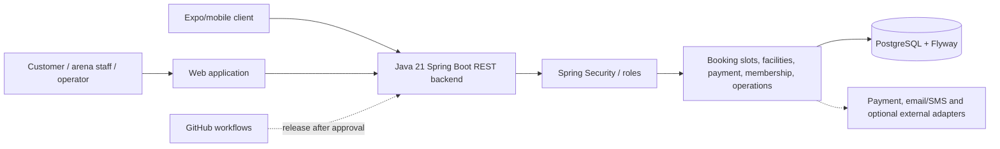

# Jnapanam Sports Zone — Source-backed reverse-engineering dossier

> **Source inspected:** [`bv-prasanna/jnapanam-sports-zone` `main`](https://github.com/bv-prasanna/jnapanam-sports-zone/tree/main), on 10 November 2026. This guide maps **actual source filenames** on that branch. It does not prove this exact commit was deployed. Backup copies were excluded from current Java handler counts.

## System architecture recovered from code

The diagram is a **logical application view**, not a provider-specific infrastructure inventory. Check production endpoints, database, DNS, Android signing, cloud services and secrets with actual deployment credentials.

## Code evidence summary
| Component / audit dimension | Count of matching source files |
|---|---:|
| Spring Boot controller classes | 69 |
| Service classes | 42 |
| Model/entity Java files | 70 |
| Flyway migrations | 60 |
| Web app page/route files | 38 |
| Mobile source paths | 55 |
| Test-source files | 77 |
| GitHub workflows | 2 |
| Runtime/infra config files | 6 |

### Domain/source directories (classified by Java package paths)
- `model`: 70 matched Java source files
- `controller`: 59 matched Java source files
- `service`: 32 matched Java source files
- `pricing`: 10 matched Java source files
- `subscription`: 3 matched Java source files
- `apprelease`: 2 matched Java source files
- `features`: 2 matched Java source files
- `security`: 2 matched Java source files
- `growth`: 1 matched Java source files

## REST controller entry points (69)
The full method/URI list must be derived from annotations (`@RequestMapping`, `@GetMapping`, `@PostMapping`, etc.) and validated against the running OpenAPI endpoint. **A controller filename by itself is not an endpoint or passing integration test.**
- [`apps/backend/src/main/java/com/jnapanam/sportszone/admin/controller/AdminErrorLogController.java`](https://github.com/bv-prasanna/jnapanam-sports-zone/blob/main/apps/backend/src/main/java/com/jnapanam/sportszone/admin/controller/AdminErrorLogController.java)
- [`apps/backend/src/main/java/com/jnapanam/sportszone/admin/controller/AdminReportingController.java`](https://github.com/bv-prasanna/jnapanam-sports-zone/blob/main/apps/backend/src/main/java/com/jnapanam/sportszone/admin/controller/AdminReportingController.java)
- [`apps/backend/src/main/java/com/jnapanam/sportszone/admin/controller/AdminVerificationController.java`](https://github.com/bv-prasanna/jnapanam-sports-zone/blob/main/apps/backend/src/main/java/com/jnapanam/sportszone/admin/controller/AdminVerificationController.java)
- [`apps/backend/src/main/java/com/jnapanam/sportszone/admin/controller/OperationsController.java`](https://github.com/bv-prasanna/jnapanam-sports-zone/blob/main/apps/backend/src/main/java/com/jnapanam/sportszone/admin/controller/OperationsController.java)
- [`apps/backend/src/main/java/com/jnapanam/sportszone/admin/controller/OperatorAssignmentController.java`](https://github.com/bv-prasanna/jnapanam-sports-zone/blob/main/apps/backend/src/main/java/com/jnapanam/sportszone/admin/controller/OperatorAssignmentController.java)
- [`apps/backend/src/main/java/com/jnapanam/sportszone/admin/controller/OperatorBookingIdentityController.java`](https://github.com/bv-prasanna/jnapanam-sports-zone/blob/main/apps/backend/src/main/java/com/jnapanam/sportszone/admin/controller/OperatorBookingIdentityController.java)
- [`apps/backend/src/main/java/com/jnapanam/sportszone/admin/controller/OperatorDocumentPreviewController.java`](https://github.com/bv-prasanna/jnapanam-sports-zone/blob/main/apps/backend/src/main/java/com/jnapanam/sportszone/admin/controller/OperatorDocumentPreviewController.java)
- [`apps/backend/src/main/java/com/jnapanam/sportszone/admin/controller/OperatorFacilityController.java`](https://github.com/bv-prasanna/jnapanam-sports-zone/blob/main/apps/backend/src/main/java/com/jnapanam/sportszone/admin/controller/OperatorFacilityController.java)
- [`apps/backend/src/main/java/com/jnapanam/sportszone/apprelease/AppReleaseController.java`](https://github.com/bv-prasanna/jnapanam-sports-zone/blob/main/apps/backend/src/main/java/com/jnapanam/sportszone/apprelease/AppReleaseController.java)
- [`apps/backend/src/main/java/com/jnapanam/sportszone/booking/controller/AdminBookingCapacityAuditController.java`](https://github.com/bv-prasanna/jnapanam-sports-zone/blob/main/apps/backend/src/main/java/com/jnapanam/sportszone/booking/controller/AdminBookingCapacityAuditController.java)
- [`apps/backend/src/main/java/com/jnapanam/sportszone/booking/controller/AdminBookingController.java`](https://github.com/bv-prasanna/jnapanam-sports-zone/blob/main/apps/backend/src/main/java/com/jnapanam/sportszone/booking/controller/AdminBookingController.java)
- [`apps/backend/src/main/java/com/jnapanam/sportszone/booking/controller/BookingCheckInQrController.java`](https://github.com/bv-prasanna/jnapanam-sports-zone/blob/main/apps/backend/src/main/java/com/jnapanam/sportszone/booking/controller/BookingCheckInQrController.java)
- [`apps/backend/src/main/java/com/jnapanam/sportszone/booking/controller/BookingController.java`](https://github.com/bv-prasanna/jnapanam-sports-zone/blob/main/apps/backend/src/main/java/com/jnapanam/sportszone/booking/controller/BookingController.java)
- [`apps/backend/src/main/java/com/jnapanam/sportszone/booking/controller/BookingRescheduleController.java`](https://github.com/bv-prasanna/jnapanam-sports-zone/blob/main/apps/backend/src/main/java/com/jnapanam/sportszone/booking/controller/BookingRescheduleController.java)
- [`apps/backend/src/main/java/com/jnapanam/sportszone/booking/controller/PublicSlotController.java`](https://github.com/bv-prasanna/jnapanam-sports-zone/blob/main/apps/backend/src/main/java/com/jnapanam/sportszone/booking/controller/PublicSlotController.java)
- [`apps/backend/src/main/java/com/jnapanam/sportszone/booking/controller/VenueCheckInController.java`](https://github.com/bv-prasanna/jnapanam-sports-zone/blob/main/apps/backend/src/main/java/com/jnapanam/sportszone/booking/controller/VenueCheckInController.java)
- [`apps/backend/src/main/java/com/jnapanam/sportszone/catalog/controller/AdminCatalogueController.java`](https://github.com/bv-prasanna/jnapanam-sports-zone/blob/main/apps/backend/src/main/java/com/jnapanam/sportszone/catalog/controller/AdminCatalogueController.java)
- [`apps/backend/src/main/java/com/jnapanam/sportszone/catalog/controller/PublicCatalogueController.java`](https://github.com/bv-prasanna/jnapanam-sports-zone/blob/main/apps/backend/src/main/java/com/jnapanam/sportszone/catalog/controller/PublicCatalogueController.java)
- [`apps/backend/src/main/java/com/jnapanam/sportszone/commerce/controller/CommerceAdminController.java`](https://github.com/bv-prasanna/jnapanam-sports-zone/blob/main/apps/backend/src/main/java/com/jnapanam/sportszone/commerce/controller/CommerceAdminController.java)
- [`apps/backend/src/main/java/com/jnapanam/sportszone/commerce/controller/CommerceController.java`](https://github.com/bv-prasanna/jnapanam-sports-zone/blob/main/apps/backend/src/main/java/com/jnapanam/sportszone/commerce/controller/CommerceController.java)
- [`apps/backend/src/main/java/com/jnapanam/sportszone/commerce/controller/ShopCounterController.java`](https://github.com/bv-prasanna/jnapanam-sports-zone/blob/main/apps/backend/src/main/java/com/jnapanam/sportszone/commerce/controller/ShopCounterController.java)
- [`apps/backend/src/main/java/com/jnapanam/sportszone/content/controller/AdminContentController.java`](https://github.com/bv-prasanna/jnapanam-sports-zone/blob/main/apps/backend/src/main/java/com/jnapanam/sportszone/content/controller/AdminContentController.java)
- [`apps/backend/src/main/java/com/jnapanam/sportszone/content/controller/EventMediaController.java`](https://github.com/bv-prasanna/jnapanam-sports-zone/blob/main/apps/backend/src/main/java/com/jnapanam/sportszone/content/controller/EventMediaController.java)
- [`apps/backend/src/main/java/com/jnapanam/sportszone/content/controller/PublicContentController.java`](https://github.com/bv-prasanna/jnapanam-sports-zone/blob/main/apps/backend/src/main/java/com/jnapanam/sportszone/content/controller/PublicContentController.java)
- [`apps/backend/src/main/java/com/jnapanam/sportszone/features/FeatureVisibilityController.java`](https://github.com/bv-prasanna/jnapanam-sports-zone/blob/main/apps/backend/src/main/java/com/jnapanam/sportszone/features/FeatureVisibilityController.java)
- [`apps/backend/src/main/java/com/jnapanam/sportszone/growth/PlayerGrowthController.java`](https://github.com/bv-prasanna/jnapanam-sports-zone/blob/main/apps/backend/src/main/java/com/jnapanam/sportszone/growth/PlayerGrowthController.java)
- [`apps/backend/src/main/java/com/jnapanam/sportszone/identity/controller/AuthController.java`](https://github.com/bv-prasanna/jnapanam-sports-zone/blob/main/apps/backend/src/main/java/com/jnapanam/sportszone/identity/controller/AuthController.java)
- [`apps/backend/src/main/java/com/jnapanam/sportszone/identity/controller/BookingAddressProofController.java`](https://github.com/bv-prasanna/jnapanam-sports-zone/blob/main/apps/backend/src/main/java/com/jnapanam/sportszone/identity/controller/BookingAddressProofController.java)
- [`apps/backend/src/main/java/com/jnapanam/sportszone/identity/controller/ChangePasswordController.java`](https://github.com/bv-prasanna/jnapanam-sports-zone/blob/main/apps/backend/src/main/java/com/jnapanam/sportszone/identity/controller/ChangePasswordController.java)
- [`apps/backend/src/main/java/com/jnapanam/sportszone/identity/controller/PasswordRecoveryController.java`](https://github.com/bv-prasanna/jnapanam-sports-zone/blob/main/apps/backend/src/main/java/com/jnapanam/sportszone/identity/controller/PasswordRecoveryController.java)
- [`apps/backend/src/main/java/com/jnapanam/sportszone/identity/controller/ProfileController.java`](https://github.com/bv-prasanna/jnapanam-sports-zone/blob/main/apps/backend/src/main/java/com/jnapanam/sportszone/identity/controller/ProfileController.java)
- [`apps/backend/src/main/java/com/jnapanam/sportszone/identity/controller/ProfilePhotoController.java`](https://github.com/bv-prasanna/jnapanam-sports-zone/blob/main/apps/backend/src/main/java/com/jnapanam/sportszone/identity/controller/ProfilePhotoController.java)
- [`apps/backend/src/main/java/com/jnapanam/sportszone/identity/controller/SmsOtpController.java`](https://github.com/bv-prasanna/jnapanam-sports-zone/blob/main/apps/backend/src/main/java/com/jnapanam/sportszone/identity/controller/SmsOtpController.java)
- [`apps/backend/src/main/java/com/jnapanam/sportszone/identity/controller/UatOtpNumberController.java`](https://github.com/bv-prasanna/jnapanam-sports-zone/blob/main/apps/backend/src/main/java/com/jnapanam/sportszone/identity/controller/UatOtpNumberController.java)
- [`apps/backend/src/main/java/com/jnapanam/sportszone/loyalty/controller/AdminLoyaltyController.java`](https://github.com/bv-prasanna/jnapanam-sports-zone/blob/main/apps/backend/src/main/java/com/jnapanam/sportszone/loyalty/controller/AdminLoyaltyController.java)
- [`apps/backend/src/main/java/com/jnapanam/sportszone/loyalty/controller/LoyaltyController.java`](https://github.com/bv-prasanna/jnapanam-sports-zone/blob/main/apps/backend/src/main/java/com/jnapanam/sportszone/loyalty/controller/LoyaltyController.java)
- [`apps/backend/src/main/java/com/jnapanam/sportszone/membership/controller/AdminMembershipController.java`](https://github.com/bv-prasanna/jnapanam-sports-zone/blob/main/apps/backend/src/main/java/com/jnapanam/sportszone/membership/controller/AdminMembershipController.java)
- [`apps/backend/src/main/java/com/jnapanam/sportszone/membership/controller/CustomerMembershipController.java`](https://github.com/bv-prasanna/jnapanam-sports-zone/blob/main/apps/backend/src/main/java/com/jnapanam/sportszone/membership/controller/CustomerMembershipController.java)
- [`apps/backend/src/main/java/com/jnapanam/sportszone/membership/controller/PublicMembershipController.java`](https://github.com/bv-prasanna/jnapanam-sports-zone/blob/main/apps/backend/src/main/java/com/jnapanam/sportszone/membership/controller/PublicMembershipController.java)
- [`apps/backend/src/main/java/com/jnapanam/sportszone/notification/controller/AdminNotificationController.java`](https://github.com/bv-prasanna/jnapanam-sports-zone/blob/main/apps/backend/src/main/java/com/jnapanam/sportszone/notification/controller/AdminNotificationController.java)
- [`apps/backend/src/main/java/com/jnapanam/sportszone/notification/controller/NotificationController.java`](https://github.com/bv-prasanna/jnapanam-sports-zone/blob/main/apps/backend/src/main/java/com/jnapanam/sportszone/notification/controller/NotificationController.java)
- [`apps/backend/src/main/java/com/jnapanam/sportszone/notification/controller/NotificationProviderSettingsController.java`](https://github.com/bv-prasanna/jnapanam-sports-zone/blob/main/apps/backend/src/main/java/com/jnapanam/sportszone/notification/controller/NotificationProviderSettingsController.java)
- [`apps/backend/src/main/java/com/jnapanam/sportszone/notification/controller/WhatsAppConsentController.java`](https://github.com/bv-prasanna/jnapanam-sports-zone/blob/main/apps/backend/src/main/java/com/jnapanam/sportszone/notification/controller/WhatsAppConsentController.java)
- [`apps/backend/src/main/java/com/jnapanam/sportszone/payment/controller/AdminPaymentAuditController.java`](https://github.com/bv-prasanna/jnapanam-sports-zone/blob/main/apps/backend/src/main/java/com/jnapanam/sportszone/payment/controller/AdminPaymentAuditController.java)
- [`apps/backend/src/main/java/com/jnapanam/sportszone/payment/controller/AdminPaymentController.java`](https://github.com/bv-prasanna/jnapanam-sports-zone/blob/main/apps/backend/src/main/java/com/jnapanam/sportszone/payment/controller/AdminPaymentController.java)
- [`apps/backend/src/main/java/com/jnapanam/sportszone/payment/controller/HostedPaymentCheckoutController.java`](https://github.com/bv-prasanna/jnapanam-sports-zone/blob/main/apps/backend/src/main/java/com/jnapanam/sportszone/payment/controller/HostedPaymentCheckoutController.java)
- [`apps/backend/src/main/java/com/jnapanam/sportszone/payment/controller/PaymentController.java`](https://github.com/bv-prasanna/jnapanam-sports-zone/blob/main/apps/backend/src/main/java/com/jnapanam/sportszone/payment/controller/PaymentController.java)
- [`apps/backend/src/main/java/com/jnapanam/sportszone/payment/controller/PaymentWebhookController.java`](https://github.com/bv-prasanna/jnapanam-sports-zone/blob/main/apps/backend/src/main/java/com/jnapanam/sportszone/payment/controller/PaymentWebhookController.java)
- [`apps/backend/src/main/java/com/jnapanam/sportszone/payment/subscription/RecurringSubscriptionsController.java`](https://github.com/bv-prasanna/jnapanam-sports-zone/blob/main/apps/backend/src/main/java/com/jnapanam/sportszone/payment/subscription/RecurringSubscriptionsController.java)
- [`apps/backend/src/main/java/com/jnapanam/sportszone/pricing/CustomerBillingProfileController.java`](https://github.com/bv-prasanna/jnapanam-sports-zone/blob/main/apps/backend/src/main/java/com/jnapanam/sportszone/pricing/CustomerBillingProfileController.java)
- [`apps/backend/src/main/java/com/jnapanam/sportszone/pricing/VenueBillingAdminController.java`](https://github.com/bv-prasanna/jnapanam-sports-zone/blob/main/apps/backend/src/main/java/com/jnapanam/sportszone/pricing/VenueBillingAdminController.java)
- [`apps/backend/src/main/java/com/jnapanam/sportszone/pricing/VenueBillingPdfController.java`](https://github.com/bv-prasanna/jnapanam-sports-zone/blob/main/apps/backend/src/main/java/com/jnapanam/sportszone/pricing/VenueBillingPdfController.java)
- [`apps/backend/src/main/java/com/jnapanam/sportszone/pricing/VenueBillingReceiptController.java`](https://github.com/bv-prasanna/jnapanam-sports-zone/blob/main/apps/backend/src/main/java/com/jnapanam/sportszone/pricing/VenueBillingReceiptController.java)
- [`apps/backend/src/main/java/com/jnapanam/sportszone/pricing/VenuePricingAdminController.java`](https://github.com/bv-prasanna/jnapanam-sports-zone/blob/main/apps/backend/src/main/java/com/jnapanam/sportszone/pricing/VenuePricingAdminController.java)
- [`apps/backend/src/main/java/com/jnapanam/sportszone/pricing/VenuePricingPublicController.java`](https://github.com/bv-prasanna/jnapanam-sports-zone/blob/main/apps/backend/src/main/java/com/jnapanam/sportszone/pricing/VenuePricingPublicController.java)
- [`apps/backend/src/main/java/com/jnapanam/sportszone/promotion/controller/AdminPromotionController.java`](https://github.com/bv-prasanna/jnapanam-sports-zone/blob/main/apps/backend/src/main/java/com/jnapanam/sportszone/promotion/controller/AdminPromotionController.java)
- [`apps/backend/src/main/java/com/jnapanam/sportszone/release1/controller/AdvancedLifecycleController.java`](https://github.com/bv-prasanna/jnapanam-sports-zone/blob/main/apps/backend/src/main/java/com/jnapanam/sportszone/release1/controller/AdvancedLifecycleController.java)
- [`apps/backend/src/main/java/com/jnapanam/sportszone/release1/controller/FrontDeskController.java`](https://github.com/bv-prasanna/jnapanam-sports-zone/blob/main/apps/backend/src/main/java/com/jnapanam/sportszone/release1/controller/FrontDeskController.java)
- [`apps/backend/src/main/java/com/jnapanam/sportszone/release1/controller/Release1Controller.java`](https://github.com/bv-prasanna/jnapanam-sports-zone/blob/main/apps/backend/src/main/java/com/jnapanam/sportszone/release1/controller/Release1Controller.java)
- [`apps/backend/src/main/java/com/jnapanam/sportszone/release1/controller/Release1OperationsController.java`](https://github.com/bv-prasanna/jnapanam-sports-zone/blob/main/apps/backend/src/main/java/com/jnapanam/sportszone/release1/controller/Release1OperationsController.java)
- [`apps/backend/src/main/java/com/jnapanam/sportszone/tournament/controller/AdminTournamentController.java`](https://github.com/bv-prasanna/jnapanam-sports-zone/blob/main/apps/backend/src/main/java/com/jnapanam/sportszone/tournament/controller/AdminTournamentController.java)
- [`apps/backend/src/main/java/com/jnapanam/sportszone/tournament/controller/PublicTournamentController.java`](https://github.com/bv-prasanna/jnapanam-sports-zone/blob/main/apps/backend/src/main/java/com/jnapanam/sportszone/tournament/controller/PublicTournamentController.java)
- [`apps/backend/src/main/java/com/jnapanam/sportszone/tournament/controller/TournamentController.java`](https://github.com/bv-prasanna/jnapanam-sports-zone/blob/main/apps/backend/src/main/java/com/jnapanam/sportszone/tournament/controller/TournamentController.java)
- [`apps/backend/src/main/java/com/jnapanam/sportszone/training/controller/AdminTrainingController.java`](https://github.com/bv-prasanna/jnapanam-sports-zone/blob/main/apps/backend/src/main/java/com/jnapanam/sportszone/training/controller/AdminTrainingController.java)
- [`apps/backend/src/main/java/com/jnapanam/sportszone/training/controller/CoachTrainingController.java`](https://github.com/bv-prasanna/jnapanam-sports-zone/blob/main/apps/backend/src/main/java/com/jnapanam/sportszone/training/controller/CoachTrainingController.java)
- [`apps/backend/src/main/java/com/jnapanam/sportszone/training/controller/CustomerTrainingController.java`](https://github.com/bv-prasanna/jnapanam-sports-zone/blob/main/apps/backend/src/main/java/com/jnapanam/sportszone/training/controller/CustomerTrainingController.java)
- [`apps/backend/src/main/java/com/jnapanam/sportszone/training/controller/PublicTrainingController.java`](https://github.com/bv-prasanna/jnapanam-sports-zone/blob/main/apps/backend/src/main/java/com/jnapanam/sportszone/training/controller/PublicTrainingController.java)
- [`apps/backend/src/main/java/com/jnapanam/sportszone/usermanagement/controller/AdminUserManagementController.java`](https://github.com/bv-prasanna/jnapanam-sports-zone/blob/main/apps/backend/src/main/java/com/jnapanam/sportszone/usermanagement/controller/AdminUserManagementController.java)
- [`apps/backend/src/main/java/com/jnapanam/sportszone/usermanagement/controller/UserPasswordController.java`](https://github.com/bv-prasanna/jnapanam-sports-zone/blob/main/apps/backend/src/main/java/com/jnapanam/sportszone/usermanagement/controller/UserPasswordController.java)

## Domain services (42)
- [`apps/backend/src/main/java/com/jnapanam/sportszone/admin/service/AdminReportingService.java`](https://github.com/bv-prasanna/jnapanam-sports-zone/blob/main/apps/backend/src/main/java/com/jnapanam/sportszone/admin/service/AdminReportingService.java)
- [`apps/backend/src/main/java/com/jnapanam/sportszone/admin/service/OperatorAssignmentService.java`](https://github.com/bv-prasanna/jnapanam-sports-zone/blob/main/apps/backend/src/main/java/com/jnapanam/sportszone/admin/service/OperatorAssignmentService.java)
- [`apps/backend/src/main/java/com/jnapanam/sportszone/apprelease/AppReleaseService.java`](https://github.com/bv-prasanna/jnapanam-sports-zone/blob/main/apps/backend/src/main/java/com/jnapanam/sportszone/apprelease/AppReleaseService.java)
- [`apps/backend/src/main/java/com/jnapanam/sportszone/booking/service/BookingCapacityAuditService.java`](https://github.com/bv-prasanna/jnapanam-sports-zone/blob/main/apps/backend/src/main/java/com/jnapanam/sportszone/booking/service/BookingCapacityAuditService.java)
- [`apps/backend/src/main/java/com/jnapanam/sportszone/booking/service/BookingCheckInQrService.java`](https://github.com/bv-prasanna/jnapanam-sports-zone/blob/main/apps/backend/src/main/java/com/jnapanam/sportszone/booking/service/BookingCheckInQrService.java)
- [`apps/backend/src/main/java/com/jnapanam/sportszone/booking/service/BookingRescheduleService.java`](https://github.com/bv-prasanna/jnapanam-sports-zone/blob/main/apps/backend/src/main/java/com/jnapanam/sportszone/booking/service/BookingRescheduleService.java)
- [`apps/backend/src/main/java/com/jnapanam/sportszone/booking/service/BookingService.java`](https://github.com/bv-prasanna/jnapanam-sports-zone/blob/main/apps/backend/src/main/java/com/jnapanam/sportszone/booking/service/BookingService.java)
- [`apps/backend/src/main/java/com/jnapanam/sportszone/booking/service/SlotService.java`](https://github.com/bv-prasanna/jnapanam-sports-zone/blob/main/apps/backend/src/main/java/com/jnapanam/sportszone/booking/service/SlotService.java)
- [`apps/backend/src/main/java/com/jnapanam/sportszone/booking/service/VenueCheckInService.java`](https://github.com/bv-prasanna/jnapanam-sports-zone/blob/main/apps/backend/src/main/java/com/jnapanam/sportszone/booking/service/VenueCheckInService.java)
- [`apps/backend/src/main/java/com/jnapanam/sportszone/catalog/service/CatalogueService.java`](https://github.com/bv-prasanna/jnapanam-sports-zone/blob/main/apps/backend/src/main/java/com/jnapanam/sportszone/catalog/service/CatalogueService.java)
- [`apps/backend/src/main/java/com/jnapanam/sportszone/catalog/service/FacilityScheduleService.java`](https://github.com/bv-prasanna/jnapanam-sports-zone/blob/main/apps/backend/src/main/java/com/jnapanam/sportszone/catalog/service/FacilityScheduleService.java)
- [`apps/backend/src/main/java/com/jnapanam/sportszone/commerce/service/CommerceAdminService.java`](https://github.com/bv-prasanna/jnapanam-sports-zone/blob/main/apps/backend/src/main/java/com/jnapanam/sportszone/commerce/service/CommerceAdminService.java)
- [`apps/backend/src/main/java/com/jnapanam/sportszone/commerce/service/CommerceService.java`](https://github.com/bv-prasanna/jnapanam-sports-zone/blob/main/apps/backend/src/main/java/com/jnapanam/sportszone/commerce/service/CommerceService.java)
- [`apps/backend/src/main/java/com/jnapanam/sportszone/commerce/service/ShopCounterService.java`](https://github.com/bv-prasanna/jnapanam-sports-zone/blob/main/apps/backend/src/main/java/com/jnapanam/sportszone/commerce/service/ShopCounterService.java)
- [`apps/backend/src/main/java/com/jnapanam/sportszone/content/service/ContentService.java`](https://github.com/bv-prasanna/jnapanam-sports-zone/blob/main/apps/backend/src/main/java/com/jnapanam/sportszone/content/service/ContentService.java)
- [`apps/backend/src/main/java/com/jnapanam/sportszone/features/FeaturePolicyService.java`](https://github.com/bv-prasanna/jnapanam-sports-zone/blob/main/apps/backend/src/main/java/com/jnapanam/sportszone/features/FeaturePolicyService.java)
- [`apps/backend/src/main/java/com/jnapanam/sportszone/identity/service/AuthService.java`](https://github.com/bv-prasanna/jnapanam-sports-zone/blob/main/apps/backend/src/main/java/com/jnapanam/sportszone/identity/service/AuthService.java)
- [`apps/backend/src/main/java/com/jnapanam/sportszone/identity/service/ChangePasswordService.java`](https://github.com/bv-prasanna/jnapanam-sports-zone/blob/main/apps/backend/src/main/java/com/jnapanam/sportszone/identity/service/ChangePasswordService.java)
- [`apps/backend/src/main/java/com/jnapanam/sportszone/identity/service/MfaService.java`](https://github.com/bv-prasanna/jnapanam-sports-zone/blob/main/apps/backend/src/main/java/com/jnapanam/sportszone/identity/service/MfaService.java)
- [`apps/backend/src/main/java/com/jnapanam/sportszone/identity/service/PasswordRecoveryService.java`](https://github.com/bv-prasanna/jnapanam-sports-zone/blob/main/apps/backend/src/main/java/com/jnapanam/sportszone/identity/service/PasswordRecoveryService.java)
- [`apps/backend/src/main/java/com/jnapanam/sportszone/identity/service/RegistrationEmailOtpService.java`](https://github.com/bv-prasanna/jnapanam-sports-zone/blob/main/apps/backend/src/main/java/com/jnapanam/sportszone/identity/service/RegistrationEmailOtpService.java)
- [`apps/backend/src/main/java/com/jnapanam/sportszone/identity/service/SmsOtpService.java`](https://github.com/bv-prasanna/jnapanam-sports-zone/blob/main/apps/backend/src/main/java/com/jnapanam/sportszone/identity/service/SmsOtpService.java)
- [`apps/backend/src/main/java/com/jnapanam/sportszone/loyalty/service/LoyaltyService.java`](https://github.com/bv-prasanna/jnapanam-sports-zone/blob/main/apps/backend/src/main/java/com/jnapanam/sportszone/loyalty/service/LoyaltyService.java)
- [`apps/backend/src/main/java/com/jnapanam/sportszone/membership/service/MembershipService.java`](https://github.com/bv-prasanna/jnapanam-sports-zone/blob/main/apps/backend/src/main/java/com/jnapanam/sportszone/membership/service/MembershipService.java)
- [`apps/backend/src/main/java/com/jnapanam/sportszone/notification/service/NotificationProviderSettingsService.java`](https://github.com/bv-prasanna/jnapanam-sports-zone/blob/main/apps/backend/src/main/java/com/jnapanam/sportszone/notification/service/NotificationProviderSettingsService.java)
- [`apps/backend/src/main/java/com/jnapanam/sportszone/notification/service/NotificationService.java`](https://github.com/bv-prasanna/jnapanam-sports-zone/blob/main/apps/backend/src/main/java/com/jnapanam/sportszone/notification/service/NotificationService.java)
- [`apps/backend/src/main/java/com/jnapanam/sportszone/payment/service/PaymentService.java`](https://github.com/bv-prasanna/jnapanam-sports-zone/blob/main/apps/backend/src/main/java/com/jnapanam/sportszone/payment/service/PaymentService.java)
- [`apps/backend/src/main/java/com/jnapanam/sportszone/payment/subscription/RecurringSubscriptionService.java`](https://github.com/bv-prasanna/jnapanam-sports-zone/blob/main/apps/backend/src/main/java/com/jnapanam/sportszone/payment/subscription/RecurringSubscriptionService.java)
- [`apps/backend/src/main/java/com/jnapanam/sportszone/payment/subscription/RecurringWebhookService.java`](https://github.com/bv-prasanna/jnapanam-sports-zone/blob/main/apps/backend/src/main/java/com/jnapanam/sportszone/payment/subscription/RecurringWebhookService.java)
- [`apps/backend/src/main/java/com/jnapanam/sportszone/pricing/PaymentTaxSnapshotService.java`](https://github.com/bv-prasanna/jnapanam-sports-zone/blob/main/apps/backend/src/main/java/com/jnapanam/sportszone/pricing/PaymentTaxSnapshotService.java)
- [`apps/backend/src/main/java/com/jnapanam/sportszone/pricing/VenueBillingService.java`](https://github.com/bv-prasanna/jnapanam-sports-zone/blob/main/apps/backend/src/main/java/com/jnapanam/sportszone/pricing/VenueBillingService.java)
- [`apps/backend/src/main/java/com/jnapanam/sportszone/pricing/VenueInvoicePdfService.java`](https://github.com/bv-prasanna/jnapanam-sports-zone/blob/main/apps/backend/src/main/java/com/jnapanam/sportszone/pricing/VenueInvoicePdfService.java)
- [`apps/backend/src/main/java/com/jnapanam/sportszone/pricing/VenuePricingService.java`](https://github.com/bv-prasanna/jnapanam-sports-zone/blob/main/apps/backend/src/main/java/com/jnapanam/sportszone/pricing/VenuePricingService.java)
- [`apps/backend/src/main/java/com/jnapanam/sportszone/promotion/service/PromotionService.java`](https://github.com/bv-prasanna/jnapanam-sports-zone/blob/main/apps/backend/src/main/java/com/jnapanam/sportszone/promotion/service/PromotionService.java)
- [`apps/backend/src/main/java/com/jnapanam/sportszone/release1/service/AdvancedLifecycleService.java`](https://github.com/bv-prasanna/jnapanam-sports-zone/blob/main/apps/backend/src/main/java/com/jnapanam/sportszone/release1/service/AdvancedLifecycleService.java)
- [`apps/backend/src/main/java/com/jnapanam/sportszone/release1/service/Release1OperationsService.java`](https://github.com/bv-prasanna/jnapanam-sports-zone/blob/main/apps/backend/src/main/java/com/jnapanam/sportszone/release1/service/Release1OperationsService.java)
- [`apps/backend/src/main/java/com/jnapanam/sportszone/release1/service/Release1Service.java`](https://github.com/bv-prasanna/jnapanam-sports-zone/blob/main/apps/backend/src/main/java/com/jnapanam/sportszone/release1/service/Release1Service.java)
- [`apps/backend/src/main/java/com/jnapanam/sportszone/security/CustomUserDetailsService.java`](https://github.com/bv-prasanna/jnapanam-sports-zone/blob/main/apps/backend/src/main/java/com/jnapanam/sportszone/security/CustomUserDetailsService.java)
- [`apps/backend/src/main/java/com/jnapanam/sportszone/security/TokenService.java`](https://github.com/bv-prasanna/jnapanam-sports-zone/blob/main/apps/backend/src/main/java/com/jnapanam/sportszone/security/TokenService.java)
- [`apps/backend/src/main/java/com/jnapanam/sportszone/tournament/service/TournamentService.java`](https://github.com/bv-prasanna/jnapanam-sports-zone/blob/main/apps/backend/src/main/java/com/jnapanam/sportszone/tournament/service/TournamentService.java)
- [`apps/backend/src/main/java/com/jnapanam/sportszone/training/service/TrainingService.java`](https://github.com/bv-prasanna/jnapanam-sports-zone/blob/main/apps/backend/src/main/java/com/jnapanam/sportszone/training/service/TrainingService.java)
- [`apps/backend/src/main/java/com/jnapanam/sportszone/usermanagement/service/UserManagementService.java`](https://github.com/bv-prasanna/jnapanam-sports-zone/blob/main/apps/backend/src/main/java/com/jnapanam/sportszone/usermanagement/service/UserManagementService.java)

## Persistence and schema
- **Schema source:** 60 Flyway SQL migrations in `apps/backend/src/main/resources/db/migration`, plus code entities. The [source-scanned schema catalogue](SCHEMA_INDEX.md) links every migration.
- Verify the deployed `flyway_schema_history` and schema-only export; code-derived per-migration ER diagrams are **not cumulative physical database exports**.
- Staging test booking, wallet, slot overlap, refund deductions, payment reconciliation and operator check-in with negative/concurrent requests.

## Frontend and mobile source entry points
**Web pages found:** 38; **mobile files matched:** 55. See source tree for CSS, hooks, workflows and other components.
- Web [`apps/web/app/about/page.tsx`](https://github.com/bv-prasanna/jnapanam-sports-zone/blob/main/apps/web/app/about/page.tsx)
- Web [`apps/web/app/account-services/page.tsx`](https://github.com/bv-prasanna/jnapanam-sports-zone/blob/main/apps/web/app/account-services/page.tsx)
- Web [`apps/web/app/admin/app-management/page.tsx`](https://github.com/bv-prasanna/jnapanam-sports-zone/blob/main/apps/web/app/admin/app-management/page.tsx)
- Web [`apps/web/app/admin/billing/page.tsx`](https://github.com/bv-prasanna/jnapanam-sports-zone/blob/main/apps/web/app/admin/billing/page.tsx)
- Web [`apps/web/app/admin/bookings/page.tsx`](https://github.com/bv-prasanna/jnapanam-sports-zone/blob/main/apps/web/app/admin/bookings/page.tsx)
- Web [`apps/web/app/admin/commerce/page.tsx`](https://github.com/bv-prasanna/jnapanam-sports-zone/blob/main/apps/web/app/admin/commerce/page.tsx)
- Web [`apps/web/app/admin/errors/page.tsx`](https://github.com/bv-prasanna/jnapanam-sports-zone/blob/main/apps/web/app/admin/errors/page.tsx)
- Web [`apps/web/app/admin/features/page.tsx`](https://github.com/bv-prasanna/jnapanam-sports-zone/blob/main/apps/web/app/admin/features/page.tsx)
- Web [`apps/web/app/admin/notification-providers/page.tsx`](https://github.com/bv-prasanna/jnapanam-sports-zone/blob/main/apps/web/app/admin/notification-providers/page.tsx)
- Web [`apps/web/app/admin/operator-assignments/page.tsx`](https://github.com/bv-prasanna/jnapanam-sports-zone/blob/main/apps/web/app/admin/operator-assignments/page.tsx)
- Web [`apps/web/app/admin/page.tsx`](https://github.com/bv-prasanna/jnapanam-sports-zone/blob/main/apps/web/app/admin/page.tsx)
- Web [`apps/web/app/admin/player-growth/page.tsx`](https://github.com/bv-prasanna/jnapanam-sports-zone/blob/main/apps/web/app/admin/player-growth/page.tsx)
- Web [`apps/web/app/admin/pricing/page.tsx`](https://github.com/bv-prasanna/jnapanam-sports-zone/blob/main/apps/web/app/admin/pricing/page.tsx)
- Web [`apps/web/app/admin/release-readiness/page.tsx`](https://github.com/bv-prasanna/jnapanam-sports-zone/blob/main/apps/web/app/admin/release-readiness/page.tsx)
- Web [`apps/web/app/admin/subscriptions/page.tsx`](https://github.com/bv-prasanna/jnapanam-sports-zone/blob/main/apps/web/app/admin/subscriptions/page.tsx)
- Web [`apps/web/app/admin/uat-otp/page.tsx`](https://github.com/bv-prasanna/jnapanam-sports-zone/blob/main/apps/web/app/admin/uat-otp/page.tsx)
- Web [`apps/web/app/admin/users/page.tsx`](https://github.com/bv-prasanna/jnapanam-sports-zone/blob/main/apps/web/app/admin/users/page.tsx)
- Web [`apps/web/app/admin/verification/page.tsx`](https://github.com/bv-prasanna/jnapanam-sports-zone/blob/main/apps/web/app/admin/verification/page.tsx)
- Web [`apps/web/app/app/page.tsx`](https://github.com/bv-prasanna/jnapanam-sports-zone/blob/main/apps/web/app/app/page.tsx)
- Web [`apps/web/app/billing-documents/[id]/page.tsx`](https://github.com/bv-prasanna/jnapanam-sports-zone/blob/main/apps/web/app/billing-documents/[id]/page.tsx)
- Web [`apps/web/app/billing-profile/page.tsx`](https://github.com/bv-prasanna/jnapanam-sports-zone/blob/main/apps/web/app/billing-profile/page.tsx)
- Web [`apps/web/app/contact/page.tsx`](https://github.com/bv-prasanna/jnapanam-sports-zone/blob/main/apps/web/app/contact/page.tsx)
- Web [`apps/web/app/dashboard/page.tsx`](https://github.com/bv-prasanna/jnapanam-sports-zone/blob/main/apps/web/app/dashboard/page.tsx)
- Web [`apps/web/app/events/page.tsx`](https://github.com/bv-prasanna/jnapanam-sports-zone/blob/main/apps/web/app/events/page.tsx)
- Web [`apps/web/app/forgot-password/page.tsx`](https://github.com/bv-prasanna/jnapanam-sports-zone/blob/main/apps/web/app/forgot-password/page.tsx)
- Web [`apps/web/app/gallery/page.tsx`](https://github.com/bv-prasanna/jnapanam-sports-zone/blob/main/apps/web/app/gallery/page.tsx)
- Web [`apps/web/app/login/page.tsx`](https://github.com/bv-prasanna/jnapanam-sports-zone/blob/main/apps/web/app/login/page.tsx)
- Web [`apps/web/app/memberships/page.tsx`](https://github.com/bv-prasanna/jnapanam-sports-zone/blob/main/apps/web/app/memberships/page.tsx)
- Web [`apps/web/app/operations/front-desk/page.tsx`](https://github.com/bv-prasanna/jnapanam-sports-zone/blob/main/apps/web/app/operations/front-desk/page.tsx)
- Web [`apps/web/app/operations/page.tsx`](https://github.com/bv-prasanna/jnapanam-sports-zone/blob/main/apps/web/app/operations/page.tsx)
- Web [`apps/web/app/page.tsx`](https://github.com/bv-prasanna/jnapanam-sports-zone/blob/main/apps/web/app/page.tsx)
- Web [`apps/web/app/profile/page.tsx`](https://github.com/bv-prasanna/jnapanam-sports-zone/blob/main/apps/web/app/profile/page.tsx)
- Web [`apps/web/app/register/page.tsx`](https://github.com/bv-prasanna/jnapanam-sports-zone/blob/main/apps/web/app/register/page.tsx)
- Web [`apps/web/app/services/page.tsx`](https://github.com/bv-prasanna/jnapanam-sports-zone/blob/main/apps/web/app/services/page.tsx)
- Web [`apps/web/app/shop-counter/page.tsx`](https://github.com/bv-prasanna/jnapanam-sports-zone/blob/main/apps/web/app/shop-counter/page.tsx)
- Web [`apps/web/app/shop/page.tsx`](https://github.com/bv-prasanna/jnapanam-sports-zone/blob/main/apps/web/app/shop/page.tsx)
- Web [`apps/web/app/sports/page.tsx`](https://github.com/bv-prasanna/jnapanam-sports-zone/blob/main/apps/web/app/sports/page.tsx)
- Web [`apps/web/app/subscriptions/page.tsx`](https://github.com/bv-prasanna/jnapanam-sports-zone/blob/main/apps/web/app/subscriptions/page.tsx)
- Mobile [`apps/mobile/src/app/_layout.tsx`](https://github.com/bv-prasanna/jnapanam-sports-zone/blob/main/apps/mobile/src/app/_layout.tsx)
- Mobile [`apps/mobile/src/app/admin.tsx`](https://github.com/bv-prasanna/jnapanam-sports-zone/blob/main/apps/mobile/src/app/admin.tsx)
- Mobile [`apps/mobile/src/app/billing.tsx`](https://github.com/bv-prasanna/jnapanam-sports-zone/blob/main/apps/mobile/src/app/billing.tsx)
- Mobile [`apps/mobile/src/app/booking-qr.tsx`](https://github.com/bv-prasanna/jnapanam-sports-zone/blob/main/apps/mobile/src/app/booking-qr.tsx)
- Mobile [`apps/mobile/src/app/bookings.tsx`](https://github.com/bv-prasanna/jnapanam-sports-zone/blob/main/apps/mobile/src/app/bookings.tsx)
- Mobile [`apps/mobile/src/app/checkin.tsx`](https://github.com/bv-prasanna/jnapanam-sports-zone/blob/main/apps/mobile/src/app/checkin.tsx)
- Mobile [`apps/mobile/src/app/explore.tsx`](https://github.com/bv-prasanna/jnapanam-sports-zone/blob/main/apps/mobile/src/app/explore.tsx)
- Mobile [`apps/mobile/src/app/forgot-password.tsx`](https://github.com/bv-prasanna/jnapanam-sports-zone/blob/main/apps/mobile/src/app/forgot-password.tsx)
- Mobile [`apps/mobile/src/app/growth.tsx`](https://github.com/bv-prasanna/jnapanam-sports-zone/blob/main/apps/mobile/src/app/growth.tsx)
- Mobile [`apps/mobile/src/app/index.tsx`](https://github.com/bv-prasanna/jnapanam-sports-zone/blob/main/apps/mobile/src/app/index.tsx)
- Mobile [`apps/mobile/src/app/login.tsx`](https://github.com/bv-prasanna/jnapanam-sports-zone/blob/main/apps/mobile/src/app/login.tsx)
- Mobile [`apps/mobile/src/app/memberships.tsx`](https://github.com/bv-prasanna/jnapanam-sports-zone/blob/main/apps/mobile/src/app/memberships.tsx)
- Mobile [`apps/mobile/src/app/notifications.tsx`](https://github.com/bv-prasanna/jnapanam-sports-zone/blob/main/apps/mobile/src/app/notifications.tsx)
- Mobile [`apps/mobile/src/app/operations.tsx`](https://github.com/bv-prasanna/jnapanam-sports-zone/blob/main/apps/mobile/src/app/operations.tsx)
- Mobile [`apps/mobile/src/app/payment-return.tsx`](https://github.com/bv-prasanna/jnapanam-sports-zone/blob/main/apps/mobile/src/app/payment-return.tsx)
- Mobile [`apps/mobile/src/app/profile.tsx`](https://github.com/bv-prasanna/jnapanam-sports-zone/blob/main/apps/mobile/src/app/profile.tsx)
- Mobile [`apps/mobile/src/app/register.tsx`](https://github.com/bv-prasanna/jnapanam-sports-zone/blob/main/apps/mobile/src/app/register.tsx)
- Mobile [`apps/mobile/src/app/scan-checkin.tsx`](https://github.com/bv-prasanna/jnapanam-sports-zone/blob/main/apps/mobile/src/app/scan-checkin.tsx)
- Mobile [`apps/mobile/src/app/shop-counter.tsx`](https://github.com/bv-prasanna/jnapanam-sports-zone/blob/main/apps/mobile/src/app/shop-counter.tsx)
- Mobile [`apps/mobile/src/app/shop.tsx`](https://github.com/bv-prasanna/jnapanam-sports-zone/blob/main/apps/mobile/src/app/shop.tsx)
- Mobile [`apps/mobile/src/app/subscriptions.tsx`](https://github.com/bv-prasanna/jnapanam-sports-zone/blob/main/apps/mobile/src/app/subscriptions.tsx)
- Mobile [`apps/mobile/src/app/tournaments.tsx`](https://github.com/bv-prasanna/jnapanam-sports-zone/blob/main/apps/mobile/src/app/tournaments.tsx)
- Mobile [`apps/mobile/src/app/training.tsx`](https://github.com/bv-prasanna/jnapanam-sports-zone/blob/main/apps/mobile/src/app/training.tsx)
- Mobile [`apps/mobile/src/components/animated-icon.module.css`](https://github.com/bv-prasanna/jnapanam-sports-zone/blob/main/apps/mobile/src/components/animated-icon.module.css)
- Mobile [`apps/mobile/src/components/animated-icon.tsx`](https://github.com/bv-prasanna/jnapanam-sports-zone/blob/main/apps/mobile/src/components/animated-icon.tsx)
- Mobile [`apps/mobile/src/components/animated-icon.web.tsx`](https://github.com/bv-prasanna/jnapanam-sports-zone/blob/main/apps/mobile/src/components/animated-icon.web.tsx)
- Mobile [`apps/mobile/src/components/app-tabs.tsx`](https://github.com/bv-prasanna/jnapanam-sports-zone/blob/main/apps/mobile/src/components/app-tabs.tsx)
- Mobile [`apps/mobile/src/components/app-update-gate.tsx`](https://github.com/bv-prasanna/jnapanam-sports-zone/blob/main/apps/mobile/src/components/app-update-gate.tsx)
- Mobile [`apps/mobile/src/components/external-link.tsx`](https://github.com/bv-prasanna/jnapanam-sports-zone/blob/main/apps/mobile/src/components/external-link.tsx)
- Mobile [`apps/mobile/src/components/hint-row.tsx`](https://github.com/bv-prasanna/jnapanam-sports-zone/blob/main/apps/mobile/src/components/hint-row.tsx)
- Mobile [`apps/mobile/src/components/language-switch.tsx`](https://github.com/bv-prasanna/jnapanam-sports-zone/blob/main/apps/mobile/src/components/language-switch.tsx)
- Mobile [`apps/mobile/src/components/mobile-header.tsx`](https://github.com/bv-prasanna/jnapanam-sports-zone/blob/main/apps/mobile/src/components/mobile-header.tsx)

## Build and deployment evidence
`apps/backend/pom.xml` — Java dependency/build descriptor (check its actual Java/Spring Boot version before build)

`apps/web/package.json` package scripts: `install:ci`, `dev`, `build`, `start`, `test`, `lint`, `db:generate`

**CI workflows (2)**
- [`.github/workflows/android-apk-cloud.yml`](https://github.com/bv-prasanna/jnapanam-sports-zone/blob/main/.github/workflows/android-apk-cloud.yml)
- [`.github/workflows/application-ci.yml`](https://github.com/bv-prasanna/jnapanam-sports-zone/blob/main/.github/workflows/application-ci.yml)

**Runtime and environment configuration**
- [`apps/backend/.env.example`](https://github.com/bv-prasanna/jnapanam-sports-zone/blob/main/apps/backend/.env.example)
- [`apps/backend/Dockerfile`](https://github.com/bv-prasanna/jnapanam-sports-zone/blob/main/apps/backend/Dockerfile)
- [`apps/backend/docker-compose.yml`](https://github.com/bv-prasanna/jnapanam-sports-zone/blob/main/apps/backend/docker-compose.yml)
- [`apps/mobile/.env.example`](https://github.com/bv-prasanna/jnapanam-sports-zone/blob/main/apps/mobile/.env.example)
- [`apps/web/.env.example`](https://github.com/bv-prasanna/jnapanam-sports-zone/blob/main/apps/web/.env.example)
- [`deploy/uat/backend.env.example`](https://github.com/bv-prasanna/jnapanam-sports-zone/blob/main/deploy/uat/backend.env.example)

**Release SOP:** pin SHA; run Maven unit/integration tests and web/mobile checks; confirm Flyway migration status, environment and backup/restore; approve deploy; smoke-test login, core business transaction, sandbox payment webhooks, error/status messages and negative permissions. Verify production host separately.

## On-call / maintenance and demo
- Operations: inspect Spring actuator health, 5xx errors with correlation IDs, DB connections, Flyway state, payment/cancel/refund reconciliation, booking/order queues, alerts and backups. Review actual service locations, not proposed diagrams.
- Demonstrate roles (customer, staff/admin), nominal and failure journeys, financial reconciliation, source controllers, physical schema export, CI pipeline, backup restore, rollback and deployment ownership.
- **Negative tests:** invalid role/session, duplicate request, data race, unavailable slot/stock, payment webhook replay, partial refund, concurrent cancellation, malformed input, failed mail/SMS, bad DB migration and stale mobile versions.

## Related handover
- [Architecture, deployment, ER and KT](README.md)
- [Migration index / table dictionaries](SCHEMA_INDEX.md)
- [Read-only-first migration script](migrate-safe.sh)
 
- **UAT signoff is not established** solely by source-file inventory; record actual CI run, deployed SHA and customer verification.

*Classification caveats: file-name matching can miss dynamically configured handlers or false-positive helper classes; use the exact linked source, OpenAPI build and integration tests for validation.*