# Jnapanam — Migration catalog, part 1

> 14 SQL migration files scanned from `main` on 2026-11-09. This is **source-derived** and not the deployed physical database schema. Later migrations may alter or drop these columns.

## Referenced migration files
- [`V1__identity_schema.sql`](../../apps/backend/src/main/resources/db/migration/V1__identity_schema.sql)
- [`V2__align_refresh_token_hash_type.sql`](../../apps/backend/src/main/resources/db/migration/V2__align_refresh_token_hash_type.sql)
- [`V3__sports_facilities_schema.sql`](../../apps/backend/src/main/resources/db/migration/V3__sports_facilities_schema.sql)
- [`V4__booking_schema.sql`](../../apps/backend/src/main/resources/db/migration/V4__booking_schema.sql)
- [`V5__membership_schema.sql`](../../apps/backend/src/main/resources/db/migration/V5__membership_schema.sql)
- [`V6__training_coaching_schema.sql`](../../apps/backend/src/main/resources/db/migration/V6__training_coaching_schema.sql)
- [`V7__payments_schema.sql`](../../apps/backend/src/main/resources/db/migration/V7__payments_schema.sql)
- [`V8__notifications_schema.sql`](../../apps/backend/src/main/resources/db/migration/V8__notifications_schema.sql)
- [`V9__tournaments_schema.sql`](../../apps/backend/src/main/resources/db/migration/V9__tournaments_schema.sql)
- [`V10__administration_reporting.sql`](../../apps/backend/src/main/resources/db/migration/V10__administration_reporting.sql)
- [`V11__public_content_events.sql`](../../apps/backend/src/main/resources/db/migration/V11__public_content_events.sql)
- [`V12__customer_user_management.sql`](../../apps/backend/src/main/resources/db/migration/V12__customer_user_management.sql)
- [`V13__reports_audit_hardening.sql`](../../apps/backend/src/main/resources/db/migration/V13__reports_audit_hardening.sql)
- [`V14__backend_completion_workflows.sql`](../../apps/backend/src/main/resources/db/migration/V14__backend_completion_workflows.sql)

## ER diagram for new tables in this migration group

```mermaid
erDiagram
    ANNOUNCEMENTS {
        UUID id PK
        VARCHAR180 title 
        TEXT body 
        INTEGER priority 
        TIMESTAMPTZ publish_from 
        TIMESTAMPTZ publish_until 
    }
    AUDIT_LOGS {
        UUID id PK
        UUID actor_user_id 
        VARCHAR10 http_method 
        VARCHAR300 request_path 
        INTEGER response_status 
        VARCHAR80 remote_address 
    }
    BOOKING_HOLDS {
        UUID id PK
        UUID user_id 
        UUID slot_id 
        INTEGER quantity 
        VARCHAR20 status 
        TIMESTAMPTZ expires_at 
    }
    BOOKING_SLOTS {
        UUID id PK
        UUID facility_id 
        DATE slot_date 
        TIME start_time 
        TIME end_time 
        INTEGER capacity 
    }
    BOOKINGS {
        UUID id PK
        VARCHAR30 booking_number 
        UUID user_id 
        UUID slot_id 
        INTEGER quantity 
        VARCHAR20 status 
    }
    CONTACT_INQUIRIES {
        UUID id PK
        VARCHAR120 name 
        VARCHAR180 email 
        VARCHAR20 mobile 
        VARCHAR180 subject 
        TEXT message 
    }
    CONTENT_PAGES {
        UUID id PK
        VARCHAR80 slug 
        VARCHAR180 title 
        VARCHAR500 summary 
        TEXT body 
        VARCHAR20 status 
    }
    CUSTOMER_MEMBERSHIPS {
        UUID id PK
        UUID user_id 
        UUID plan_id 
        VARCHAR30 status 
        DATE start_date 
        DATE end_date 
    }
    FACILITIES {
        UUID id PK
        UUID sport_id 
        VARCHAR50 code 
        VARCHAR120 name 
        VARCHAR500 description 
        VARCHAR160 location_label 
    }
    FACILITY_CLOSURES {
        UUID id PK
        UUID facility_id 
        DATE closure_date 
        VARCHAR250 reason 
    }
    FACILITY_OPERATING_HOURS {
        UUID id PK
        UUID facility_id 
        VARCHAR10 day_of_week 
        TIME open_time 
        TIME close_time 
        BOOLEAN closed 
    }
    FACILITY_SCHEDULE_OVERRIDES {
        UUID id PK
        UUID facility_id 
        DATE schedule_date 
        TIME start_time 
        TIME end_time 
        VARCHAR20 availability 
    }
    GALLERY_ITEMS {
        UUID id PK
        VARCHAR180 title 
        VARCHAR20 media_type 
        VARCHAR500 media_url 
        VARCHAR500 thumbnail_url 
        VARCHAR250 alt_text 
    }
    MEMBERSHIP_PLAN_SPORTS {
        UUID plan_id 
        UUID sport_id 
    }
    MEMBERSHIP_PLANS {
        UUID id PK
        VARCHAR40 code 
        VARCHAR120 name 
        VARCHAR600 description 
        INTEGER duration_days 
        NUMERIC122 price 
    }
    NOTIFICATION_PREFERENCES {
        UUID user_id PK
        BOOLEAN email_enabled 
        BOOLEAN sms_enabled 
        BOOLEAN push_enabled 
        TIMESTAMPTZ updated_at 
    }
    NOTIFICATION_TEMPLATES {
        UUID id PK
        VARCHAR60 code 
        VARCHAR20 channel 
        VARCHAR180 subject 
        TEXT body 
        BOOLEAN active 
    }
    NOTIFICATIONS {
        UUID id PK
        UUID user_id 
        VARCHAR20 channel 
        VARCHAR40 category 
        VARCHAR180 subject 
        TEXT message 
    }
    ORGANIZER_APPLICATIONS {
        UUID id PK
        UUID user_id 
        VARCHAR160 organization_name 
        TEXT experience 
        VARCHAR20 contact_number 
        VARCHAR20 status 
    }
    PASSWORD_RESET_TOKENS {
        UUID id PK
        UUID user_id 
        VARCHAR64 token_hash 
        TIMESTAMPTZ expires_at 
        TIMESTAMPTZ used_at 
        TIMESTAMPTZ created_at 
    }
    PAYMENT_ORDERS {
        UUID id PK
        UUID user_id 
        VARCHAR20 purpose 
        UUID reference_id 
        VARCHAR40 receipt_number 
        BIGINT amount_paise 
    }
    PAYMENT_REFUNDS {
        UUID id PK
        UUID payment_order_id 
        VARCHAR120 provider_refund_id 
        BIGINT amount_paise 
        VARCHAR300 reason 
        VARCHAR20 status 
    }
    PAYMENT_WEBHOOK_EVENTS {
        UUID id PK
        VARCHAR160 provider_event_id 
        VARCHAR80 event_type 
        VARCHAR64 payload_hash 
        VARCHAR20 status 
        TIMESTAMPTZ processed_at 
    }
    PUBLIC_EVENTS {
        UUID id PK
        VARCHAR100 slug 
        VARCHAR180 title 
        TEXT description 
        VARCHAR30 event_type 
        UUID sport_id 
    }
    USERS ||--o{ USER_ROLES : "user_id"
    ROLES ||--o{ USER_ROLES : "role_id"
    USERS ||--o{ REFRESH_TOKENS : "user_id"
    SPORTS ||--o{ FACILITIES : "sport_id"
    FACILITIES ||--o{ FACILITY_OPERATING_HOURS : "facility_id"
    FACILITIES ||--o{ FACILITY_CLOSURES : "facility_id"
    FACILITIES ||--o{ FACILITY_SCHEDULE_OVERRIDES : "facility_id"
    FACILITIES ||--o{ BOOKING_SLOTS : "facility_id"
    USERS ||--o{ BOOKING_HOLDS : "user_id"
    BOOKING_SLOTS ||--o{ BOOKING_HOLDS : "slot_id"
    USERS ||--o{ BOOKINGS : "user_id"
    BOOKING_SLOTS ||--o{ BOOKINGS : "slot_id"
    MEMBERSHIP_PLANS ||--o{ MEMBERSHIP_PLAN_SPORTS : "plan_id"
    SPORTS ||--o{ MEMBERSHIP_PLAN_SPORTS : "sport_id"
    USERS ||--o{ CUSTOMER_MEMBERSHIPS : "user_id"
    MEMBERSHIP_PLANS ||--o{ CUSTOMER_MEMBERSHIPS : "plan_id"
    SPORTS ||--o{ TRAINING_PROGRAMS : "sport_id"
    TRAINING_PROGRAMS ||--o{ TRAINING_BATCHES : "program_id"
    FACILITIES ||--o{ TRAINING_BATCHES : "facility_id"
    USERS ||--o{ TRAINING_BATCHES : "coach_user_id"
    TRAINING_BATCHES ||--o{ TRAINING_ENROLLMENTS : "batch_id"
    USERS ||--o{ TRAINING_ENROLLMENTS : "user_id"
    TRAINING_ENROLLMENTS ||--o{ TRAINING_ATTENDANCE : "enrollment_id"
    USERS ||--o{ PAYMENT_ORDERS : "user_id"
    PAYMENT_ORDERS ||--o{ PAYMENT_REFUNDS : "payment_order_id"
    USERS ||--o{ NOTIFICATION_PREFERENCES : "user_id"
    USERS ||--o{ NOTIFICATIONS : "user_id"
    USERS ||--o{ ORGANIZER_APPLICATIONS : "user_id"
    SPORTS ||--o{ TOURNAMENTS : "sport_id"
    USERS ||--o{ TOURNAMENTS : "organizer_user_id"
```

## Table and column dictionary

### `announcements`
Introduced: [V11__public_content_events.sql](../../apps/backend/src/main/resources/db/migration/V11__public_content_events.sql)

| Column | Declared type | PK indicated |
|---|---|---|
| `id` | `UUID` | Yes |
| `title` | `VARCHAR(180)` | - |
| `body` | `TEXT` | - |
| `priority` | `INTEGER` | - |
| `publish_from` | `TIMESTAMPTZ` | - |
| `publish_until` | `TIMESTAMPTZ` | - |
| `status` | `VARCHAR(20)` | - |
| `created_at` | `TIMESTAMPTZ` | - |
| `updated_at` | `TIMESTAMPTZ` | - |

### `audit_logs`
Introduced: [V10__administration_reporting.sql](../../apps/backend/src/main/resources/db/migration/V10__administration_reporting.sql)

| Column | Declared type | PK indicated |
|---|---|---|
| `id` | `UUID` | Yes |
| `actor_user_id` | `UUID` | - |
| `http_method` | `VARCHAR(10)` | - |
| `request_path` | `VARCHAR(300)` | - |
| `response_status` | `INTEGER` | - |
| `remote_address` | `VARCHAR(80)` | - |
| `occurred_at` | `TIMESTAMPTZ` | - |

### `booking_holds`
Introduced: [V4__booking_schema.sql](../../apps/backend/src/main/resources/db/migration/V4__booking_schema.sql)

| Column | Declared type | PK indicated |
|---|---|---|
| `id` | `UUID` | Yes |
| `user_id` | `UUID` | - |
| `slot_id` | `UUID` | - |
| `quantity` | `INTEGER` | - |
| `status` | `VARCHAR(20)` | - |
| `expires_at` | `TIMESTAMPTZ` | - |
| `created_at` | `TIMESTAMPTZ` | - |
| `updated_at` | `TIMESTAMPTZ` | - |

### `booking_slots`
Introduced: [V4__booking_schema.sql](../../apps/backend/src/main/resources/db/migration/V4__booking_schema.sql)

| Column | Declared type | PK indicated |
|---|---|---|
| `id` | `UUID` | Yes |
| `facility_id` | `UUID` | - |
| `slot_date` | `DATE` | - |
| `start_time` | `TIME` | - |
| `end_time` | `TIME` | - |
| `capacity` | `INTEGER` | - |
| `held_count` | `INTEGER` | - |
| `booked_count` | `INTEGER` | - |
| `version` | `BIGINT` | - |
| `created_at` | `TIMESTAMPTZ` | - |

### `bookings`
Introduced: [V4__booking_schema.sql](../../apps/backend/src/main/resources/db/migration/V4__booking_schema.sql)

| Column | Declared type | PK indicated |
|---|---|---|
| `id` | `UUID` | Yes |
| `booking_number` | `VARCHAR(30)` | - |
| `user_id` | `UUID` | - |
| `slot_id` | `UUID` | - |
| `quantity` | `INTEGER` | - |
| `status` | `VARCHAR(20)` | - |
| `confirmed_at` | `TIMESTAMPTZ` | - |
| `cancelled_at` | `TIMESTAMPTZ` | - |

### `contact_inquiries`
Introduced: [V11__public_content_events.sql](../../apps/backend/src/main/resources/db/migration/V11__public_content_events.sql)

| Column | Declared type | PK indicated |
|---|---|---|
| `id` | `UUID` | Yes |
| `name` | `VARCHAR(120)` | - |
| `email` | `VARCHAR(180)` | - |
| `mobile` | `VARCHAR(20)` | - |
| `subject` | `VARCHAR(180)` | - |
| `message` | `TEXT` | - |
| `status` | `VARCHAR(20)` | - |
| `admin_note` | `VARCHAR(500)` | - |
| `created_at` | `TIMESTAMPTZ` | - |
| `resolved_at` | `TIMESTAMPTZ` | - |

### `content_pages`
Introduced: [V11__public_content_events.sql](../../apps/backend/src/main/resources/db/migration/V11__public_content_events.sql)

| Column | Declared type | PK indicated |
|---|---|---|
| `id` | `UUID` | Yes |
| `slug` | `VARCHAR(80)` | - |
| `title` | `VARCHAR(180)` | - |
| `summary` | `VARCHAR(500)` | - |
| `body` | `TEXT` | - |
| `status` | `VARCHAR(20)` | - |
| `updated_at` | `TIMESTAMPTZ` | - |

### `customer_memberships`
Introduced: [V5__membership_schema.sql](../../apps/backend/src/main/resources/db/migration/V5__membership_schema.sql)

| Column | Declared type | PK indicated |
|---|---|---|
| `id` | `UUID` | Yes |
| `user_id` | `UUID` | - |
| `plan_id` | `UUID` | - |
| `status` | `VARCHAR(30)` | - |
| `start_date` | `DATE` | - |
| `end_date` | `DATE` | - |
| `subscribed_at` | `TIMESTAMPTZ` | - |
| `activated_at` | `TIMESTAMPTZ` | - |
| `updated_at` | `TIMESTAMPTZ` | - |
| `status_reason` | `VARCHAR(250)` | - |

### `facilities`
Introduced: [V3__sports_facilities_schema.sql](../../apps/backend/src/main/resources/db/migration/V3__sports_facilities_schema.sql)

| Column | Declared type | PK indicated |
|---|---|---|
| `id` | `UUID` | Yes |
| `sport_id` | `UUID` | - |
| `code` | `VARCHAR(50)` | - |
| `name` | `VARCHAR(120)` | - |
| `description` | `VARCHAR(500)` | - |
| `location_label` | `VARCHAR(160)` | - |
| `slot_duration_minutes` | `INTEGER` | - |
| `capacity` | `INTEGER` | - |
| `status` | `VARCHAR(30)` | - |
| `suspended_from` | `DATE` | - |
| `suspended_until` | `DATE` | - |
| `status_reason` | `VARCHAR(250)` | - |
| `created_at` | `TIMESTAMPTZ` | - |
| `updated_at` | `TIMESTAMPTZ` | - |

### `facility_closures`
Introduced: [V3__sports_facilities_schema.sql](../../apps/backend/src/main/resources/db/migration/V3__sports_facilities_schema.sql)

| Column | Declared type | PK indicated |
|---|---|---|
| `id` | `UUID` | Yes |
| `facility_id` | `UUID` | - |
| `closure_date` | `DATE` | - |
| `reason` | `VARCHAR(250)` | - |

### `facility_operating_hours`
Introduced: [V3__sports_facilities_schema.sql](../../apps/backend/src/main/resources/db/migration/V3__sports_facilities_schema.sql)

| Column | Declared type | PK indicated |
|---|---|---|
| `id` | `UUID` | Yes |
| `facility_id` | `UUID` | - |
| `day_of_week` | `VARCHAR(10)` | - |
| `open_time` | `TIME` | - |
| `close_time` | `TIME` | - |
| `closed` | `BOOLEAN` | - |

### `facility_schedule_overrides`
Introduced: [V3__sports_facilities_schema.sql](../../apps/backend/src/main/resources/db/migration/V3__sports_facilities_schema.sql)

| Column | Declared type | PK indicated |
|---|---|---|
| `id` | `UUID` | Yes |
| `facility_id` | `UUID` | - |
| `schedule_date` | `DATE` | - |
| `start_time` | `TIME` | - |
| `end_time` | `TIME` | - |
| `availability` | `VARCHAR(20)` | - |
| `slot_duration_minutes` | `INTEGER` | - |
| `capacity` | `INTEGER` | - |
| `reason` | `VARCHAR(250)` | - |

### `gallery_items`
Introduced: [V11__public_content_events.sql](../../apps/backend/src/main/resources/db/migration/V11__public_content_events.sql)

| Column | Declared type | PK indicated |
|---|---|---|
| `id` | `UUID` | Yes |
| `title` | `VARCHAR(180)` | - |
| `media_type` | `VARCHAR(20)` | - |
| `media_url` | `VARCHAR(500)` | - |
| `thumbnail_url` | `VARCHAR(500)` | - |
| `alt_text` | `VARCHAR(250)` | - |
| `sport_id` | `UUID` | - |
| `published` | `BOOLEAN` | - |
| `display_order` | `INTEGER` | - |
| `created_at` | `TIMESTAMPTZ` | - |

### `membership_plan_sports`
Introduced: [V5__membership_schema.sql](../../apps/backend/src/main/resources/db/migration/V5__membership_schema.sql)

| Column | Declared type | PK indicated |
|---|---|---|
| `plan_id` | `UUID` | - |
| `sport_id` | `UUID` | - |

### `membership_plans`
Introduced: [V5__membership_schema.sql](../../apps/backend/src/main/resources/db/migration/V5__membership_schema.sql)

| Column | Declared type | PK indicated |
|---|---|---|
| `id` | `UUID` | Yes |
| `code` | `VARCHAR(40)` | - |
| `name` | `VARCHAR(120)` | - |
| `description` | `VARCHAR(600)` | - |
| `duration_days` | `INTEGER` | - |
| `price` | `NUMERIC(12,2)` | - |
| `daily_booking_limit` | `INTEGER` | - |
| `monthly_booking_limit` | `INTEGER` | - |
| `status` | `VARCHAR(20)` | - |
| `created_at` | `TIMESTAMPTZ` | - |
| `updated_at` | `TIMESTAMPTZ` | - |

### `notification_preferences`
Introduced: [V8__notifications_schema.sql](../../apps/backend/src/main/resources/db/migration/V8__notifications_schema.sql)

| Column | Declared type | PK indicated |
|---|---|---|
| `user_id` | `UUID` | Yes |
| `email_enabled` | `BOOLEAN` | - |
| `sms_enabled` | `BOOLEAN` | - |
| `push_enabled` | `BOOLEAN` | - |
| `updated_at` | `TIMESTAMPTZ` | - |

### `notification_templates`
Introduced: [V8__notifications_schema.sql](../../apps/backend/src/main/resources/db/migration/V8__notifications_schema.sql)

| Column | Declared type | PK indicated |
|---|---|---|
| `id` | `UUID` | Yes |
| `code` | `VARCHAR(60)` | - |
| `channel` | `VARCHAR(20)` | - |
| `subject` | `VARCHAR(180)` | - |
| `body` | `TEXT` | - |
| `active` | `BOOLEAN` | - |
| `created_at` | `TIMESTAMPTZ` | - |
| `updated_at` | `TIMESTAMPTZ` | - |

### `notifications`
Introduced: [V8__notifications_schema.sql](../../apps/backend/src/main/resources/db/migration/V8__notifications_schema.sql)

| Column | Declared type | PK indicated |
|---|---|---|
| `id` | `UUID` | Yes |
| `user_id` | `UUID` | - |
| `channel` | `VARCHAR(20)` | - |
| `category` | `VARCHAR(40)` | - |
| `subject` | `VARCHAR(180)` | - |
| `message` | `TEXT` | - |
| `status` | `VARCHAR(20)` | - |
| `attempts` | `INTEGER` | - |
| `provider_message_id` | `VARCHAR(160)` | - |
| `last_error` | `VARCHAR(500)` | - |
| `read_at` | `TIMESTAMPTZ` | - |
| `created_at` | `TIMESTAMPTZ` | - |
| `sent_at` | `TIMESTAMPTZ` | - |
| `next_attempt_at` | `TIMESTAMPTZ` | - |

### `organizer_applications`
Introduced: [V9__tournaments_schema.sql](../../apps/backend/src/main/resources/db/migration/V9__tournaments_schema.sql)

| Column | Declared type | PK indicated |
|---|---|---|
| `id` | `UUID` | Yes |
| `user_id` | `UUID` | - |
| `organization_name` | `VARCHAR(160)` | - |
| `experience` | `TEXT` | - |
| `contact_number` | `VARCHAR(20)` | - |
| `status` | `VARCHAR(20)` | - |
| `review_note` | `VARCHAR(300)` | - |
| `applied_at` | `TIMESTAMPTZ` | - |
| `reviewed_at` | `TIMESTAMPTZ` | - |

### `password_reset_tokens`
Introduced: [V14__backend_completion_workflows.sql](../../apps/backend/src/main/resources/db/migration/V14__backend_completion_workflows.sql)

| Column | Declared type | PK indicated |
|---|---|---|
| `id` | `UUID` | Yes |
| `user_id` | `UUID` | - |
| `token_hash` | `VARCHAR(64)` | - |
| `expires_at` | `TIMESTAMPTZ` | - |
| `used_at` | `TIMESTAMPTZ` | - |
| `created_at` | `TIMESTAMPTZ` | - |

### `payment_orders`
Introduced: [V7__payments_schema.sql](../../apps/backend/src/main/resources/db/migration/V7__payments_schema.sql)

| Column | Declared type | PK indicated |
|---|---|---|
| `id` | `UUID` | Yes |
| `user_id` | `UUID` | - |
| `purpose` | `VARCHAR(20)` | - |
| `reference_id` | `UUID` | - |
| `receipt_number` | `VARCHAR(40)` | - |
| `amount_paise` | `BIGINT` | - |
| `currency` | `VARCHAR(3)` | - |
| `provider` | `VARCHAR(20)` | - |
| `provider_order_id` | `VARCHAR(120)` | - |
| `provider_payment_id` | `VARCHAR(120)` | - |
| `status` | `VARCHAR(30)` | - |
| `idempotency_key` | `VARCHAR(100)` | - |
| `paid_at` | `TIMESTAMPTZ` | - |
| `created_at` | `TIMESTAMPTZ` | - |
| `updated_at` | `TIMESTAMPTZ` | - |
| `version` | `BIGINT` | - |

### `payment_refunds`
Introduced: [V7__payments_schema.sql](../../apps/backend/src/main/resources/db/migration/V7__payments_schema.sql)

| Column | Declared type | PK indicated |
|---|---|---|
| `id` | `UUID` | Yes |
| `payment_order_id` | `UUID` | - |
| `provider_refund_id` | `VARCHAR(120)` | - |
| `amount_paise` | `BIGINT` | - |
| `reason` | `VARCHAR(300)` | - |
| `status` | `VARCHAR(20)` | - |
| `requested_at` | `TIMESTAMPTZ` | - |
| `processed_at` | `TIMESTAMPTZ` | - |

### `payment_webhook_events`
Introduced: [V7__payments_schema.sql](../../apps/backend/src/main/resources/db/migration/V7__payments_schema.sql)

| Column | Declared type | PK indicated |
|---|---|---|
| `id` | `UUID` | Yes |
| `provider_event_id` | `VARCHAR(160)` | - |
| `event_type` | `VARCHAR(80)` | - |
| `payload_hash` | `VARCHAR(64)` | - |
| `status` | `VARCHAR(20)` | - |
| `processed_at` | `TIMESTAMPTZ` | - |

### `public_events`
Introduced: [V11__public_content_events.sql](../../apps/backend/src/main/resources/db/migration/V11__public_content_events.sql)

| Column | Declared type | PK indicated |
|---|---|---|
| `id` | `UUID` | Yes |
| `slug` | `VARCHAR(100)` | - |
| `title` | `VARCHAR(180)` | - |
| `description` | `TEXT` | - |
| `event_type` | `VARCHAR(30)` | - |
| `sport_id` | `UUID` | - |
| `facility_id` | `UUID` | - |
| `starts_at` | `TIMESTAMPTZ` | - |
| `ends_at` | `TIMESTAMPTZ` | - |
| `registration_url` | `VARCHAR(500)` | - |
| `image_url` | `VARCHAR(500)` | - |
| `capacity` | `INTEGER` | - |
| `status` | `VARCHAR(20)` | - |
| `featured` | `BOOLEAN` | - |
| `display_order` | `INTEGER` | - |
| `created_at` | `TIMESTAMPTZ` | - |
| `updated_at` | `TIMESTAMPTZ` | - |

### `refresh_tokens`
Introduced: [V1__identity_schema.sql](../../apps/backend/src/main/resources/db/migration/V1__identity_schema.sql)

| Column | Declared type | PK indicated |
|---|---|---|
| `id` | `UUID` | Yes |
| `user_id` | `UUID` | - |
| `token_hash` | `CHAR(64)` | - |
| `expires_at` | `TIMESTAMPTZ` | - |
| `revoked_at` | `TIMESTAMPTZ` | - |
| `created_at` | `TIMESTAMPTZ` | - |

### `roles`
Introduced: [V1__identity_schema.sql](../../apps/backend/src/main/resources/db/migration/V1__identity_schema.sql)

| Column | Declared type | PK indicated |
|---|---|---|
| `id` | `BIGSERIAL` | Yes |
| `name` | `VARCHAR(40)` | - |

### `sports`
Introduced: [V3__sports_facilities_schema.sql](../../apps/backend/src/main/resources/db/migration/V3__sports_facilities_schema.sql)

| Column | Declared type | PK indicated |
|---|---|---|
| `id` | `UUID` | Yes |
| `code` | `VARCHAR(40)` | - |
| `name` | `VARCHAR(100)` | - |
| `description` | `VARCHAR(500)` | - |
| `icon_key` | `VARCHAR(60)` | - |
| `display_order` | `INTEGER` | - |
| `status` | `VARCHAR(30)` | - |
| `suspended_from` | `DATE` | - |
| `suspended_until` | `DATE` | - |
| `status_reason` | `VARCHAR(250)` | - |
| `created_at` | `TIMESTAMPTZ` | - |
| `updated_at` | `TIMESTAMPTZ` | - |

### `tournament_fixtures`
Introduced: [V9__tournaments_schema.sql](../../apps/backend/src/main/resources/db/migration/V9__tournaments_schema.sql)

| Column | Declared type | PK indicated |
|---|---|---|
| `id` | `UUID` | Yes |
| `tournament_id` | `UUID` | - |
| `round_number` | `INTEGER` | - |
| `match_number` | `INTEGER` | - |
| `home_team_id` | `UUID` | - |
| `away_team_id` | `UUID` | - |
| `facility_id` | `UUID` | - |
| `scheduled_at` | `TIMESTAMPTZ` | - |
| `home_score` | `INTEGER` | - |
| `away_score` | `INTEGER` | - |
| `winner_team_id` | `UUID` | - |
| `status` | `VARCHAR(20)` | - |
| `updated_at` | `TIMESTAMPTZ` | - |

### `tournament_team_members`
Introduced: [V9__tournaments_schema.sql](../../apps/backend/src/main/resources/db/migration/V9__tournaments_schema.sql)

| Column | Declared type | PK indicated |
|---|---|---|
| `id` | `UUID` | Yes |
| `team_id` | `UUID` | - |
| `name` | `VARCHAR(120)` | - |
| `email` | `VARCHAR(180)` | - |
| `mobile` | `VARCHAR(20)` | - |
| `created_at` | `TIMESTAMPTZ` | - |

### `tournament_teams`
Introduced: [V9__tournaments_schema.sql](../../apps/backend/src/main/resources/db/migration/V9__tournaments_schema.sql)

| Column | Declared type | PK indicated |
|---|---|---|
| `id` | `UUID` | Yes |
| `tournament_id` | `UUID` | - |
| `captain_user_id` | `UUID` | - |
| `name` | `VARCHAR(120)` | - |
| `status` | `VARCHAR(20)` | - |
| `registered_at` | `TIMESTAMPTZ` | - |

### `tournaments`
Introduced: [V9__tournaments_schema.sql](../../apps/backend/src/main/resources/db/migration/V9__tournaments_schema.sql)

| Column | Declared type | PK indicated |
|---|---|---|
| `id` | `UUID` | Yes |
| `code` | `VARCHAR(40)` | - |
| `name` | `VARCHAR(160)` | - |
| `description` | `TEXT` | - |
| `sport_id` | `UUID` | - |
| `organizer_user_id` | `UUID` | - |
| `format` | `VARCHAR(30)` | - |
| `status` | `VARCHAR(30)` | - |
| `registration_opens` | `DATE` | - |
| `registration_closes` | `DATE` | - |
| `start_date` | `DATE` | - |
| `end_date` | `DATE` | - |
| `team_size` | `INTEGER` | - |
| `max_teams` | `INTEGER` | - |
| `entry_fee` | `NUMERIC(12,2)` | - |
| `created_at` | `TIMESTAMPTZ` | - |
| `updated_at` | `TIMESTAMPTZ` | - |

### `training_attendance`
Introduced: [V6__training_coaching_schema.sql](../../apps/backend/src/main/resources/db/migration/V6__training_coaching_schema.sql)

| Column | Declared type | PK indicated |
|---|---|---|
| `id` | `UUID` | Yes |
| `enrollment_id` | `UUID` | - |
| `session_date` | `DATE` | - |
| `present` | `BOOLEAN` | - |
| `marked_at` | `TIMESTAMPTZ` | - |

### `training_batches`
Introduced: [V6__training_coaching_schema.sql](../../apps/backend/src/main/resources/db/migration/V6__training_coaching_schema.sql)

| Column | Declared type | PK indicated |
|---|---|---|
| `id` | `UUID` | Yes |
| `program_id` | `UUID` | - |
| `facility_id` | `UUID` | - |
| `coach_user_id` | `UUID` | - |
| `name` | `VARCHAR(140)` | - |
| `start_date` | `DATE` | - |
| `end_date` | `DATE` | - |
| `start_time` | `TIME` | - |
| `end_time` | `TIME` | - |
| `days_of_week` | `VARCHAR(80)` | - |
| `capacity` | `INTEGER` | - |
| `fee` | `NUMERIC(12,2)` | - |
| `status` | `VARCHAR(20)` | - |
| `version` | `BIGINT` | - |
| `created_at` | `TIMESTAMPTZ` | - |
| `updated_at` | `TIMESTAMPTZ` | - |

### `training_enrollments`
Introduced: [V6__training_coaching_schema.sql](../../apps/backend/src/main/resources/db/migration/V6__training_coaching_schema.sql)

| Column | Declared type | PK indicated |
|---|---|---|
| `id` | `UUID` | Yes |
| `batch_id` | `UUID` | - |
| `user_id` | `UUID` | - |
| `participant_name` | `VARCHAR(120)` | - |
| `participant_age` | `INTEGER` | - |
| `status` | `VARCHAR(20)` | - |
| `enrolled_at` | `TIMESTAMPTZ` | - |
| `cancelled_at` | `TIMESTAMPTZ` | - |

### `training_programs`
Introduced: [V6__training_coaching_schema.sql](../../apps/backend/src/main/resources/db/migration/V6__training_coaching_schema.sql)

| Column | Declared type | PK indicated |
|---|---|---|
| `id` | `UUID` | Yes |
| `code` | `VARCHAR(40)` | - |
| `sport_id` | `UUID` | - |
| `name` | `VARCHAR(140)` | - |
| `description` | `VARCHAR(700)` | - |
| `min_age` | `INTEGER` | - |
| `max_age` | `INTEGER` | - |
| `level` | `VARCHAR(30)` | - |
| `status` | `VARCHAR(20)` | - |
| `created_at` | `TIMESTAMPTZ` | - |
| `updated_at` | `TIMESTAMPTZ` | - |

### `user_admin_notes`
Introduced: [V12__customer_user_management.sql](../../apps/backend/src/main/resources/db/migration/V12__customer_user_management.sql)

| Column | Declared type | PK indicated |
|---|---|---|
| `id` | `UUID` | Yes |
| `user_id` | `UUID` | - |
| `author_user_id` | `UUID` | - |
| `note` | `VARCHAR(1000)` | - |
| `created_at` | `TIMESTAMPTZ` | - |

### `user_roles`
Introduced: [V1__identity_schema.sql](../../apps/backend/src/main/resources/db/migration/V1__identity_schema.sql)

| Column | Declared type | PK indicated |
|---|---|---|
| `user_id` | `UUID` | - |
| `role_id` | `BIGINT` | - |

### `user_tags`
Introduced: [V12__customer_user_management.sql](../../apps/backend/src/main/resources/db/migration/V12__customer_user_management.sql)

| Column | Declared type | PK indicated |
|---|---|---|
| `user_id` | `UUID` | - |
| `tag` | `VARCHAR(50)` | - |

### `users`
Introduced: [V1__identity_schema.sql](../../apps/backend/src/main/resources/db/migration/V1__identity_schema.sql)

| Column | Declared type | PK indicated |
|---|---|---|
| `id` | `UUID` | Yes |
| `full_name` | `VARCHAR(120)` | - |
| `email` | `VARCHAR(180)` | - |
| `mobile` | `VARCHAR(20)` | - |
| `password_hash` | `VARCHAR(255)` | - |
| `status` | `VARCHAR(30)` | - |
| `created_at` | `TIMESTAMPTZ` | - |
| `updated_at` | `TIMESTAMPTZ` | - |

## Add-column changes in this group
| Table | Column | Type | Migration |
|---|---|---|---|
| `facilities` | `booking_price` | `NUMERIC` | [SQL](../../apps/backend/src/main/resources/db/migration/V7__payments_schema.sql) |
| `bookings` | `checked_in_at` | `TIMESTAMPTZ` | [SQL](../../apps/backend/src/main/resources/db/migration/V10__administration_reporting.sql) |
| `bookings` | `checked_in_by` | `UUID` | [SQL](../../apps/backend/src/main/resources/db/migration/V10__administration_reporting.sql) |
| `users` | `address_line` | `VARCHAR` | [SQL](../../apps/backend/src/main/resources/db/migration/V12__customer_user_management.sql) |
| `users` | `city` | `VARCHAR` | [SQL](../../apps/backend/src/main/resources/db/migration/V12__customer_user_management.sql) |
| `users` | `state` | `VARCHAR` | [SQL](../../apps/backend/src/main/resources/db/migration/V12__customer_user_management.sql) |
| `users` | `postal_code` | `VARCHAR` | [SQL](../../apps/backend/src/main/resources/db/migration/V12__customer_user_management.sql) |
| `users` | `emergency_contact_name` | `VARCHAR` | [SQL](../../apps/backend/src/main/resources/db/migration/V12__customer_user_management.sql) |
| `users` | `emergency_contact_mobile` | `VARCHAR` | [SQL](../../apps/backend/src/main/resources/db/migration/V12__customer_user_management.sql) |
| `users` | `force_password_change` | `BOOLEAN` | [SQL](../../apps/backend/src/main/resources/db/migration/V12__customer_user_management.sql) |
| `audit_logs` | `action` | `VARCHAR` | [SQL](../../apps/backend/src/main/resources/db/migration/V13__reports_audit_hardening.sql) |
| `audit_logs` | `resource_type` | `VARCHAR` | [SQL](../../apps/backend/src/main/resources/db/migration/V13__reports_audit_hardening.sql) |
| `audit_logs` | `resource_id` | `VARCHAR` | [SQL](../../apps/backend/src/main/resources/db/migration/V13__reports_audit_hardening.sql) |
| `audit_logs` | `query_string` | `VARCHAR` | [SQL](../../apps/backend/src/main/resources/db/migration/V13__reports_audit_hardening.sql) |
| `audit_logs` | `correlation_id` | `VARCHAR` | [SQL](../../apps/backend/src/main/resources/db/migration/V13__reports_audit_hardening.sql) |
| `audit_logs` | `user_agent` | `VARCHAR` | [SQL](../../apps/backend/src/main/resources/db/migration/V13__reports_audit_hardening.sql) |
| `audit_logs` | `duration_ms` | `BIGINT` | [SQL](../../apps/backend/src/main/resources/db/migration/V13__reports_audit_hardening.sql) |
| `audit_logs` | `successful` | `BOOLEAN` | [SQL](../../apps/backend/src/main/resources/db/migration/V13__reports_audit_hardening.sql) |
| `bookings` | `payment_expires_at` | `TIMESTAMPTZ` | [SQL](../../apps/backend/src/main/resources/db/migration/V14__backend_completion_workflows.sql) |
| `bookings` | `payment_completed_at` | `TIMESTAMPTZ` | [SQL](../../apps/backend/src/main/resources/db/migration/V14__backend_completion_workflows.sql) |
| `bookings` | `status_reason` | `VARCHAR` | [SQL](../../apps/backend/src/main/resources/db/migration/V14__backend_completion_workflows.sql) |
| `customer_memberships` | `payment_expires_at` | `TIMESTAMPTZ` | [SQL](../../apps/backend/src/main/resources/db/migration/V14__backend_completion_workflows.sql) |
| `training_enrollments` | `payment_expires_at` | `TIMESTAMPTZ` | [SQL](../../apps/backend/src/main/resources/db/migration/V14__backend_completion_workflows.sql) |
| `training_enrollments` | `payment_completed_at` | `TIMESTAMPTZ` | [SQL](../../apps/backend/src/main/resources/db/migration/V14__backend_completion_workflows.sql) |
| `tournament_teams` | `payment_expires_at` | `TIMESTAMPTZ` | [SQL](../../apps/backend/src/main/resources/db/migration/V14__backend_completion_workflows.sql) |
| `tournament_teams` | `payment_completed_at` | `TIMESTAMPTZ` | [SQL](../../apps/backend/src/main/resources/db/migration/V14__backend_completion_workflows.sql) |

## Caveats
This reference scans CREATE TABLE and common ALTER TABLE ADD COLUMN expressions. It does not reconcile all ALTER variants, FK/index/trigger changes, SQL stored procedures or the actual data store. For physical ER use database-side introspection from a verified instance.