# Jnapanam: Schema migrations part 2

> 14 migration SQL files analysed (source branch `main`, 2026-11-09). This source-derived schema is not a verified physical database export. Subsequent migrations change some definitions.

## Source migration files
- [V15__booking_payment_options.sql](../../apps/backend/src/main/resources/db/migration/V15__booking_payment_options.sql)
- [V16__promotions_and_loyalty.sql](../../apps/backend/src/main/resources/db/migration/V16__promotions_and_loyalty.sql)
- [V17__payment_void_and_kannada_content.sql](../../apps/backend/src/main/resources/db/migration/V17__payment_void_and_kannada_content.sql)
- [V18__booking_visit_tracking.sql](../../apps/backend/src/main/resources/db/migration/V18__booking_visit_tracking.sql)
- [V19__profile_preferences.sql](../../apps/backend/src/main/resources/db/migration/V19__profile_preferences.sql)
- [V20__commerce_schema.sql](../../apps/backend/src/main/resources/db/migration/V20__commerce_schema.sql)
- [V21__commerce_settings_and_loyalty.sql](../../apps/backend/src/main/resources/db/migration/V21__commerce_settings_and_loyalty.sql)
- [V22__commerce_logo_upload.sql](../../apps/backend/src/main/resources/db/migration/V22__commerce_logo_upload.sql)
- [V23__shop_keeper_role.sql](../../apps/backend/src/main/resources/db/migration/V23__shop_keeper_role.sql)
- [V24__operator_facility_assignments.sql](../../apps/backend/src/main/resources/db/migration/V24__operator_facility_assignments.sql)
- [V25__shop_counter_workflows.sql](../../apps/backend/src/main/resources/db/migration/V25__shop_counter_workflows.sql)
- [V26__promotion_multi_purpose.sql](../../apps/backend/src/main/resources/db/migration/V26__promotion_multi_purpose.sql)
- [V27__notification_template_channels.sql](../../apps/backend/src/main/resources/db/migration/V27__notification_template_channels.sql)
- [V28__release1_completion.sql](../../apps/backend/src/main/resources/db/migration/V28__release1_completion.sql)

## New table relationship diagram

```mermaid
erDiagram
    BOOKING_RESCHEDULES {
        UUID id PK
        UUID booking_id 
        UUID old_slot_id 
        UUID new_slot_id 
        UUID changed_by 
        TIMESTAMPTZ changed_at 
    }
    COMMERCE_CART_ITEMS {
        uuid id PK
        uuid user_id 
        uuid variant_id 
        integer quantity 
        timestamptz created_at 
        timestamptz updated_at 
    }
    COMMERCE_CATEGORIES {
        uuid id PK
        varchar50 code 
        varchar120 name 
        varchar120 name_kn 
        varchar500 description 
        varchar1000 image_url 
    }
    COMMERCE_ORDER_ITEMS {
        uuid id PK
        uuid order_id 
        uuid product_id 
        uuid variant_id 
        varchar80 sku 
        varchar180 product_name 
    }
    COMMERCE_ORDERS {
        uuid id PK
        varchar30 order_number 
        uuid user_id 
        varchar30 status 
        varchar20 fulfilment_type 
        varchar30 payment_method 
    }
    COMMERCE_PRODUCTS {
        uuid id PK
        uuid category_id 
        varchar80 sku 
        varchar180 name 
        varchar180 name_kn 
        varchar1000 description 
    }
    COMMERCE_SHOP_SETTINGS {
        BOOLEAN singleton_id PK
        BOOLEAN enabled 
        VARCHAR120 shop_name 
        VARCHAR120 shop_name_kn 
        VARCHAR180 hero_title 
        VARCHAR180 hero_title_kn 
    }
    COMMERCE_STOCK_MOVEMENTS {
        uuid id PK
        uuid variant_id 
        integer quantity_delta 
        varchar40 reason 
        uuid reference_id 
        uuid actor_id 
    }
    COMMERCE_STORE_CREDITS {
        uuid id PK
        uuid customer_user_id 
        varchar20 mobile 
        bigint amount_paise 
        uuid reference_id 
        uuid created_by 
    }
    COMMERCE_VARIANTS {
        uuid id PK
        uuid product_id 
        varchar80 sku 
        varchar120 label 
        bigint price_paise 
        integer stock_quantity 
    }
    CUSTOMER_DEPENDENTS {
        UUID id PK
        UUID user_id 
        VARCHAR160 full_name 
        DATE date_of_birth 
        VARCHAR60 relationship 
        BOOLEAN guardian_consent 
    }
    EQUIPMENT_TRANSACTIONS {
        UUID id PK
        UUID booking_id 
        UUID facility_id 
        UUID customer_user_id 
        VARCHAR160 equipment_name 
        INT quantity 
    }
    LOYALTY_TRANSACTIONS {
        UUID id PK
        UUID user_id 
        UUID payment_order_id 
        VARCHAR20 transaction_type 
        BIGINT points 
        VARCHAR250 description 
    }
    LOYALTY_WALLETS {
        UUID user_id PK
        BIGINT points_balance 
        BIGINT lifetime_earned 
        BIGINT lifetime_redeemed 
        TIMESTAMPTZ updated_at 
        BIGINT version 
    }
    NOTIFICATION_TEMPLATE_CHANNELS {
        uuid template_id 
        varchar20 channel 
    }
    OPERATIONS_HANDOVER {
        UUID id PK
        UUID staff_user_id 
        DATE shift_date 
        VARCHAR4000 notes 
        TIMESTAMPTZ created_at 
    }
    OPERATIONS_INCIDENTS {
        UUID id PK
        UUID facility_id 
        UUID booking_id 
        UUID reported_by 
        VARCHAR40 incident_type 
        VARCHAR20 severity 
    }
    OPERATOR_FACILITY_ASSIGNMENTS {
        uuid operator_id 
        uuid facility_id 
        timestamptz assigned_at 
    }
    PROMOTION_PURPOSES {
        uuid promotion_id 
        varchar20 purpose 
    }
    PROMOTION_REDEMPTIONS {
        UUID id PK
        UUID promotion_id 
        UUID user_id 
        UUID payment_order_id 
        BIGINT discount_paise 
        TIMESTAMPTZ redeemed_at 
    }
    PROMOTIONS {
        UUID id PK
        VARCHAR40 code 
        VARCHAR120 name 
        VARCHAR500 description 
        VARCHAR20 discount_type 
        NUMERIC122 discount_value 
    }
    SHOP_COUNTER_SALE_ITEMS {
        uuid id PK
        uuid sale_id 
        uuid product_id 
        uuid variant_id 
        varchar80 sku 
        varchar180 product_name 
    }
    SHOP_COUNTER_SALES {
        uuid id PK
        varchar32 sale_number 
        uuid customer_user_id 
        varchar150 customer_name 
        varchar20 mobile 
        varchar20 payment_method 
    }
    SHOP_RETURN_REQUESTS {
        uuid id PK
        varchar20 source_type 
        uuid source_id 
        uuid variant_id 
        integer quantity 
        varchar30 resolution 
    }
    SUPPORT_TICKETS {
        UUID id PK
        VARCHAR30 ticket_number 
        UUID user_id 
        VARCHAR40 category 
        VARCHAR180 subject 
        VARCHAR3000 description 
    }
    PROMOTIONS ||--o{ PROMOTION_REDEMPTIONS : references
    COMMERCE_CATEGORIES ||--o{ COMMERCE_PRODUCTS : references
    COMMERCE_PRODUCTS ||--o{ COMMERCE_VARIANTS : references
    COMMERCE_VARIANTS ||--o{ COMMERCE_CART_ITEMS : references
    COMMERCE_ORDERS ||--o{ COMMERCE_ORDER_ITEMS : references
    COMMERCE_VARIANTS ||--o{ COMMERCE_STOCK_MOVEMENTS : references
    SHOP_COUNTER_SALES ||--o{ SHOP_COUNTER_SALE_ITEMS : references
    COMMERCE_PRODUCTS ||--o{ SHOP_COUNTER_SALE_ITEMS : references
    COMMERCE_VARIANTS ||--o{ SHOP_COUNTER_SALE_ITEMS : references
    COMMERCE_VARIANTS ||--o{ SHOP_RETURN_REQUESTS : references
    COMMERCE_VARIANTS ||--o{ SHOP_RETURN_REQUESTS : references
    SHOP_RETURN_REQUESTS ||--o{ COMMERCE_STORE_CREDITS : references
    PROMOTIONS ||--o{ PROMOTION_PURPOSES : references
```

## Created tables and columns
### `booking_reschedules`
Introduced in [V28__release1_completion.sql](../../apps/backend/src/main/resources/db/migration/V28__release1_completion.sql)

| Column | Declared type | Primary key hint |
|---|---|---|
| `id` | `UUID` | Yes |
| `booking_id` | `UUID` | - |
| `old_slot_id` | `UUID` | - |
| `new_slot_id` | `UUID` | - |
| `changed_by` | `UUID` | - |
| `changed_at` | `TIMESTAMPTZ` | - |

### `commerce_cart_items`
Introduced in [V20__commerce_schema.sql](../../apps/backend/src/main/resources/db/migration/V20__commerce_schema.sql)

| Column | Declared type | Primary key hint |
|---|---|---|
| `id` | `uuid` | Yes |
| `user_id` | `uuid` | - |
| `variant_id` | `uuid` | - |
| `quantity` | `integer` | - |
| `created_at` | `timestamptz` | - |
| `updated_at` | `timestamptz` | - |

### `commerce_categories`
Introduced in [V20__commerce_schema.sql](../../apps/backend/src/main/resources/db/migration/V20__commerce_schema.sql)

| Column | Declared type | Primary key hint |
|---|---|---|
| `id` | `uuid` | Yes |
| `code` | `varchar(50)` | - |
| `name` | `varchar(120)` | - |
| `name_kn` | `varchar(120)` | - |
| `description` | `varchar(500)` | - |
| `image_url` | `varchar(1000)` | - |
| `display_order` | `integer` | - |
| `status` | `varchar(20)` | - |
| `created_at` | `timestamptz` | - |
| `updated_at` | `timestamptz` | - |

### `commerce_order_items`
Introduced in [V20__commerce_schema.sql](../../apps/backend/src/main/resources/db/migration/V20__commerce_schema.sql)

| Column | Declared type | Primary key hint |
|---|---|---|
| `id` | `uuid` | Yes |
| `order_id` | `uuid` | - |
| `product_id` | `uuid` | - |
| `variant_id` | `uuid` | - |
| `sku` | `varchar(80)` | - |
| `product_name` | `varchar(180)` | - |
| `variant_label` | `varchar(120)` | - |
| `unit_price_paise` | `bigint` | - |
| `tax_paise` | `bigint` | - |
| `quantity` | `integer` | - |
| `line_total_paise` | `bigint` | - |

### `commerce_orders`
Introduced in [V20__commerce_schema.sql](../../apps/backend/src/main/resources/db/migration/V20__commerce_schema.sql)

| Column | Declared type | Primary key hint |
|---|---|---|
| `id` | `uuid` | Yes |
| `order_number` | `varchar(30)` | - |
| `user_id` | `uuid` | - |
| `status` | `varchar(30)` | - |
| `fulfilment_type` | `varchar(20)` | - |
| `payment_method` | `varchar(30)` | - |
| `payment_status` | `varchar(20)` | - |
| `subtotal_paise` | `bigint` | - |
| `tax_paise` | `bigint` | - |
| `delivery_fee_paise` | `bigint` | - |
| `total_paise` | `bigint` | - |
| `recipient_name` | `varchar(150)` | - |
| `mobile` | `varchar(20)` | - |
| `address_line` | `varchar(250)` | - |
| `city` | `varchar(100)` | - |
| `state` | `varchar(100)` | - |
| `postal_code` | `varchar(12)` | - |
| `cancellation_reason` | `varchar(300)` | - |
| `created_at` | `timestamptz` | - |
| `updated_at` | `timestamptz` | - |

### `commerce_products`
Introduced in [V20__commerce_schema.sql](../../apps/backend/src/main/resources/db/migration/V20__commerce_schema.sql)

| Column | Declared type | Primary key hint |
|---|---|---|
| `id` | `uuid` | Yes |
| `category_id` | `uuid` | - |
| `sku` | `varchar(80)` | - |
| `name` | `varchar(180)` | - |
| `name_kn` | `varchar(180)` | - |
| `description` | `varchar(1000)` | - |
| `description_kn` | `varchar(1000)` | - |
| `image_url` | `varchar(1000)` | - |
| `tax_percent` | `numeric(5,2)` | - |
| `status` | `varchar(20)` | - |
| `created_at` | `timestamptz` | - |
| `updated_at` | `timestamptz` | - |

### `commerce_shop_settings`
Introduced in [V21__commerce_settings_and_loyalty.sql](../../apps/backend/src/main/resources/db/migration/V21__commerce_settings_and_loyalty.sql)

| Column | Declared type | Primary key hint |
|---|---|---|
| `singleton_id` | `BOOLEAN` | Yes |
| `enabled` | `BOOLEAN` | - |
| `shop_name` | `VARCHAR(120)` | - |
| `shop_name_kn` | `VARCHAR(120)` | - |
| `hero_title` | `VARCHAR(180)` | - |
| `hero_title_kn` | `VARCHAR(180)` | - |
| `hero_subtitle` | `VARCHAR(300)` | - |
| `hero_subtitle_kn` | `VARCHAR(300)` | - |
| `logo_url` | `VARCHAR(1000)` | - |
| `primary_color` | `VARCHAR(7)` | - |
| `secondary_color` | `VARCHAR(7)` | - |
| `accent_color` | `VARCHAR(7)` | - |
| `background_color` | `VARCHAR(7)` | - |
| `text_color` | `VARCHAR(7)` | - |
| `loyalty_max_percent` | `NUMERIC(5,2)` | - |
| `loyalty_point_value_paise` | `BIGINT` | - |
| `delivery_enabled` | `BOOLEAN` | - |
| `delivery_fee_paise` | `BIGINT` | - |
| `pay_at_facility_enabled` | `BOOLEAN` | - |
| `contact_phone` | `VARCHAR(20)` | - |
| `contact_email` | `VARCHAR(180)` | - |
| `updated_at` | `TIMESTAMPTZ` | - |

### `commerce_stock_movements`
Introduced in [V20__commerce_schema.sql](../../apps/backend/src/main/resources/db/migration/V20__commerce_schema.sql)

| Column | Declared type | Primary key hint |
|---|---|---|
| `id` | `uuid` | Yes |
| `variant_id` | `uuid` | - |
| `quantity_delta` | `integer` | - |
| `reason` | `varchar(40)` | - |
| `reference_id` | `uuid` | - |
| `actor_id` | `uuid` | - |
| `created_at` | `timestamptz` | - |

### `commerce_store_credits`
Introduced in [V25__shop_counter_workflows.sql](../../apps/backend/src/main/resources/db/migration/V25__shop_counter_workflows.sql)

| Column | Declared type | Primary key hint |
|---|---|---|
| `id` | `uuid` | Yes |
| `customer_user_id` | `uuid` | - |
| `mobile` | `varchar(20)` | - |
| `amount_paise` | `bigint` | - |
| `reference_id` | `uuid` | - |
| `created_by` | `uuid` | - |
| `created_at` | `timestamptz` | - |

### `commerce_variants`
Introduced in [V20__commerce_schema.sql](../../apps/backend/src/main/resources/db/migration/V20__commerce_schema.sql)

| Column | Declared type | Primary key hint |
|---|---|---|
| `id` | `uuid` | Yes |
| `product_id` | `uuid` | - |
| `sku` | `varchar(80)` | - |
| `label` | `varchar(120)` | - |
| `price_paise` | `bigint` | - |
| `stock_quantity` | `integer` | - |
| `low_stock_threshold` | `integer` | - |
| `status` | `varchar(20)` | - |

### `customer_dependents`
Introduced in [V28__release1_completion.sql](../../apps/backend/src/main/resources/db/migration/V28__release1_completion.sql)

| Column | Declared type | Primary key hint |
|---|---|---|
| `id` | `UUID` | Yes |
| `user_id` | `UUID` | - |
| `full_name` | `VARCHAR(160)` | - |
| `date_of_birth` | `DATE` | - |
| `relationship` | `VARCHAR(60)` | - |
| `guardian_consent` | `BOOLEAN` | - |
| `waiver_version` | `VARCHAR(40)` | - |
| `consented_at` | `TIMESTAMPTZ` | - |
| `active` | `BOOLEAN` | - |
| `created_at` | `TIMESTAMPTZ` | - |

### `equipment_transactions`
Introduced in [V28__release1_completion.sql](../../apps/backend/src/main/resources/db/migration/V28__release1_completion.sql)

| Column | Declared type | Primary key hint |
|---|---|---|
| `id` | `UUID` | Yes |
| `booking_id` | `UUID` | - |
| `facility_id` | `UUID` | - |
| `customer_user_id` | `UUID` | - |
| `equipment_name` | `VARCHAR(160)` | - |
| `quantity` | `INT` | - |
| `issued_by` | `UUID` | - |
| `issued_at` | `TIMESTAMPTZ` | - |
| `returned_by` | `UUID` | - |
| `returned_at` | `TIMESTAMPTZ` | - |
| `condition_out` | `VARCHAR(300)` | - |
| `condition_in` | `VARCHAR(300)` | - |
| `damage_note` | `VARCHAR(1000)` | - |

### `loyalty_transactions`
Introduced in [V16__promotions_and_loyalty.sql](../../apps/backend/src/main/resources/db/migration/V16__promotions_and_loyalty.sql)

| Column | Declared type | Primary key hint |
|---|---|---|
| `id` | `UUID` | Yes |
| `user_id` | `UUID` | - |
| `payment_order_id` | `UUID` | - |
| `transaction_type` | `VARCHAR(20)` | - |
| `points` | `BIGINT` | - |
| `description` | `VARCHAR(250)` | - |
| `created_at` | `TIMESTAMPTZ` | - |

### `loyalty_wallets`
Introduced in [V16__promotions_and_loyalty.sql](../../apps/backend/src/main/resources/db/migration/V16__promotions_and_loyalty.sql)

| Column | Declared type | Primary key hint |
|---|---|---|
| `user_id` | `UUID` | Yes |
| `points_balance` | `BIGINT` | - |
| `lifetime_earned` | `BIGINT` | - |
| `lifetime_redeemed` | `BIGINT` | - |
| `updated_at` | `TIMESTAMPTZ` | - |
| `version` | `BIGINT` | - |

### `notification_template_channels`
Introduced in [V27__notification_template_channels.sql](../../apps/backend/src/main/resources/db/migration/V27__notification_template_channels.sql)

| Column | Declared type | Primary key hint |
|---|---|---|
| `template_id` | `uuid` | - |
| `channel` | `varchar(20)` | - |

### `operations_handover`
Introduced in [V28__release1_completion.sql](../../apps/backend/src/main/resources/db/migration/V28__release1_completion.sql)

| Column | Declared type | Primary key hint |
|---|---|---|
| `id` | `UUID` | Yes |
| `staff_user_id` | `UUID` | - |
| `shift_date` | `DATE` | - |
| `notes` | `VARCHAR(4000)` | - |
| `created_at` | `TIMESTAMPTZ` | - |

### `operations_incidents`
Introduced in [V28__release1_completion.sql](../../apps/backend/src/main/resources/db/migration/V28__release1_completion.sql)

| Column | Declared type | Primary key hint |
|---|---|---|
| `id` | `UUID` | Yes |
| `facility_id` | `UUID` | - |
| `booking_id` | `UUID` | - |
| `reported_by` | `UUID` | - |
| `incident_type` | `VARCHAR(40)` | - |
| `severity` | `VARCHAR(20)` | - |
| `description` | `VARCHAR(3000)` | - |
| `status` | `VARCHAR(30)` | - |
| `resolution` | `VARCHAR(2000)` | - |
| `created_at` | `TIMESTAMPTZ` | - |
| `resolved_at` | `TIMESTAMPTZ` | - |

### `operator_facility_assignments`
Introduced in [V24__operator_facility_assignments.sql](../../apps/backend/src/main/resources/db/migration/V24__operator_facility_assignments.sql)

| Column | Declared type | Primary key hint |
|---|---|---|
| `operator_id` | `uuid` | - |
| `facility_id` | `uuid` | - |
| `assigned_at` | `timestamptz` | - |

### `promotion_purposes`
Introduced in [V26__promotion_multi_purpose.sql](../../apps/backend/src/main/resources/db/migration/V26__promotion_multi_purpose.sql)

| Column | Declared type | Primary key hint |
|---|---|---|
| `promotion_id` | `uuid` | - |
| `purpose` | `varchar(20)` | - |

### `promotion_redemptions`
Introduced in [V16__promotions_and_loyalty.sql](../../apps/backend/src/main/resources/db/migration/V16__promotions_and_loyalty.sql)

| Column | Declared type | Primary key hint |
|---|---|---|
| `id` | `UUID` | Yes |
| `promotion_id` | `UUID` | - |
| `user_id` | `UUID` | - |
| `payment_order_id` | `UUID` | - |
| `discount_paise` | `BIGINT` | - |
| `redeemed_at` | `TIMESTAMPTZ` | - |

### `promotions`
Introduced in [V16__promotions_and_loyalty.sql](../../apps/backend/src/main/resources/db/migration/V16__promotions_and_loyalty.sql)

| Column | Declared type | Primary key hint |
|---|---|---|
| `id` | `UUID` | Yes |
| `code` | `VARCHAR(40)` | - |
| `name` | `VARCHAR(120)` | - |
| `description` | `VARCHAR(500)` | - |
| `discount_type` | `VARCHAR(20)` | - |
| `discount_value` | `NUMERIC(12,2)` | - |
| `max_discount_paise` | `BIGINT` | - |
| `min_order_paise` | `BIGINT` | - |
| `purpose` | `VARCHAR(20)` | - |
| `automatic` | `BOOLEAN` | - |
| `online_only` | `BOOLEAN` | - |
| `starts_at` | `TIMESTAMPTZ` | - |
| `ends_at` | `TIMESTAMPTZ` | - |
| `global_usage_limit` | `INTEGER` | - |
| `per_user_limit` | `INTEGER` | - |
| `usage_count` | `INTEGER` | - |
| `active` | `BOOLEAN` | - |
| `created_at` | `TIMESTAMPTZ` | - |
| `updated_at` | `TIMESTAMPTZ` | - |
| `version` | `BIGINT` | - |

### `shop_counter_sale_items`
Introduced in [V25__shop_counter_workflows.sql](../../apps/backend/src/main/resources/db/migration/V25__shop_counter_workflows.sql)

| Column | Declared type | Primary key hint |
|---|---|---|
| `id` | `uuid` | Yes |
| `sale_id` | `uuid` | - |
| `product_id` | `uuid` | - |
| `variant_id` | `uuid` | - |
| `sku` | `varchar(80)` | - |
| `product_name` | `varchar(180)` | - |
| `variant_label` | `varchar(120)` | - |
| `unit_price_paise` | `bigint` | - |
| `tax_paise` | `bigint` | - |
| `quantity` | `integer` | - |
| `line_total_paise` | `bigint` | - |

### `shop_counter_sales`
Introduced in [V25__shop_counter_workflows.sql](../../apps/backend/src/main/resources/db/migration/V25__shop_counter_workflows.sql)

| Column | Declared type | Primary key hint |
|---|---|---|
| `id` | `uuid` | Yes |
| `sale_number` | `varchar(32)` | - |
| `customer_user_id` | `uuid` | - |
| `customer_name` | `varchar(150)` | - |
| `mobile` | `varchar(20)` | - |
| `payment_method` | `varchar(20)` | - |
| `payment_reference` | `varchar(120)` | - |
| `payment_status` | `varchar(20)` | - |
| `subtotal_paise` | `bigint` | - |
| `tax_paise` | `bigint` | - |
| `total_paise` | `bigint` | - |
| `created_by` | `uuid` | - |
| `created_at` | `timestamptz` | - |

### `shop_return_requests`
Introduced in [V25__shop_counter_workflows.sql](../../apps/backend/src/main/resources/db/migration/V25__shop_counter_workflows.sql)

| Column | Declared type | Primary key hint |
|---|---|---|
| `id` | `uuid` | Yes |
| `source_type` | `varchar(20)` | - |
| `source_id` | `uuid` | - |
| `variant_id` | `uuid` | - |
| `quantity` | `integer` | - |
| `resolution` | `varchar(30)` | - |
| `replacement_variant_id` | `uuid` | - |
| `reason` | `varchar(300)` | - |
| `amount_paise` | `bigint` | - |
| `status` | `varchar(30)` | - |
| `requested_by` | `uuid` | - |
| `approved_by` | `uuid` | - |
| `requested_at` | `timestamptz` | - |
| `reviewed_at` | `timestamptz` | - |
| `completed_at` | `timestamptz` | - |

### `support_tickets`
Introduced in [V28__release1_completion.sql](../../apps/backend/src/main/resources/db/migration/V28__release1_completion.sql)

| Column | Declared type | Primary key hint |
|---|---|---|
| `id` | `UUID` | Yes |
| `ticket_number` | `VARCHAR(30)` | - |
| `user_id` | `UUID` | - |
| `category` | `VARCHAR(40)` | - |
| `subject` | `VARCHAR(180)` | - |
| `description` | `VARCHAR(3000)` | - |
| `priority` | `VARCHAR(20)` | - |
| `status` | `VARCHAR(30)` | - |
| `assigned_to` | `UUID` | - |
| `resolution` | `VARCHAR(2000)` | - |
| `created_at` | `TIMESTAMPTZ` | - |
| `updated_at` | `TIMESTAMPTZ` | - |
| `resolved_at` | `TIMESTAMPTZ` | - |

### `user_consents`
Introduced in [V28__release1_completion.sql](../../apps/backend/src/main/resources/db/migration/V28__release1_completion.sql)

| Column | Declared type | Primary key hint |
|---|---|---|
| `id` | `UUID` | Yes |
| `user_id` | `UUID` | - |
| `consent_type` | `VARCHAR(40)` | - |
| `document_version` | `VARCHAR(40)` | - |
| `accepted` | `BOOLEAN` | - |
| `accepted_at` | `TIMESTAMPTZ` | - |

## ALTER TABLE ADD COLUMN statements
| Table | Column | Type | Source |
|---|---|---|---|
| `users` | `requires_upfront_payment` | `BOOLEAN` | [SQL](../../apps/backend/src/main/resources/db/migration/V15__booking_payment_options.sql) |
| `bookings` | `payment_option` | `VARCHAR` | [SQL](../../apps/backend/src/main/resources/db/migration/V15__booking_payment_options.sql) |
| `payment_orders` | `original_amount_paise` | `BIGINT` | [SQL](../../apps/backend/src/main/resources/db/migration/V16__promotions_and_loyalty.sql) |
| `payment_orders` | `voided_at` | `TIMESTAMPTZ` | [SQL](../../apps/backend/src/main/resources/db/migration/V17__payment_void_and_kannada_content.sql) |
| `public_events` | `title_kn` | `VARCHAR` | [SQL](../../apps/backend/src/main/resources/db/migration/V17__payment_void_and_kannada_content.sql) |
| `announcements` | `title_kn` | `VARCHAR` | [SQL](../../apps/backend/src/main/resources/db/migration/V17__payment_void_and_kannada_content.sql) |
| `content_pages` | `title_kn` | `VARCHAR` | [SQL](../../apps/backend/src/main/resources/db/migration/V17__payment_void_and_kannada_content.sql) |
| `gallery_items` | `title_kn` | `VARCHAR` | [SQL](../../apps/backend/src/main/resources/db/migration/V17__payment_void_and_kannada_content.sql) |
| `bookings` | `checked_out_at` | `TIMESTAMPTZ` | [SQL](../../apps/backend/src/main/resources/db/migration/V18__booking_visit_tracking.sql) |
| `users` | `display_name` | `VARCHAR` | [SQL](../../apps/backend/src/main/resources/db/migration/V19__profile_preferences.sql) |
| `commerce_categories` | `loyalty_max_percent` | `NUMERIC` | [SQL](../../apps/backend/src/main/resources/db/migration/V21__commerce_settings_and_loyalty.sql) |
| `commerce_products` | `loyalty_max_percent` | `NUMERIC` | [SQL](../../apps/backend/src/main/resources/db/migration/V21__commerce_settings_and_loyalty.sql) |
| `commerce_orders` | `original_total_paise` | `BIGINT` | [SQL](../../apps/backend/src/main/resources/db/migration/V21__commerce_settings_and_loyalty.sql) |
| `commerce_products` | `return_window_days` | `integer` | [SQL](../../apps/backend/src/main/resources/db/migration/V25__shop_counter_workflows.sql) |

**Schema caution:** excludes many later changes to constraints, types, indexes, views, and migration execution order. Verify live `pg_dump --schema-only` and `flyway_schema_history` for deployment readiness.
