# Jnapanam migration schema: Part 3

> SQL files V29–V43 (V42 absent) of 60, from `main` on 2026-11-09. **Source-derived partial schema, not live database schema.**

## Migration inventory
- [`V29__advanced_release1_workflows.sql`](../../apps/backend/src/main/resources/db/migration/V29__advanced_release1_workflows.sql)
- [`V30__privileged_mfa_challenge.sql`](../../apps/backend/src/main/resources/db/migration/V30__privileged_mfa_challenge.sql)
- [`V31__release1_operational_depth.sql`](../../apps/backend/src/main/resources/db/migration/V31__release1_operational_depth.sql)
- [`V32__sms_otp_and_device_sessions.sql`](../../apps/backend/src/main/resources/db/migration/V32__sms_otp_and_device_sessions.sql)
- [`V33__release1_workflow_completion.sql`](../../apps/backend/src/main/resources/db/migration/V33__release1_workflow_completion.sql)
- [`V34__whatsapp_consent.sql`](../../apps/backend/src/main/resources/db/migration/V34__whatsapp_consent.sql)
- [`V35__notification_provider_settings.sql`](../../apps/backend/src/main/resources/db/migration/V35__notification_provider_settings.sql)
- [`V36__player_growth_phase1.sql`](../../apps/backend/src/main/resources/db/migration/V36__player_growth_phase1.sql)
- [`V37__audit_event_geolocation.sql`](../../apps/backend/src/main/resources/db/migration/V37__audit_event_geolocation.sql)
- [`V38__uat_otp_allowed_mobiles.sql`](../../apps/backend/src/main/resources/db/migration/V38__uat_otp_allowed_mobiles.sql)
- [`V39__registration_email_otp.sql`](../../apps/backend/src/main/resources/db/migration/V39__registration_email_otp.sql)
- [`V40__booking_address_proofs.sql`](../../apps/backend/src/main/resources/db/migration/V40__booking_address_proofs.sql)
- [`V41__document_verification_audit.sql`](../../apps/backend/src/main/resources/db/migration/V41__document_verification_audit.sql)
- [`V43__event_media_images.sql`](../../apps/backend/src/main/resources/db/migration/V43__event_media_images.sql)

## New table relationships

```mermaid
erDiagram
    MEMBERSHIP_LIFECYCLE_EVENTS {
        UUID id
        UUID membership_id
        VARCHAR40 action
        VARCHAR1000 details
        UUID actor_user_id
        TIMESTAMPTZ created_at
    }
    MEMBERSHIP_ENTITLEMENT_LEDGER {
        UUID id
        UUID membership_id
        VARCHAR80 entitlement
        INT quantity
        VARCHAR120 reference
        TIMESTAMPTZ created_at
    }
    TRAINING_LIFECYCLE_EVENTS {
        UUID id
        UUID enrollment_id
        VARCHAR40 action
        VARCHAR1500 details
        UUID actor_user_id
        TIMESTAMPTZ created_at
    }
    TRAINING_WAITLIST {
        UUID id
        UUID batch_id
        UUID user_id
        VARCHAR160 participant_name
        INT position
        TIMESTAMPTZ created_at
    }
    TRAINING_PROGRESS_NOTES {
        UUID id
        UUID enrollment_id
        UUID coach_user_id
        VARCHAR2000 note
        TIMESTAMPTZ created_at
    }
    TRAINING_CERTIFICATES {
        UUID id
        UUID enrollment_id
        VARCHAR40 certificate_number
        TIMESTAMPTZ issued_at
    }
    TOURNAMENT_RESULT_HISTORY {
        UUID id
        UUID tournament_id
        UUID fixture_id
        VARCHAR1000 old_result
        VARCHAR1000 new_result
        VARCHAR1000 reason
    }
    TOURNAMENT_OFFICIALS {
        UUID id
        UUID tournament_id
        UUID user_id
        VARCHAR160 official_name
        VARCHAR60 role
        TIMESTAMPTZ created_at
    }
    TOURNAMENT_FINANCIAL_CLOSURE {
        UUID id
        UUID tournament_id
        BIGINT income_paise
        BIGINT expense_paise
        VARCHAR2000 notes
        UUID closed_by
    }
    NOTIFICATION_DELIVERY_ATTEMPTS {
        UUID id
        UUID notification_id
        VARCHAR30 channel
        VARCHAR60 provider
        VARCHAR200 destination
        VARCHAR30 status
    }
    REMINDER_SCHEDULE {
        UUID id
        UUID user_id
        VARCHAR50 category
        VARCHAR50 reference_type
        UUID reference_id
        TIMESTAMPTZ scheduled_at
    }
    ACCOUNT_DATA_REQUESTS {
        UUID id
        UUID user_id
        VARCHAR30 request_type
        VARCHAR30 status
        VARCHAR1000 notes
        TIMESTAMPTZ created_at
    }
    ACCOUNT_MERGE_REQUESTS {
        UUID id
        UUID source_user_id
        UUID target_user_id
        BOOLEAN verified_mobile
        VARCHAR30 status
        UUID requested_by
    }
    PRIVILEGED_MFA {
        UUID id
        UUID user_id
        BOOLEAN enabled
        VARCHAR30 method
        VARCHAR255 secret_hash
        TIMESTAMPTZ updated_at
    }
    FACILITY_EMERGENCY_ACTIONS {
        UUID id
        UUID facility_id
        DATE closure_date
        VARCHAR1000 reason
        VARCHAR30 action
        INT affected_bookings
    }
    EQUIPMENT_INVENTORY {
        UUID id
        UUID facility_id
        VARCHAR160 equipment_name
        INT total_quantity
        INT available_quantity
        BIGINT deposit_paise
    }
    SUPPORT_TICKET_HISTORY {
        UUID id
        UUID ticket_id
        VARCHAR40 action
        VARCHAR2000 details
        UUID actor_user_id
        TIMESTAMPTZ created_at
    }
    MEMBERSHIP_FAMILY_MEMBERS {
        UUID id
        UUID membership_id
        UUID dependent_id
        TIMESTAMPTZ created_at
    }
    TRAINING_INSTALLMENTS {
        UUID id
        UUID enrollment_id
        INT installment_no
        BIGINT amount_paise
        DATE due_date
        VARCHAR30 status
    }
    TOURNAMENT_STANDINGS {
        UUID id
        UUID tournament_id
        UUID team_id
        INT played
        INT won
        INT drawn
    }
    SCHEDULED_BACKUP_AUDIT {
        UUID id
        VARCHAR30 backup_type
        VARCHAR30 status
        VARCHAR500 location
        TIMESTAMPTZ started_at
        TIMESTAMPTZ completed_at
    }
    MOBILE_OTP_CHALLENGES {
        UUID id
        VARCHAR30 purpose
        VARCHAR20 mobile
        VARCHAR255 otp_hash
        TEXT payload_json
        TIMESTAMPTZ expires_at
    }
    WHATSAPP_CONSENT_HISTORY {
        UUID id
        UUID user_id
        BOOLEAN enabled
        TIMESTAMPTZ consented_at
    }
    NOTIFICATION_PROVIDER_SETTINGS {
        VARCHAR80 setting_key
        TEXT encrypted_value
        UUID updated_by
        TIMESTAMPTZ updated_at
    }
    PLAYER_GROWTH_ASSESSMENTS {
        UUID id
        UUID player_id
        UUID sport_id
        UUID assessor_id
        VARCHAR100 skill
        INTEGER score
    }

```

## Table / column dictionary
### `membership_lifecycle_events`
[Original migration](../../apps/backend/src/main/resources/db/migration/V29__advanced_release1_workflows.sql)

| Column | DDL type |
|---|---|
| `id` | `UUID` |
| `membership_id` | `UUID` |
| `action` | `VARCHAR(40)` |
| `details` | `VARCHAR(1000)` |
| `actor_user_id` | `UUID` |
| `created_at` | `TIMESTAMPTZ` |

### `membership_entitlement_ledger`
[Original migration](../../apps/backend/src/main/resources/db/migration/V29__advanced_release1_workflows.sql)

| Column | DDL type |
|---|---|
| `id` | `UUID` |
| `membership_id` | `UUID` |
| `entitlement` | `VARCHAR(80)` |
| `quantity` | `INT` |
| `reference` | `VARCHAR(120)` |
| `created_at` | `TIMESTAMPTZ` |

### `training_lifecycle_events`
[Original migration](../../apps/backend/src/main/resources/db/migration/V29__advanced_release1_workflows.sql)

| Column | DDL type |
|---|---|
| `id` | `UUID` |
| `enrollment_id` | `UUID` |
| `action` | `VARCHAR(40)` |
| `details` | `VARCHAR(1500)` |
| `actor_user_id` | `UUID` |
| `created_at` | `TIMESTAMPTZ` |

### `training_waitlist`
[Original migration](../../apps/backend/src/main/resources/db/migration/V29__advanced_release1_workflows.sql)

| Column | DDL type |
|---|---|
| `id` | `UUID` |
| `batch_id` | `UUID` |
| `user_id` | `UUID` |
| `participant_name` | `VARCHAR(160)` |
| `position` | `INT` |
| `created_at` | `TIMESTAMPTZ` |

### `training_progress_notes`
[Original migration](../../apps/backend/src/main/resources/db/migration/V29__advanced_release1_workflows.sql)

| Column | DDL type |
|---|---|
| `id` | `UUID` |
| `enrollment_id` | `UUID` |
| `coach_user_id` | `UUID` |
| `note` | `VARCHAR(2000)` |
| `created_at` | `TIMESTAMPTZ` |

### `training_certificates`
[Original migration](../../apps/backend/src/main/resources/db/migration/V29__advanced_release1_workflows.sql)

| Column | DDL type |
|---|---|
| `id` | `UUID` |
| `enrollment_id` | `UUID` |
| `certificate_number` | `VARCHAR(40)` |
| `issued_at` | `TIMESTAMPTZ` |

### `tournament_result_history`
[Original migration](../../apps/backend/src/main/resources/db/migration/V29__advanced_release1_workflows.sql)

| Column | DDL type |
|---|---|
| `id` | `UUID` |
| `tournament_id` | `UUID` |
| `fixture_id` | `UUID` |
| `old_result` | `VARCHAR(1000)` |
| `new_result` | `VARCHAR(1000)` |
| `reason` | `VARCHAR(1000)` |
| `submitted_by` | `UUID` |
| `approved_by` | `UUID` |
| `status` | `VARCHAR(30)` |
| `created_at` | `TIMESTAMPTZ` |
| `approved_at` | `TIMESTAMPTZ` |

### `tournament_officials`
[Original migration](../../apps/backend/src/main/resources/db/migration/V29__advanced_release1_workflows.sql)

| Column | DDL type |
|---|---|
| `id` | `UUID` |
| `tournament_id` | `UUID` |
| `user_id` | `UUID` |
| `official_name` | `VARCHAR(160)` |
| `role` | `VARCHAR(60)` |
| `created_at` | `TIMESTAMPTZ` |

### `tournament_financial_closure`
[Original migration](../../apps/backend/src/main/resources/db/migration/V29__advanced_release1_workflows.sql)

| Column | DDL type |
|---|---|
| `id` | `UUID` |
| `tournament_id` | `UUID` |
| `income_paise` | `BIGINT` |
| `expense_paise` | `BIGINT` |
| `notes` | `VARCHAR(2000)` |
| `closed_by` | `UUID` |
| `closed_at` | `TIMESTAMPTZ` |

### `notification_delivery_attempts`
[Original migration](../../apps/backend/src/main/resources/db/migration/V29__advanced_release1_workflows.sql)

| Column | DDL type |
|---|---|
| `id` | `UUID` |
| `notification_id` | `UUID` |
| `channel` | `VARCHAR(30)` |
| `provider` | `VARCHAR(60)` |
| `destination` | `VARCHAR(200)` |
| `status` | `VARCHAR(30)` |
| `provider_reference` | `VARCHAR(200)` |
| `error_message` | `VARCHAR(1000)` |
| `created_at` | `TIMESTAMPTZ` |

### `reminder_schedule`
[Original migration](../../apps/backend/src/main/resources/db/migration/V29__advanced_release1_workflows.sql)

| Column | DDL type |
|---|---|
| `id` | `UUID` |
| `user_id` | `UUID` |
| `category` | `VARCHAR(50)` |
| `reference_type` | `VARCHAR(50)` |
| `reference_id` | `UUID` |
| `scheduled_at` | `TIMESTAMPTZ` |
| `status` | `VARCHAR(30)` |
| `created_at` | `TIMESTAMPTZ` |

### `account_data_requests`
[Original migration](../../apps/backend/src/main/resources/db/migration/V29__advanced_release1_workflows.sql)

| Column | DDL type |
|---|---|
| `id` | `UUID` |
| `user_id` | `UUID` |
| `request_type` | `VARCHAR(30)` |
| `status` | `VARCHAR(30)` |
| `notes` | `VARCHAR(1000)` |
| `created_at` | `TIMESTAMPTZ` |
| `completed_at` | `TIMESTAMPTZ` |

### `account_merge_requests`
[Original migration](../../apps/backend/src/main/resources/db/migration/V29__advanced_release1_workflows.sql)

| Column | DDL type |
|---|---|
| `id` | `UUID` |
| `source_user_id` | `UUID` |
| `target_user_id` | `UUID` |
| `verified_mobile` | `BOOLEAN` |
| `status` | `VARCHAR(30)` |
| `requested_by` | `UUID` |
| `approved_by` | `UUID` |
| `created_at` | `TIMESTAMPTZ` |
| `completed_at` | `TIMESTAMPTZ` |

### `privileged_mfa`
[Original migration](../../apps/backend/src/main/resources/db/migration/V29__advanced_release1_workflows.sql)

| Column | DDL type |
|---|---|
| `id` | `UUID` |
| `user_id` | `UUID` |
| `enabled` | `BOOLEAN` |
| `method` | `VARCHAR(30)` |
| `secret_hash` | `VARCHAR(255)` |
| `updated_at` | `TIMESTAMPTZ` |

### `facility_emergency_actions`
[Original migration](../../apps/backend/src/main/resources/db/migration/V29__advanced_release1_workflows.sql)

| Column | DDL type |
|---|---|
| `id` | `UUID` |
| `facility_id` | `UUID` |
| `closure_date` | `DATE` |
| `reason` | `VARCHAR(1000)` |
| `action` | `VARCHAR(30)` |
| `affected_bookings` | `INT` |
| `created_by` | `UUID` |
| `created_at` | `TIMESTAMPTZ` |

### `equipment_inventory`
[Original migration](../../apps/backend/src/main/resources/db/migration/V31__release1_operational_depth.sql)

| Column | DDL type |
|---|---|
| `id` | `UUID` |
| `facility_id` | `UUID` |
| `equipment_name` | `VARCHAR(160)` |
| `total_quantity` | `INT` |
| `available_quantity` | `INT` |
| `deposit_paise` | `BIGINT` |
| `active` | `BOOLEAN` |

### `support_ticket_history`
[Original migration](../../apps/backend/src/main/resources/db/migration/V31__release1_operational_depth.sql)

| Column | DDL type |
|---|---|
| `id` | `UUID` |
| `ticket_id` | `UUID` |
| `action` | `VARCHAR(40)` |
| `details` | `VARCHAR(2000)` |
| `actor_user_id` | `UUID` |
| `created_at` | `TIMESTAMPTZ` |

### `membership_family_members`
[Original migration](../../apps/backend/src/main/resources/db/migration/V31__release1_operational_depth.sql)

| Column | DDL type |
|---|---|
| `id` | `UUID` |
| `membership_id` | `UUID` |
| `dependent_id` | `UUID` |
| `created_at` | `TIMESTAMPTZ` |

### `training_installments`
[Original migration](../../apps/backend/src/main/resources/db/migration/V31__release1_operational_depth.sql)

| Column | DDL type |
|---|---|
| `id` | `UUID` |
| `enrollment_id` | `UUID` |
| `installment_no` | `INT` |
| `amount_paise` | `BIGINT` |
| `due_date` | `DATE` |
| `status` | `VARCHAR(30)` |
| `paid_at` | `TIMESTAMPTZ` |

### `tournament_standings`
[Original migration](../../apps/backend/src/main/resources/db/migration/V31__release1_operational_depth.sql)

| Column | DDL type |
|---|---|
| `id` | `UUID` |
| `tournament_id` | `UUID` |
| `team_id` | `UUID` |
| `played` | `INT` |
| `won` | `INT` |
| `drawn` | `INT` |
| `lost` | `INT` |
| `points` | `INT` |
| `score_for` | `INT` |
| `score_against` | `INT` |
| `tie_break_value` | `NUMERIC(12,3)` |

### `scheduled_backup_audit`
[Original migration](../../apps/backend/src/main/resources/db/migration/V31__release1_operational_depth.sql)

| Column | DDL type |
|---|---|
| `id` | `UUID` |
| `backup_type` | `VARCHAR(30)` |
| `status` | `VARCHAR(30)` |
| `location` | `VARCHAR(500)` |
| `started_at` | `TIMESTAMPTZ` |
| `completed_at` | `TIMESTAMPTZ` |
| `details` | `VARCHAR(1000)` |

### `mobile_otp_challenges`
[Original migration](../../apps/backend/src/main/resources/db/migration/V32__sms_otp_and_device_sessions.sql)

| Column | DDL type |
|---|---|
| `id` | `UUID` |
| `purpose` | `VARCHAR(30)` |
| `mobile` | `VARCHAR(20)` |
| `otp_hash` | `VARCHAR(255)` |
| `payload_json` | `TEXT` |
| `expires_at` | `TIMESTAMPTZ` |
| `verified_at` | `TIMESTAMPTZ` |
| `attempts` | `INT` |
| `created_at` | `TIMESTAMPTZ` |

### `whatsapp_consent_history`
[Original migration](../../apps/backend/src/main/resources/db/migration/V34__whatsapp_consent.sql)

| Column | DDL type |
|---|---|
| `id` | `UUID` |
| `user_id` | `UUID` |
| `enabled` | `BOOLEAN` |
| `consented_at` | `TIMESTAMPTZ` |

### `notification_provider_settings`
[Original migration](../../apps/backend/src/main/resources/db/migration/V35__notification_provider_settings.sql)

| Column | DDL type |
|---|---|
| `setting_key` | `VARCHAR(80)` |
| `encrypted_value` | `TEXT` |
| `updated_by` | `UUID` |
| `updated_at` | `TIMESTAMPTZ` |

### `player_growth_assessments`
[Original migration](../../apps/backend/src/main/resources/db/migration/V36__player_growth_phase1.sql)

| Column | DDL type |
|---|---|
| `id` | `UUID` |
| `player_id` | `UUID` |
| `sport_id` | `UUID` |
| `assessor_id` | `UUID` |
| `skill` | `VARCHAR(100)` |
| `score` | `INTEGER` |
| `remarks` | `VARCHAR(500)` |
| `assessed_on` | `DATE` |
| `created_at` | `TIMESTAMPTZ` |

### `player_growth_goals`
[Original migration](../../apps/backend/src/main/resources/db/migration/V36__player_growth_phase1.sql)

| Column | DDL type |
|---|---|
| `id` | `UUID` |
| `player_id` | `UUID` |
| `sport_id` | `UUID` |
| `created_by` | `UUID` |
| `title` | `VARCHAR(140)` |
| `target_score` | `INTEGER` |
| `due_on` | `DATE` |
| `status` | `VARCHAR(15)` |
| `created_at` | `TIMESTAMPTZ` |

### `uat_otp_allowed_mobiles`
[Original migration](../../apps/backend/src/main/resources/db/migration/V38__uat_otp_allowed_mobiles.sql)

| Column | DDL type |
|---|---|
| `mobile` | `VARCHAR(10)` |
| `active` | `BOOLEAN` |
| `note` | `VARCHAR(200)` |
| `created_by` | `UUID` |
| `created_at` | `TIMESTAMPTZ` |
| `updated_at` | `TIMESTAMPTZ` |

### `registration_email_otp_challenges`
[Original migration](../../apps/backend/src/main/resources/db/migration/V39__registration_email_otp.sql)

| Column | DDL type |
|---|---|
| `id` | `UUID` |
| `email` | `VARCHAR(180)` |
| `otp_hash` | `VARCHAR(255)` |
| `expires_at` | `TIMESTAMPTZ` |
| `verified_at` | `TIMESTAMPTZ` |
| `attempts` | `INTEGER` |
| `created_at` | `TIMESTAMPTZ` |

### `booking_address_proofs`
[Original migration](../../apps/backend/src/main/resources/db/migration/V40__booking_address_proofs.sql)

| Column | DDL type |
|---|---|
| `id` | `UUID` |
| `user_id` | `UUID` |
| `document_type` | `VARCHAR(20)` |
| `content_type` | `VARCHAR(40)` |
| `original_filename` | `VARCHAR(180)` |
| `document_bytes` | `BYTEA` |
| `status` | `VARCHAR(20)` |
| `uploaded_at` | `TIMESTAMPTZ` |
| `reviewed_at` | `TIMESTAMPTZ` |

### `event_media_images`
[Original migration](../../apps/backend/src/main/resources/db/migration/V43__event_media_images.sql)

| Column | DDL type |
|---|---|
| `id` | `uuid` |
| `data` | `bytea` |
| `content_type` | `varchar(32)` |
| `byte_size` | `integer` |
| `created_at` | `timestamptz` |

## Added columns
| Table | Column | Type | Migration |
|---|---|---|---|
| `customer_memberships` | `frozen_until` | `DATE` | [SQL](../../apps/backend/src/main/resources/db/migration/V29__advanced_release1_workflows.sql) |
| `customer_memberships` | `family_plan` | `BOOLEAN` | [SQL](../../apps/backend/src/main/resources/db/migration/V29__advanced_release1_workflows.sql) |
| `privileged_mfa` | `challenge_hash` | `VARCHAR` | [SQL](../../apps/backend/src/main/resources/db/migration/V30__privileged_mfa_challenge.sql) |
| `privileged_mfa` | `challenge_expires_at` | `TIMESTAMPTZ` | [SQL](../../apps/backend/src/main/resources/db/migration/V30__privileged_mfa_challenge.sql) |
| `equipment_transactions` | `deposit_paise` | `BIGINT` | [SQL](../../apps/backend/src/main/resources/db/migration/V31__release1_operational_depth.sql) |
| `equipment_transactions` | `deposit_status` | `VARCHAR` | [SQL](../../apps/backend/src/main/resources/db/migration/V31__release1_operational_depth.sql) |
| `refresh_tokens` | `device_signature_hash` | `VARCHAR` | [SQL](../../apps/backend/src/main/resources/db/migration/V32__sms_otp_and_device_sessions.sql) |
| `refresh_tokens` | `device_name` | `VARCHAR` | [SQL](../../apps/backend/src/main/resources/db/migration/V32__sms_otp_and_device_sessions.sql) |
| `booking_reschedules` | `adjustment_status` | `VARCHAR` | [SQL](../../apps/backend/src/main/resources/db/migration/V33__release1_workflow_completion.sql) |
| `booking_reschedules` | `price_difference_paise` | `BIGINT` | [SQL](../../apps/backend/src/main/resources/db/migration/V33__release1_workflow_completion.sql) |
| `equipment_transactions` | `inventory_id` | `UUID` | [SQL](../../apps/backend/src/main/resources/db/migration/V33__release1_workflow_completion.sql) |
| `equipment_transactions` | `return_condition` | `VARCHAR` | [SQL](../../apps/backend/src/main/resources/db/migration/V33__release1_workflow_completion.sql) |
| `equipment_transactions` | `damage_notes` | `VARCHAR` | [SQL](../../apps/backend/src/main/resources/db/migration/V33__release1_workflow_completion.sql) |
| `training_waitlist` | `status` | `VARCHAR` | [SQL](../../apps/backend/src/main/resources/db/migration/V33__release1_workflow_completion.sql) |
| `training_lifecycle_events` | `target_batch_id` | `UUID` | [SQL](../../apps/backend/src/main/resources/db/migration/V33__release1_workflow_completion.sql) |
| `membership_lifecycle_events` | `effective_until` | `DATE` | [SQL](../../apps/backend/src/main/resources/db/migration/V33__release1_workflow_completion.sql) |
| `account_data_requests` | `processed_by` | `UUID` | [SQL](../../apps/backend/src/main/resources/db/migration/V33__release1_workflow_completion.sql) |
| `account_merge_requests` | `notes` | `VARCHAR` | [SQL](../../apps/backend/src/main/resources/db/migration/V33__release1_workflow_completion.sql) |
| `notification_preferences` | `whatsapp_enabled` | `BOOLEAN` | [SQL](../../apps/backend/src/main/resources/db/migration/V34__whatsapp_consent.sql) |
| `notification_preferences` | `whatsapp_consented_at` | `TIMESTAMPTZ` | [SQL](../../apps/backend/src/main/resources/db/migration/V34__whatsapp_consent.sql) |
| `audit_logs` | `latitude` | `NUMERIC` | [SQL](../../apps/backend/src/main/resources/db/migration/V37__audit_event_geolocation.sql) |
| `audit_logs` | `longitude` | `NUMERIC` | [SQL](../../apps/backend/src/main/resources/db/migration/V37__audit_event_geolocation.sql) |
| `audit_logs` | `location_status` | `VARCHAR` | [SQL](../../apps/backend/src/main/resources/db/migration/V37__audit_event_geolocation.sql) |
| `audit_logs` | `location_source` | `VARCHAR` | [SQL](../../apps/backend/src/main/resources/db/migration/V37__audit_event_geolocation.sql) |
| `booking_address_proofs` | `reviewed_by` | `UUID` | [SQL](../../apps/backend/src/main/resources/db/migration/V41__document_verification_audit.sql) |

**Limits:** ALTERs/constraints/indexes/renames/triggers may be omitted. Use actual `pg_dump --schema-only` and `flyway_schema_history` for complete physical ER and deployment verification.
