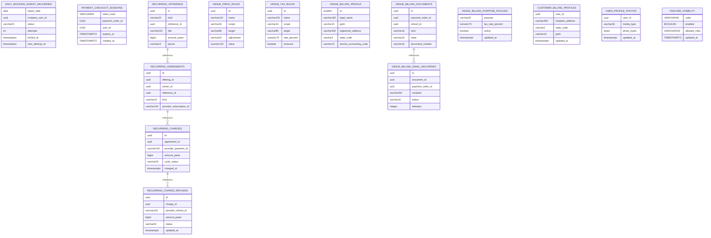

# Jnapanam migration schema: Part 4

> SQL files 43–56 of 60, from `main` on 2026-11-09. **Source-derived partial schema, not live database schema.**

## Migration inventory
- [`V44__daily_booking_digest_deliveries.sql`](../../apps/backend/src/main/resources/db/migration/V44__daily_booking_digest_deliveries.sql)
- [`V45__payment_checkout_sessions.sql`](../../apps/backend/src/main/resources/db/migration/V45__payment_checkout_sessions.sql)
- [`V46__razorpay_webhook_observations.sql`](../../apps/backend/src/main/resources/db/migration/V46__razorpay_webhook_observations.sql)
- [`V47__recurring_subscriptions.sql`](../../apps/backend/src/main/resources/db/migration/V47__recurring_subscriptions.sql)
- [`V48__venue_pricing_taxes_booking_snapshot.sql`](../../apps/backend/src/main/resources/db/migration/V48__venue_pricing_taxes_booking_snapshot.sql)
- [`V49__billing_tax_documents.sql`](../../apps/backend/src/main/resources/db/migration/V49__billing_tax_documents.sql)
- [`V50__booking_tax_rate_snapshot.sql`](../../apps/backend/src/main/resources/db/migration/V50__booking_tax_rate_snapshot.sql)
- [`V51__billing_payment_tax_policy.sql`](../../apps/backend/src/main/resources/db/migration/V51__billing_payment_tax_policy.sql)
- [`V52__billing_email_outbox.sql`](../../apps/backend/src/main/resources/db/migration/V52__billing_email_outbox.sql)
- [`V53__customer_billing_and_auto_issue_policy.sql`](../../apps/backend/src/main/resources/db/migration/V53__customer_billing_and_auto_issue_policy.sql)
- [`V54__loyalty_refund_debt.sql`](../../apps/backend/src/main/resources/db/migration/V54__loyalty_refund_debt.sql)
- [`V55__profile_photo_persistence.sql`](../../apps/backend/src/main/resources/db/migration/V55__profile_photo_persistence.sql)
- [`V56__facility_booking_rules_and_operating_periods.sql`](../../apps/backend/src/main/resources/db/migration/V56__facility_booking_rules_and_operating_periods.sql)
- [`V57__feature_visibility.sql`](../../apps/backend/src/main/resources/db/migration/V57__feature_visibility.sql)

## New table relationships

## Table / column dictionary
### `daily_booking_digest_deliveries`
[Original migration](../../apps/backend/src/main/resources/db/migration/V44__daily_booking_digest_deliveries.sql)

| Column | DDL type |
|---|---|
| `report_date` | `date` |
| `recipient_user_id` | `uuid` |
| `status` | `varchar(20)` |
| `attempts` | `int` |
| `locked_at` | `timestamptz` |
| `next_attempt_at` | `timestamptz` |
| `sent_at` | `timestamptz` |
| `provider_reference` | `varchar(160)` |
| `last_error` | `varchar(500)` |
| `created_at` | `timestamptz` |

### `payment_checkout_sessions`
[Original migration](../../apps/backend/src/main/resources/db/migration/V45__payment_checkout_sessions.sql)

| Column | DDL type |
|---|---|
| `token_hash` | `VARCHAR(64)` |
| `payment_order_id` | `UUID` |
| `user_id` | `UUID` |
| `expires_at` | `TIMESTAMPTZ` |
| `created_at` | `TIMESTAMPTZ` |

### `recurring_offerings`
[Original migration](../../apps/backend/src/main/resources/db/migration/V47__recurring_subscriptions.sql)

| Column | DDL type |
|---|---|
| `id` | `uuid` |
| `kind` | `varchar(15)` |
| `reference_id` | `uuid` |
| `title` | `varchar(150)` |
| `amount_paise` | `bigint` |
| `period` | `varchar(12)` |
| `interval_count` | `integer` |
| `total_cycles` | `integer` |
| `razorpay_plan_id` | `varchar(120)` |
| `enabled` | `boolean` |
| `created_at` | `timestamptz` |

### `recurring_agreements`
[Original migration](../../apps/backend/src/main/resources/db/migration/V47__recurring_subscriptions.sql)

| Column | DDL type |
|---|---|
| `id` | `uuid` |
| `offering_id` | `uuid` |
| `owner_id` | `uuid` |
| `reference_id` | `uuid` |
| `kind` | `varchar(15)` |
| `provider_subscription_id` | `varchar(120)` |
| `authorization_token_hash` | `varchar(64)` |
| `authorization_expires_at` | `timestamptz` |
| `status` | `varchar(25)` |
| `paid_cycles` | `integer` |
| `last_charge_at` | `timestamptz` |
| `created_at` | `timestamptz` |
| `updated_at` | `timestamptz` |

### `recurring_charges`
[Original migration](../../apps/backend/src/main/resources/db/migration/V47__recurring_subscriptions.sql)

| Column | DDL type |
|---|---|
| `id` | `uuid` |
| `agreement_id` | `uuid` |
| `provider_payment_id` | `varchar(120)` |
| `amount_paise` | `bigint` |
| `cycle_status` | `varchar(25)` |
| `charged_at` | `timestamptz` |

### `recurring_charge_refunds`
[Original migration](../../apps/backend/src/main/resources/db/migration/V47__recurring_subscriptions.sql)

| Column | DDL type |
|---|---|
| `id` | `uuid` |
| `charge_id` | `uuid` |
| `provider_refund_id` | `varchar(120)` |
| `amount_paise` | `bigint` |
| `status` | `varchar(20)` |
| `updated_at` | `timestamptz` |

### `venue_price_rules`
[Original migration](../../apps/backend/src/main/resources/db/migration/V48__venue_pricing_taxes_booking_snapshot.sql)

| Column | DDL type |
|---|---|
| `id` | `uuid` |
| `name` | `varchar(120)` |
| `scope` | `varchar(16)` |
| `target` | `varchar(80)` |
| `adjustment` | `varchar(24)` |
| `value` | `numeric(12,2)` |
| `priority` | `integer` |
| `effective_from` | `date` |
| `effective_to` | `date` |
| `weekdays` | `varchar(80)` |
| `active` | `boolean` |
| `created_at` | `timestamptz` |
| `updated_at` | `timestamptz` |

### `venue_tax_rules`
[Original migration](../../apps/backend/src/main/resources/db/migration/V48__venue_pricing_taxes_booking_snapshot.sql)

| Column | DDL type |
|---|---|
| `id` | `uuid` |
| `name` | `varchar(120)` |
| `scope` | `varchar(16)` |
| `target` | `varchar(80)` |
| `rate_percent` | `numeric(7,3)` |
| `inclusive` | `boolean` |
| `effective_from` | `date` |
| `effective_to` | `date` |
| `active` | `boolean` |
| `created_at` | `timestamptz` |
| `updated_at` | `timestamptz` |

### `venue_billing_profile`
[Original migration](../../apps/backend/src/main/resources/db/migration/V49__billing_tax_documents.sql)

| Column | DDL type |
|---|---|
| `id` | `smallint` |
| `legal_name` | `varchar(160)` |
| `gstin` | `varchar(15)` |
| `registered_address` | `varchar(400)` |
| `state_code` | `varchar(2)` |
| `service_accounting_code` | `varchar(12)` |
| `signatory` | `varchar(120)` |
| `updated_at` | `timestamptz` |

### `venue_billing_documents`
[Original migration](../../apps/backend/src/main/resources/db/migration/V49__billing_tax_documents.sql)

| Column | DDL type |
|---|---|
| `id` | `uuid` |
| `payment_order_id` | `uuid` |
| `refund_id` | `uuid` |
| `kind` | `varchar(16)` |
| `state` | `varchar(16)` |
| `document_number` | `varchar(16)` |
| `fiscal_year` | `integer` |
| `taxable_paise` | `bigint` |
| `tax_paise` | `bigint` |
| `total_paise` | `bigint` |
| `document_data` | `jsonb` |
| `created_at` | `timestamptz` |
| `issued_at` | `timestamptz` |

### `venue_billing_purpose_policies`
[Original migration](../../apps/backend/src/main/resources/db/migration/V51__billing_payment_tax_policy.sql)

| Column | DDL type |
|---|---|
| `purpose` | `varchar(20)` |
| `tax_rate_percent` | `numeric(7,3)` |
| `active` | `boolean` |
| `updated_at` | `timestamptz` |

### `venue_billing_email_deliveries`
[Original migration](../../apps/backend/src/main/resources/db/migration/V52__billing_email_outbox.sql)

| Column | DDL type |
|---|---|
| `id` | `uuid` |
| `document_id` | `uuid` |
| `payment_order_id` | `uuid` |
| `recipient` | `varchar(254)` |
| `status` | `varchar(16)` |
| `attempts` | `integer` |
| `last_error` | `varchar(250)` |
| `queued_at` | `timestamptz` |
| `attempted_at` | `timestamptz` |
| `sent_at` | `timestamptz` |

### `customer_billing_profiles`
[Original migration](../../apps/backend/src/main/resources/db/migration/V53__customer_billing_and_auto_issue_policy.sql)

| Column | DDL type |
|---|---|
| `user_id` | `uuid` |
| `recipient_address` | `varchar(400)` |
| `state_code` | `varchar(2)` |
| `gstin` | `varchar(15)` |
| `updated_at` | `timestamptz` |

### `user_profile_photos`
[Original migration](../../apps/backend/src/main/resources/db/migration/V55__profile_photo_persistence.sql)

| Column | DDL type |
|---|---|
| `user_id` | `uuid` |
| `media_type` | `varchar(32)` |
| `photo_bytes` | `bytea` |
| `updated_at` | `timestamptz` |

### `feature_visibility`
[Original migration](../../apps/backend/src/main/resources/db/migration/V57__feature_visibility.sql)

| Column | DDL type |
|---|---|
| `code` | `VARCHAR(40)` |
| `enabled` | `BOOLEAN` |
| `allowed_roles` | `VARCHAR(220)` |
| `updated_at` | `TIMESTAMPTZ` |

## Added columns
| Table | Column | Type | Migration |
|---|---|---|---|
| `payment_webhook_events` | `provider_object_id` | `varchar` | [SQL](../../apps/backend/src/main/resources/db/migration/V46__razorpay_webhook_observations.sql) |
| `bookings` | `price_base_paise` | `bigint` | [SQL](../../apps/backend/src/main/resources/db/migration/V48__venue_pricing_taxes_booking_snapshot.sql) |
| `bookings` | `tax_rate_percent` | `numeric` | [SQL](../../apps/backend/src/main/resources/db/migration/V50__booking_tax_rate_snapshot.sql) |
| `payment_orders` | `billing_gross_paise` | `bigint` | [SQL](../../apps/backend/src/main/resources/db/migration/V51__billing_payment_tax_policy.sql) |
| `venue_billing_profile` | `coupon_tax_treatment` | `varchar` | [SQL](../../apps/backend/src/main/resources/db/migration/V51__billing_payment_tax_policy.sql) |
| `venue_billing_purpose_policies` | `place_of_supply_state_code` | `varchar` | [SQL](../../apps/backend/src/main/resources/db/migration/V53__customer_billing_and_auto_issue_policy.sql) |
| `loyalty_wallets` | `earned_points_reversal_debt` | `bigint` | [SQL](../../apps/backend/src/main/resources/db/migration/V54__loyalty_refund_debt.sql) |
| `facilities` | `buffer_minutes` | `INTEGER` | [SQL](../../apps/backend/src/main/resources/db/migration/V56__facility_booking_rules_and_operating_periods.sql) |
| `facilities` | `terms_and_conditions` | `VARCHAR` | [SQL](../../apps/backend/src/main/resources/db/migration/V56__facility_booking_rules_and_operating_periods.sql) |
| `bookings` | `terms_accepted_at` | `TIMESTAMPTZ` | [SQL](../../apps/backend/src/main/resources/db/migration/V56__facility_booking_rules_and_operating_periods.sql) |
| `bookings` | `terms_snapshot` | `VARCHAR` | [SQL](../../apps/backend/src/main/resources/db/migration/V56__facility_booking_rules_and_operating_periods.sql) |

**Limits:** ALTERs/constraints/indexes/renames/triggers may be omitted. Use actual `pg_dump --schema-only` and `flyway_schema_history` for complete physical ER and deployment verification.
