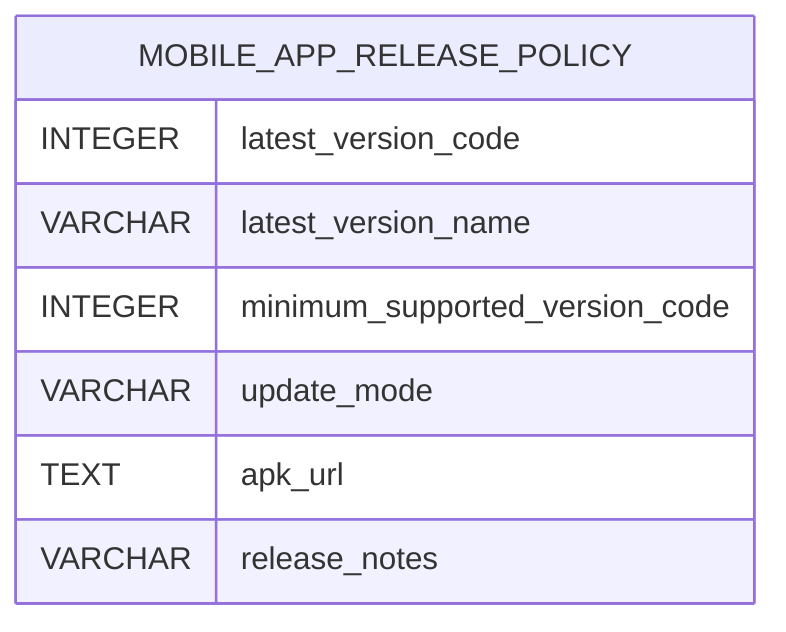

# Jnapanam schema migrations: Part 5
> Final 4 of 60 migration SQL files on `main`, retrieved 2026-11-09. **Not a live schema export.**

## Files
- [`V58__facility_kannada_terms.sql`](../../apps/backend/src/main/resources/db/migration/V58__facility_kannada_terms.sql)
- [`V59__mobile_app_release_policy.sql`](../../apps/backend/src/main/resources/db/migration/V59__mobile_app_release_policy.sql)
- [`V60__payment_refund_deductions.sql`](../../apps/backend/src/main/resources/db/migration/V60__payment_refund_deductions.sql)
- [`V61__payment_refund_deduction_description.sql`](../../apps/backend/src/main/resources/db/migration/V61__payment_refund_deduction_description.sql)

## Tables created

### `mobile_app_release_policy`
[SQL](../../apps/backend/src/main/resources/db/migration/V59__mobile_app_release_policy.sql)

| Column | DDL type |
|---|---|
| `latest_version_code` | `INTEGER` |
| `latest_version_name` | `VARCHAR` |
| `minimum_supported_version_code` | `INTEGER` |
| `update_mode` | `VARCHAR` |
| `apk_url` | `TEXT` |
| `release_notes` | `VARCHAR` |
| `updated_by` | `UUID` |
| `updated_at` | `TIMESTAMPTZ` |

## ADD COLUMN mutations
- `payment_refunds.deduction_paise` BIGINT ([SQL](../../apps/backend/src/main/resources/db/migration/V60__payment_refund_deductions.sql))
- `payment_refunds.deduction_description` VARCHAR ([SQL](../../apps/backend/src/main/resources/db/migration/V61__payment_refund_deduction_description.sql))

Use `pg_dump --schema-only` from verified environment for authoritative physical schema/ER.
