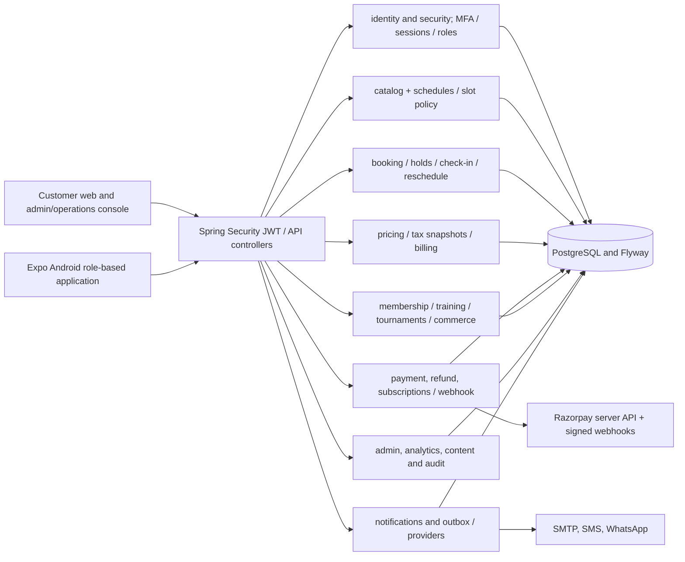
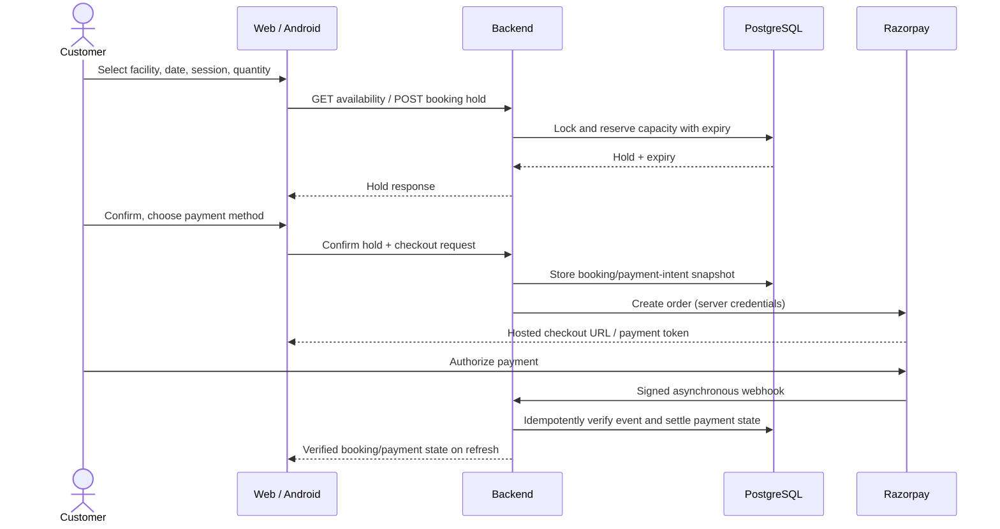

# Jnapanam — System and component architecture

> Source-derived modular-monolith view. Names here correspond to packages under apps/backend/src/main/java/com/jnapanam/sportszone and app routes under apps/web/app and apps/mobile/src/app.

## Component diagram



### Domain boundaries

- **Identity:** registration, MFA challenges, refresh-token rotation, role grants and profile data. Server owns authorization; UI menus never enforce it alone.
- **Catalog and slot rules:** sports, facilities, weekly operating periods, overrides, closures and slot capacity.
- **Booking and operations:** capacity hold, confirmation, cancellation, check-in/out, no-show, equipment, rescheduling and operator facility assignment.
- **Pricing and settlement:** quote snapshots, tax rules, payment orders, recurring agreements, refund reconciliation and credit-note/invoice issuance.
- **Programs and shop:** membership, training/coaching, tournament registrations, commerce stock/cart/order workflows.
- **Trust and support:** audit records, correlation IDs, device/app-version policy, notification retries, media and error monitoring.

## Booking / payment sequence



**Do not equate a browser return, UPI selection or client success screen with verified capture.** Late capture, duplicate webhook, refund uncertainty and payment cancellation require reconciliation. PAY_AT_VENUE bookings must explicitly show payment due.

## Error and audit flow

```mermaid
sequenceDiagram
  participant Client as Web / Android client
  participant Filter as Correlation/audit filters
  participant API as Controller / exception advice
  participant Log as Audit log
  Client->>Filter: API request; optional valid X-Correlation-ID
  Filter->>API: Forward with server request ID
  API-->>Filter: HTTP status + ProblemDetail code/detail/requestId
  Filter->>Log: Store HTTP category, sanitized path, status, duration, requestId
  Filter-->>Client: X-Correlation-ID + safe response
```

Do not log raw credentials, OTPs, personal document bodies, payment secrets, JWTs, unredacted query parameters, or complete payment gateway payloads. See HTTP_AUDIT_UI_CHECKLIST.md for response and frontend handling.

## Threat boundaries

1. Internet-to-web, internet-to-API, gateway-webhook-to-API and API-to-DB are separate trust zones.
2. Verify JWT signature, role and resource ownership on every nonpublic operation; enforce booking capacity transactionally.
3. Never trust browser success or client GPS coordinates as authoritative payment or personnel location evidence.
4. Rate-limit OTP, password reset, sign-in, payment and administrative mutations; store passwords as BCrypt hashes and refresh tokens hashed.
5. Treat forwarding headers as untrusted unless a verified ingress/servlet layer is configured to normalize them.
6. Rotate secrets by environment; disable mock provider and OTP shortcuts before production.
